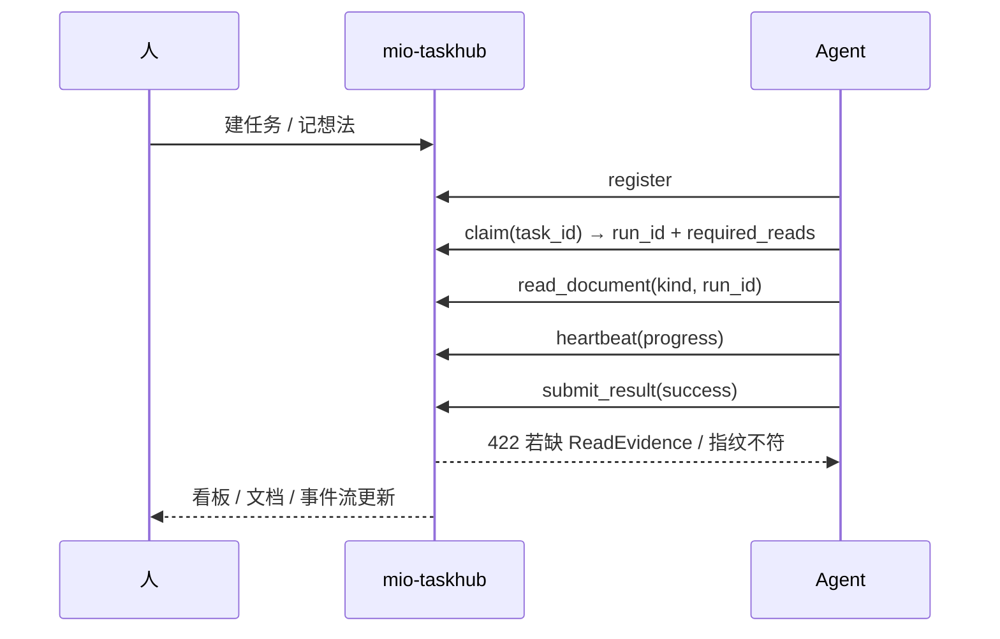

# 一个人开三个 AI 助手之后，我发现真正的瓶颈不是模型

> 当 opencode、claude code、codex 同时为我干活时，卡住我的不是「模型够不够聪明」，而是——我到底派了哪些活、它们干到哪了、产出散落在哪。

---

## 一、聊天窗口撑不起多 Agent 协作

同时开好几个 AI 编程助手，看起来很爽，实际很快就撞墙：

- **谁在干什么？** 没有统一的任务归属和在线状态，两个 Agent 改同一块代码、重复劳动，你压根不知道。
- **干到哪了？** 长任务一断线就失忆，进度、重试、超时没人兜底，只能靠翻聊天记录回忆。
- **产出在哪、靠不靠谱？** 需求、接口契约、测试验收散落在各自会话里，写没写全、写没写对，无人把关。

根因其实很朴素：**聊天窗口是「逐句对话」的载体，它天生缺少三样东西——任务的事实源、产出的门控、执行的可追溯。**

我想要的，是让多 Agent 协作有一套本地可查、可追溯的「事实」，而不是靠我在几个窗口之间人肉同步。

## 二、于是我把任务收敛成一份本地事实

**mio-taskhub** 是一个本地单用户的跨 Agent 任务协调中枢：人在 Web 看板建任务、看进度；多个 AI 助手通过 MCP 或 HTTP 注册上线、自动领活、上报进度、交回结果。全程零联网、零外部依赖。

它把我关心的东西全部钉在本地 SQLite 里：

- **任务**：执行状态机 + 7 段研发阶段，谁领了、干到哪一阶段一目了然。
- **Agent**：注册与心跳，180 秒无心跳自动转离线。
- **执行**：Run + 进度 + 重试 + 超时回收。
- **产出**：22 类文档、7 件套文档链、生命周期状态机 + 写时质量 lint。
- **事件**：一条单调递增的全局事件流，供增量订阅。

```
   人                      mio-taskhub                     Agent
   │                          │                              │
   │  建任务 / 记想法          │                              │
   ├─────────────────────────>│  queued · brainstorming       │
   │                          │<─────── register ─────────────┤
   │                          │<─────── claim ────────────────┤  (或 hub 主动分配)
   │                          ├─────── run 上下文 ───────────>│
   │                          │<─────── heartbeat 进度 ───────┤
   │  看板 / 甘特 / 拓扑        │                              │
   │<─────────────────────────┤<─────── submit_result ────────┤
   │                          │  completed · done            │
```

## 三、五个我每天都在用的能力

### 1）7 段研发阶段：产出物就是过路口令

任务除了执行状态机，还正交地挂一条 7 段流水线：

```
brainstorming → design → planning → ready → implementing → review → done
                 ↑spec/api   ↑plan                        ↑review
```

- 进 `design`，要求 `spec` 与 `api` 文档都已 `approved`；
- 进 `planning`，要求 `plan` 已 `approved`；
- 阶段不到位，任务就别想被领走。

「先写文档再写代码」从一句标语，变成流程里的一堵墙。


### 2）文档链门控 + ReadEvidence：最值得讲的一招

Agent 领任务时，服务端会返回一份**必读清单** `required_reads`（默认 spec / api / requirement）和文档内联预览。

**关键点：内联预览不等于已读。** 动手前必须对每个必读项调 `taskhub_read_document(task_id, kind, run_id=<本次 run>)`，落一条带**内容指纹**的 ReadEvidence。

提交结果时服务端校验两件事：

- 缺了已读记录 → **422**
- 文档在读取后被改动（指纹不符）→ **422**

于是「假装读过文档」在服务端层面不成立。连 `git push --no-verify` 也绕不过服务端门控——因为它压根不看你的本地钩子。

### 3）想法 → 讨论 → 拆解：需求不是凭空变成任务的

需求要发酵：

```
new ──> fermenting ──> formed ──> broken_down ──> (任务全部完成后可回流)
```

- `taskhub_add_idea` 记下想法；
- `taskhub_open_discussion` 开会碰撞，`taskhub_close_discussion` 写结论；
- 成形后 `taskhub_breakdown_idea` 一次拆成多个带依赖的任务；
- 任务全完成后，想法可回流继续演进为 ADR（架构决策记录）。

### 4）文档质量棘轮基线：只升不降

- 质量分公式：`score = max(0, 100 - 20*errors - 5*warns)`
- 推进到 `review` / `approved` / `done` 时要求 `errors == 0`；
- **棘轮**：质量分与用例数按任务记录历史最好值，后续低于基线直接 422；确为有意下调用 `force=true` 并留痕。

效果就是，「先糊上去、以后再补」的债滚不起来。

### 5）心跳保活 + 自动派活

- 空闲时每约 1 分钟调 `taskhub_agent_heartbeat` 保活，超 180 秒转离线；
- 执行期间 `taskhub_heartbeat(run_id, progress)` 上报进度，看门狗据此判断 Run 是否僵死；
- 调度器每 30 秒扫一次，有「空闲在线 Agent + ready 任务」就直接分配，遵循高优先级优先 + FIFO + 多 Agent 公平轮转。

## 四、一张图看懂整套闭环



## 五、实战：五步跑通一个任务

**第一步，注册上线：**

```bash
# MCP 工具
taskhub_register(name="opencode", agent_type="cli")

# 无 MCP 时的 CLI 降级路径
python packaging/agent_wrapper.py opencode register
```

**第二步，领取指定任务**（务必带 `task_id`，否则按相关度可能领到别的任务）：

```json
taskhub_claim(agent="opencode", task_id="0df294e8")
// 返回：run_id + required_reads + required_fr + documents(预览)
```

**第三步，写码前逐份读取必读文档，产生 ReadEvidence：**

```json
taskhub_read_document(task_id="0df294e8", kind="spec",        run_id="<run>")
taskhub_read_document(task_id="0df294e8", kind="requirement", run_id="<run>")
```

**第四步，执行期间上报进度：**

```json
taskhub_heartbeat(run_id="<run>", progress=50, checkpoint="编码中")
```

**第五步，提交结果**（成功路径会校验 ReadEvidence）：

```json
taskhub_submit_result(run_id="<run>", success=true, result="产出描述")
```

提交前还能用 `taskhub_read_status(run_id)` 自查，看还差哪些必读项。

## 六、我踩过的五个坑

- **不传 `task_id` 会领错任务**：`claim` 默认按相关度挑，点名提取务必显式传 `task_id`。
- **内联预览 ≠ 已读**：`claim` 返回的 `documents.content` 只是预览，不落 evidence，提交照样 422。
- **文档读完又改内容 → 指纹失效**：需要重读；尤其改文档状态会**改写文档头部（版本/状态/时间）**，务必在改完状态后重读。
- **`--no-verify` 只绕本地钩子**：绕不过服务端门控，别抱侥幸。
- **文档 kind 有三处同步点**：`DOC_KINDS` / `DOC_PATTERNS` / `KIND_META`，新增一类漏改，前端就不显示。

## 七、适合谁用

- 个人 / 小团队的**本地多 Agent 协作**；
- 需要**强文档链与可追溯**研发流程的团队；
- 离线或内网环境（零联网、零外部依赖）。

几点坦白：它是**单用户本地服务**，认证只有单 Bearer token，不要直接暴露公网；SQLite 有并发上限，规模再涨要迁 Postgres；文档质量 lint 是**启发式**的，只看章节标题与表格行数，判断不了内容对不对，真正的内容审查还得靠人或 Agent 读。

---

**一句话收尾：** 把「多 Agent 协作」从聊天窗口里的口头约定，变成本地可查、可门控、可追溯的事实。

> 项目地址：`http://127.0.0.1:48620`（本地服务）
> Git 仓库：https://github.com/mldlbs/mio-taskhub
> 相关链接：https://crlkcloud.cyou/
> 关键词：多 Agent 协作 / MCP / 任务中心 / 文档门控 / ReadEvidence
