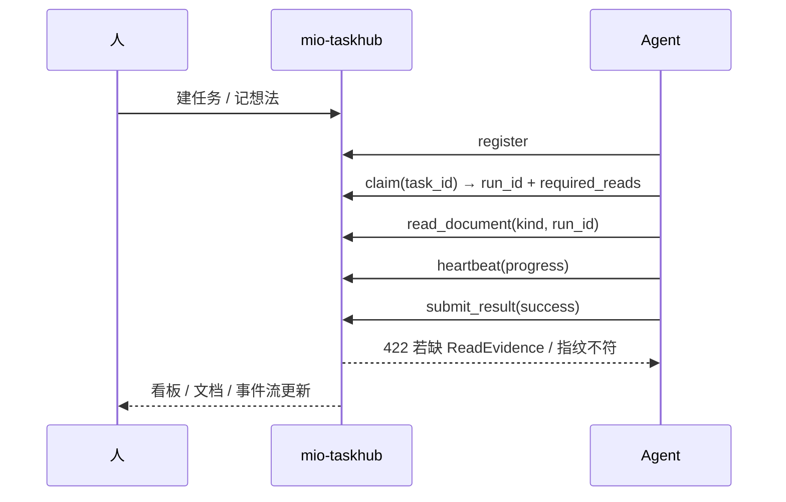

> 软件项目文档链 · 7 件套
> 上游：[需求规格 / 文章正文](docs/csdn-mio-taskhub-practice.md) | 下游：—

# 模块 Spec：CSDN 博文大纲与章节结构

## 文档信息

| 项 | 值 |
|---|---|
| 文档版本 | v2.0 |
| 最后更新 | 2026-09-30 12:10 |
| 状态 | approved |
| 负责人 | opencode |
| 适用范围 | 定义 CSDN 博文的章节大纲、每章要点与素材来源；正文见 requirement 文档 |

## 1. 模块职责与边界

- 做什么：
  - 给出文章的目标读者、章节骨架、每章要点与素材出处。
  - 约束篇幅（约 4300 字，≤5000 字）与必备元素（导语、目录、小标题、代码示例、mermaid 图）。
- 不做什么：
  - 不重复正文内容，只描述结构与写作要点。
  - 不涉及 mio-taskhub 的安装排障与环境适配。

## 2. 输入 / 输出

- 输入：
  - `mio-taskhub/README.md`：定位、核心模型、能力详解。
  - `mio-taskhub/doc-consult-enforcement-plan.md`：文档 consult 强制门控方案。
  - `AGENTS.md`：ReadEvidence、棘轮基线、分支命名等运行时约定。
- 输出：
  - 一份可发布到 CSDN 的中文技术博文，正文落在 `docs/csdn-mio-taskhub-practice.md`。

## 3. 依赖

- 上游模块：无（本任务为独立文档产出）。
- 外部库：无，纯 Markdown，不依赖构建工具。

## 4. 详细设计

- 目标读者：后端 / 全栈 / Agent 方向工程师，关注多 Agent 协作与 AI 工程化。
- 开篇策略：用「一人开三个 AI 助手」的场景切入，先立痛再给结论，避免上来就堆定义。
- 全文结构（10 章）：

```
导语             —— 场景化钩子：瓶颈不是模型，是任务与产出的管理
1  背景与问题     —— 三个痛点：谁在干 / 干到哪 / 产出在哪（附根因）
2  目标与非目标    —— 收敛到本地事实，明确不做的边界
3  用户故事/场景   —— 3 个角色 + 3 个高频场景
4  功能需求总览    —— FR-1..FR-5 能力清单表
5  核心能力详解    —— 看板阶段 / ReadEvidence / 想法闭环 / 棘轮 / 心跳 / 全局图
6  非功能需求     —— 性能 / 安全 / 兼容
7  边界与约束     —— 单用户、SQLite、启发式 lint
8  实战全流程     —— register→claim→read→submit 代码示例
9  踩坑与经验     —— 领错任务 / 预览≠已读 / 改状态致指纹失效 / no-verify
10 适用场景与后续  —— 场景收束 + 一句话结尾
```

- 每章要点与素材映射：

| 章节 | 核心要点 | 素材来源 |
|------|---------|---------|
| 导语 | 瓶颈转移：模型 → 协作管理 | README §1 |
| 1 背景与问题 | 三痛点 + 根因「对话载体缺事实源」 | README §1 |
| 2 目标与非目标 | 本地事实源 + 服务端强制 | README §1、§2 |
| 3 用户故事 | 开发者 / Agent / 审查者 | README §4.3 |
| 4 功能需求 | FR-1..FR-5 表 | README §2、§5 |
| 5 核心能力 | 5 项能力 + 1 张时序图 | README §2、§5、§6 |
| 6 非功能需求 | SQLite/认证/端点数量 | README §9、版本表 |
| 7 边界与约束 | 已知限制 | README §13 |
| 8 实战流程 | 五步代码块 | AGENTS.md、MCP 说明 |
| 9 踩坑与经验 | 五条坑 + 三处同步点 | AGENTS.md、trace 经验 |
| 10 收尾 | 场景 + 规划 | README §13、roadmap |

- 全局时序图（正文 §5.6 使用）：



- 精修检查清单（每次改稿过一遍）：

| 检查项 | 标准 |
|--------|------|
| 开篇 | 前 3 行有场景钩子，不堆术语 |
| 代码块 | ≥3 处，且工具名均为真实存在的 MCP 工具 |
| 图 | ≥1 mermaid，可在 CSDN 渲染 |
| 表格 | 功能需求表 ≥5 行，无空行 |
| 措辞 | 去「支持xx等」模糊表述，给可验收描述 |
| 篇幅 | 正文 ≤5000 字 |

## 5. 异常与边界情况

| 场景 | 处理方式 |
|------|---------|
| claim 未传 task_id | 在踩坑章节强调：默认按相关度挑选，可能领错任务 |
| 只看了 claim 返回的预览 | 在正文明确「预览 ≠ 已读」，未落 evidence 会被 422 |
| 文档读后被改动 | 指纹失效需重读，正文写明校验规则 |
| 改文档状态致头部改写 | 踩坑章节补充：状态变更会改写版本/状态/时间，需重读 |
| 正文超过 5000 字 | 压缩第 6/7 章，优先保留实战与踩坑 |
| 引用了不存在的工具名 | 只写 README / MCP 工具清单中真实存在的工具，不虚构 |
