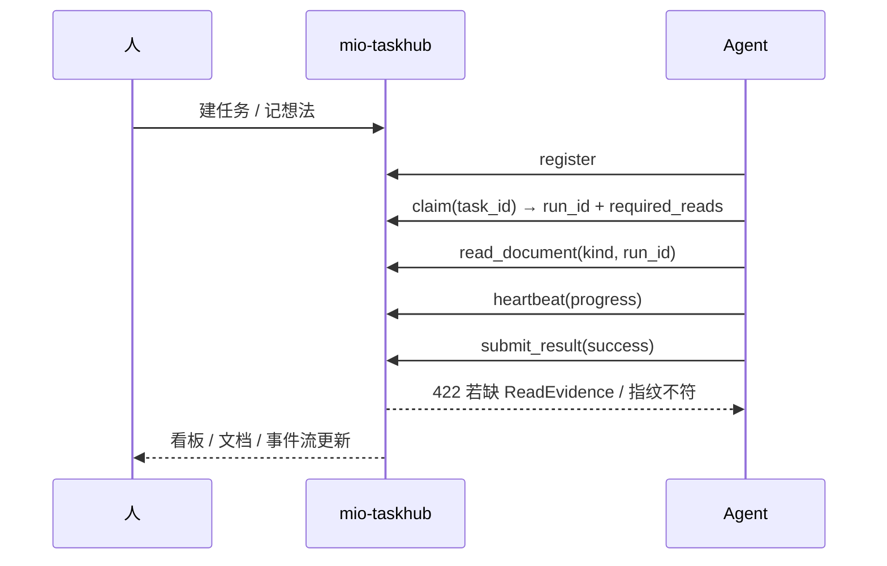

> 软件项目文档链 · 7 件套
> 上游：— | 下游：[模块 Spec / 文章大纲](docs/csdn-mio-taskhub-practice-outline.md)

# CSDN 博文：mio-taskhub 跨 agent 任务中心实践

> 当一个人同时开着 opencode、claude code、codex 三个 AI 助手干活时，真正的瓶颈不再是「模型够不够聪明」，而是「我到底派了哪些活、它们干到哪了、产出散落在哪」。这篇聊聊我们怎么用一个本地任务中心，把多 Agent 协作从聊天窗口里的口头约定，变成本地可查、可门控、可追溯的事实。

## 文档信息

| 项 | 值 |
|---|---|
| 文档版本 | v2.0 |
| 最后更新 | 2026-09-30 12:10 |
| 状态 | approved |
| 负责人 | opencode |
| 适用范围 | CSDN 技术博文正文：介绍 mio-taskhub 的定位、核心能力与实战流程；不含安装排障与环境适配细节 |

## 目录

- 1. 背景与问题：聊天窗口撑不起多 Agent 协作
- 2. 目标与非目标：收敛成一份本地事实
- 3. 用户故事与使用场景
- 4. 功能需求总览
- 5. 核心能力详解
- 6. 非功能需求
- 7. 边界与约束
- 8. 实战：register → claim → read → submit
- 9. 踩坑与经验
- 10. 适用场景与后续规划

## 1. 背景与问题：聊天窗口撑不起多 Agent 协作

- 现状：一个开发者同时开着好几个 AI 编程助手，各自在独立会话里干活，互相看不见对方。
- 痛点一「谁在干什么」：没有统一的任务归属与在线状态，重复劳动和空转难以察觉，经常两个 Agent 改了同一块代码。
- 痛点二「干到哪了」：长任务一旦断线就失忆，进度、重试、超时没人兜底，只能凭记忆翻聊天记录。
- 痛点三「产出在哪、靠不靠谱」：需求、接口契约、测试验收散落在各自会话里，写没写全、写没写对无人把关。
- 根因：聊天窗口是**逐句对话**的载体，天生缺少三样东西——任务的事实源、产出的门控、执行的可追溯。

## 2. 目标与非目标：收敛成一份本地事实

- 目标：
  - 把任务、Agent、执行 Run、产出文档、事件流收敛到一份本地 SQLite 事实里，谁都能查。
  - 把「开发前先读文档」从口头约定升级为服务端强制的门控，而不是靠自觉。
  - Agent 零配置接入：MCP 一把梭，或走 HTTP / CLI 降级路径。
- 非目标（本次明确不做）：
  - 不做多租户与权限体系（定位是本地单用户，堆权限只会让路径变重）。
  - 不做云端托管与团队协作。
  - 不替代 CI 与代码托管，只做任务与文档的事实源。

## 3. 用户故事与使用场景

- 作为独立开发者，我想把零散想法记成任务并派给不同 Agent，以便并行推进且不丢上下文。
- 作为 Agent，我想在领活时拿到明确的必读清单，以便动手前就知道边界与契约。
- 作为审查者，我想看到任务从想法到完成的全过程留痕，以便复盘与追责。
- 高频场景一 · 多 Agent 并行：hub 每 30 秒扫描一次「空闲在线 Agent」与「ready 任务」，自动派活。
- 高频场景二 · 长任务断线：心跳看门狗回收超时 Run，并触发重试或置为失败。
- 高频场景三 · 产出可追溯：文档链 + 生命周期状态机 + 质量门控三层托底。

## 4. 功能需求总览

| 编号 | 需求 | 优先级 | 验收标准 |
|------|------|--------|---------|
| FR-1 | 任务看板与 7 段研发阶段流转 | P0 | 任务能按阶段推进，未带对应产出物时拒绝推进并给出缺口 |
| FR-2 | 文档链门控 + ReadEvidence | P0 | Agent 未读必读文档时提交结果返回 422；文档读取后被改动同样 422 |
| FR-3 | 想法 → 讨论 → 拆解闭环 | P1 | 想法可记录、开会讨论、一次拆成带依赖的多个任务 |
| FR-4 | 文档质量棘轮基线 | P1 | 质量分与用例数按任务记录历史最好值，回退即 422 |
| FR-5 | 心跳保活与自动派活 | P0 | 空闲 Agent 自动领到 ready 任务，超时 Run 被回收 |

## 5. 核心能力详解

### 5.1 看板与 7 段研发阶段

- 任务有两条正交维度：执行状态机（queued → claimed → running → completed）与研发阶段。
- 研发阶段固定 7 段，「产出物」就是过路口令：

```
brainstorming → design → planning → ready → implementing → review → done
                 ↑spec/api   ↑plan                        ↑review
```

- 进入 `design` 要求 `spec` 与 `api` 文档均已 `approved`；进入 `planning` 要求 `plan` 已 `approved`。
- 阶段不到位就别想被领走——「先写文档再写代码」从一句标语，变成流程里的一堵墙。

### 5.2 文档链门控 + ReadEvidence（最值得讲的一招）

- Agent 领取任务时，服务端返回一份 `required_reads`（默认 spec / api / requirement）与文档内联预览。
- 关键点：**内联预览不等于已读**。动手前必须对每个必读 kind 调 `taskhub_read_document(task_id, kind, run_id=<本次 run>)`，落一条带内容指纹的 ReadEvidence。
- 提交结果时服务端校验两件事：缺失已读 → 422；文档在读取后被改动（指纹不符）→ 422。
- 于是「假装读过文档」在服务端层面不成立，连 `git push --no-verify` 也绕不过服务端门控。

### 5.3 想法 → 讨论 → 拆解闭环

- 需求不是凭空变成任务的，中间要发酵：`new → fermenting → formed → broken_down`。
- `taskhub_add_idea` 记下想法，`taskhub_open_discussion` 开会碰撞，`taskhub_close_discussion` 写结论。
- 成形后用 `taskhub_breakdown_idea` 一次拆成多个任务，子任务之间用 `ref` 互指依赖。
- 任务全部完成，想法可回流 `formed`，继续演进为 ADR（架构决策记录）。

### 5.4 文档质量棘轮基线

- 文档质量分公式：`score = max(0, 100 - 20*errors - 5*warns)`。
- 推进到 `review` / `approved` / `done` 时要求 `errors == 0`，否则拒绝。
- 棘轮：质量分与 `test` 用例数按任务记录**历史最好值**，后续低于基线直接 422；确为有意下调用 `force=true` 并留痕。
- 效果是文档质量只升不降，避免「先糊上去、以后再补」的债滚起来。

### 5.5 心跳保活与自动调度

- Agent 注册后空闲时每约 1 分钟调 `taskhub_agent_heartbeat` 保活，超过 180 秒无心跳转 offline。
- 执行期间用 `taskhub_heartbeat(run_id, progress)` 上报进度（0-100），看门狗据此判断 Run 是否僵死。
- 调度器每 30 秒扫一次：有「空闲在线 Agent」+「ready 任务」就直接分配，遵循高优先级优先 + FIFO + 多 Agent 公平轮转。

### 5.6 一张图看懂全局



## 6. 非功能需求

- 性能：单机 SQLite(WAL) + QueuePool，足以支撑单机多 Agent；hub 后台跑 7 个守护线程。
- 安全：本地单用户，认证只有单 Bearer token；只对 `/api/*` 生效，Web UI 与 `/docs` 免认证。
- 兼容 / 依赖：Python ≥3.10；对外 119 个 REST 端点 + 40 个 MCP 工具；全程零联网、零外部依赖。

## 7. 边界与约束

- 单用户本地服务：没有多租户与权限体系，不适合直接暴露公网。
- SQLite 并发上限：规模继续增长需迁移 Postgres。
- 文档质量 lint 是启发式的：靠章节标题与表格行数做结构性校验，判断不了内容是否真的对；真正的内容审查仍需人或 Agent 阅读。
- 阶段门控仅当该 kind 已显式设过状态时才校验，旧任务向后兼容；`force=true` 可跳过但会 emit 事件留痕。

## 8. 实战：register → claim → read → submit

- 第一步，注册上线：

```bash
# MCP 工具
taskhub_register(name="opencode", agent_type="cli")
# CLI 降级路径
python packaging/agent_wrapper.py opencode register
```

- 第二步，领取指定任务（务必带 `task_id`，否则按相关度可能领到别的任务）：

```json
taskhub_claim(agent="opencode", task_id="0df294e8")
// 返回：run_id + required_reads + required_fr + documents(预览)
```

- 第三步，写码前逐份读取必读文档，产生 ReadEvidence：

```json
taskhub_read_document(task_id="0df294e8", kind="spec",        run_id="<run>")
taskhub_read_document(task_id="0df294e8", kind="requirement", run_id="<run>")
```

- 第四步，执行期间上报进度：

```json
taskhub_heartbeat(run_id="<run>", progress=50, checkpoint="编码中")
```

- 第五步，提交结果（成功路径会校验 ReadEvidence）：

```json
taskhub_submit_result(run_id="<run>", success=true, result="产出描述")
```

- 提交前还能用 `taskhub_read_status(run_id)` 自查，看还差哪些必读项。

## 9. 踩坑与经验

- 不传 `task_id` 会领错任务：`claim` 默认按相关度挑选，点名提取务必显式传 `task_id`。
- 内联预览 ≠ 已读：`claim` 返回的 `documents.content` 只是预览，不落 ReadEvidence，提交时照样被 422。
- 文档读完又改内容：指纹会变，需要重读，否则 422；尤其**改文档状态会改写文档头部（版本/状态/时间）**，务必在改完状态后重读。
- `--no-verify` 只绕本地 pre-push 钩子，绕不过服务端门控。
- 文档 kind 有三处同步点（`DOC_KINDS` / `DOC_PATTERNS` / `KIND_META`），新增一类漏改会导致前端不显示。

## 10. 适用场景与后续规划

- 适用：个人 / 小团队的本地多 Agent 协作、需要强文档链与可追溯的研发流程、离线或内网环境。
- 后续规划：从 OpenAPI spec 自动生成 MCP 层、SQLite → Postgres 的多租户演进、文档质量从结构校验走向内容审查。
- 一句话收尾：把「多 Agent 协作」从聊天窗口里的口头约定，变成本地可查、可门控、可追溯的事实。
