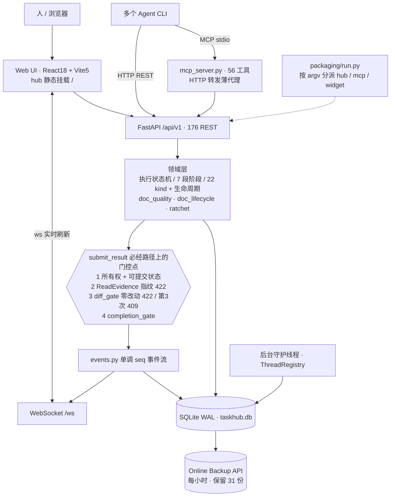

# mio-taskhub 项目交付方案

> 版本：v0.6.1 ｜ 取证日：2026-11-06（2026-11-07 续接复核；2026-11-08 W-10 冻结复核，冻结基线 HEAD=`093869b`；2026-11-09 范围裁决：当前不做对外分发）｜ 对象：`E:\work\code\agent-dev\mio-taskhub` 现有代码库
> 覆盖：需求拆解 / 架构设计 / 技术选型 / 开发排期 / 验收标准
> 定位：本地单用户、零联网、零外部依赖的跨 Agent 任务协调中枢。本方案描述的是已落地项目的**剩余交付**，不是新建系统计划。
> 表达口径：工程汇报陈述句，给字段名 / 阈值 / 状态。文档门控只称「结构完整性校验」与「服务端强制」。不确定处标【待确认】。

---

## 0. 口径与裁决

### 0.1 项目现状

| 维度 | 口径 | 来源 |
|---|---|---|
| 版本 | `0.6.1` | `pyproject.toml` / `mio_taskhub/version.py` |
| 后端 | Python ≥3.10 · FastAPI + SQLModel / SQLite(WAL) · 76 模块 / 33,436 行 | `README.md:10`（2026-11-06 实测） |
| 对外能力 | 176 REST 端点 · 56 MCP 工具 · WebSocket · React Web UI | `README.md:11` |
| 任务文档 | 22 类 kind · 7 件套链 · 9 类生命周期状态机 | `README.md:12` |
| 前端 | React 18 + Vite 5 · 49 文件 / 12,934 行 · 10 个视图 | `README.md:13` |
| 测试 | 1609 用例 · GitHub Actions（windows-latest / py3.12） | `README.md:14` |
| 部署 | pip 源码 · Docker 多阶段 · Windows 单 EXE · 图形安装包 | `README.md:15` |

事实包 §2 记 33,383 / 12,532 / 1601，是同日编制时的快照；`gen_readme_stats.py` 按 `git ls-files` 统计，跟踪文件变化后 README 已同步到上表值。本方案引用 README 当前值，事实包三处数字标为历史快照。

端点数有一处口径差：`gen_readme_stats.py` 只数已跟踪文件，本轮按同一正则扫工作树全部 `.py` 得 `@router.(get|post|put|patch|delete)` 185 处，README 记 176 端点，差额来自未跟踪的 `api/*.py`。发布前须先 `git add` 再跑 `--check`，否则统计偏小（并入 W-5 / W-10）。

数字引用一律带口径与取证日。实测 `README.md:11` 顶部表为 176 REST / 56 MCP，但 `:737` 仍写「40 个 MCP 工具」、`:750` 写「26 个路由模块（119 个端点）」、`:758` 写「1305 个用例」，属历史残留，收口任务见 W-5。`python scripts/gen_readme_stats.py --check` 本轮实测输出 `README stats OK (no drift)`，说明脚本校验的是顶部表格，正文这三处不在其覆盖范围。

**2026-11-07 19:15–19:30 数字快照（与上表不同口径，不可互换）**：HEAD 在取证窗口内**连续前进三次**——`2e42305`(19:07 P0 加固) → `2acad69`(19:22 修 CI 两条长期红的用例) → `724601b`(19:23 干净 worktree 重算 README 统计)。`724601b` 的 README 顶部表为 **`33,784 行 / 53 MCP / 12,102 行 / 1635 用例`**；而当前工作树 README 顶部表仍是 W-5 改动留下的 **`33,697 行 / 56 MCP / 12,935 行 / 1611 用例`**，比 HEAD 更旧且 MCP 数不同。`--check` 在工作树上报漂移两处（`测试用例: README=1611 实际=1643`、`后端行数: README 期望 33,928 未找到`）。`pytest tests/ --collect-only -q` 工作树实测 `1938/1942 collected (4 deselected)`。

**W-5 陷阱已修复（2026-11-07 19:40）**：上一轮发现工作树 README 顶部表是并行写入期间的旧快照（`33,697 / 56 MCP / 12,935 / 1611`），直接提交会把统计写回旧值。现已把顶部表 4 行精确对齐冻结 commit `724601b`（`33,784 / 53 MCP / 12,102 / 1635`），`git diff -- README.md` 收窄为 **5 insertions / 5 deletions**，只剩正文 5 处删除手工数字；`diff <(git show 724601b:README.md | sed -n '9,15p') <(sed -n '9,15p' README.md)` 无差异；正文旧数字 `grep` 无命中。README 现可直接提交。**2026-11-08 10:48 二次修复**：HEAD 在会话间又前进两次（`5e40b9a` F-006 门控豁免管理员确认 → `dba9268` 同步 README 统计），工作树顶部表再次变成含未跟踪文件的移动目标（`33,976 / 56 MCP / 12,973 / 1650`）。已再次把 4 行精确对齐 `dba9268`（`33,832 / 53 MCP / 12,102 / 1642`），`git diff --numstat -- README.md` 回到 **5/5**，顶部表与 HEAD 逐行一致，正文旧数字 `grep` 无命中。干净检出 `dba9268` 上 `gen_readme_stats.py --check` 为 `README stats OK (no drift)` / EXIT=0。W-10 提交前须再复核一次；若期间 HEAD 再次前进，按同一方法重对，不得整文件提交。

当前工作树 `--check` 仍报 4 处漂移（`MCP工具 53→56`、`测试用例 1635→1643`、`后端行数 33,928`、`前端行数 12,935`），原因是脚本按工作树全部文件统计，而工作树含 5 个未跟踪测试文件与并行 agent 的新模块——这是移动目标，不是 README 写错。W-10 须在冻结且停止并行写入的 commit 上跑 `--write` + `--check`，顶层数字一律以该次结果为准，不得沿用本方案 §0.1 的 2026-11-06 快照。

**W-10 冻结基线实测（2026-11-08，本节当前口径以本段为准）**：HEAD `093869b`，`git status --short` 计数 0，`git ls-files docs/taskhub/delivery-plan/` = 9，近 90 分钟无写入。README 顶部表为 `35,974 行 / 185 REST / 56 MCP / 13,833 行 / 1726 用例`，`python scripts/gen_readme_stats.py --check` 输出 `README stats OK (no drift)` / EXIT=0；正文 5 处历史手工数字已删除。因此上表与第 26 / 28 / 30 / 32 / 34 段所记的端点差、正文残留、工作树漂移、W-5 两次顶部表对齐，均为各自取证日的历史快照，**不再作为当前状态引用**；本方案发布判据一律以 `093869b` 上的实测值为准。W-5 的「提交前复核顶部表」动作已完成，当前无未提交的 README 修复。

### 0.2 六条裁决（文档与源码冲突时）

| # | 冲突点 | 文档口径 | 源码 / 实测口径 | 裁决 |
|---|---|---|---|---|
| 1 | 窄门禁状态 | 需求 §2.2 S2-a 写「进行中」；FR-B 各项写「进行中」 | `diff_gate.py`、`api/runs.py`、`App.jsx`、`TaskDetail.jsx` 三链路均已落地，注释标 `d468e633 FR-5/6` | **代码已落地、灰度观察未成立**。排期不含从零开发 |
| 2 | 拒绝上限 | FR-B06 / `d468e633/api.md` 写「≥2 判失败」 | `runs.py:480` 为 `run.rejections > MAX_REJECTIONS`（`MAX_REJECTIONS=2`），即**第 3 次**才 409 `run.empty_diff_repeated` | 以源码为准，文档修订列 §4.4 W-3 |
| 3 | 采集函数名 | 需求 / implementation plan 用 `collect()` | `diff_gate.py` 无 `collect()`；采集由 `snapshot()` + `_numstat()` + `check_diff_gate()` 完成 | 以源码为准 |
| 4 | `diff_summary.after` | 需求写 before/after 同为 `Snapshot.brief()` 6 字段 | `before` 为 6 字段；`after` 只有 `{files, insertions, deletions}`；`changed` / `reason` / `mode` 平铺顶层 | 以源码为准 |
| 5 | 门控插入点 | FR-B02 写「约 `:288` 后、`:289` 前」 | 实测 `runs.py:336-337`（文件现 636 行） | 以源码为准 |
| 6 | `docs/` 是否入库 | 旧笔记写「`docs/` 被 .gitignore 第 31 行忽略」 | 第 31/32 行是注释，实际规则在第 33 行 `docs/*` + `:34-41` 白名单反选（`!docs/taskhub/` 等）；「整体忽略」是 2026-10-10 历史态，G0/T0.4 已改白名单。`git check-ignore` 对本文件无输出（不被忽略），`git ls-files docs/taskhub/` 已跟踪 168 个文件 | **不被忽略，需显式 `git add`**：取证当时 `git status --short` 实测 `_delivery-fact-pack.md` 与 `delivery-plan/` 均为 `??`；**2026-11-08 W-10 已入库**（`git ls-files docs/taskhub/delivery-plan/` = 9，冻结 commit `093869b`）。不被忽略 ≠ 已跟踪 |

配套结论：`GET /api/v1/board/diff-gate-stats` 的确切 schema 已由 `api/board.py:371-386` 逐行复核为 **12 个顶层键**：`mode` / `scanned_runs` / `judged_runs` / `unjudged_runs` / `by_reason` / `blocked_run_count` / `blocked_runs` / `warned_run_count` / `skipped_run_count` / `suspected_false_positive_count` / `suspected_false_positive` / `note`。后端分册记「13 字段」属误数，验收按 12 键逐键断言、不按总数判定，需求 §8.2 第 3 条【待确认】收口。

### 0.3 本轮独立取证与分册复核新增的十九条事实

以下均为本次直接读文件 / 跑只读命令得到，用于收紧「剩余交付」范围。底稿中把其中数项写成待建的，按本表更正。

| # | 事实 | 取证方式 | 对排期的影响 |
|---|---|---|---|
| 1 | `LICENSE` 已存在，MIT，Copyright (c) 2026 mldlbs | 读文件 | G3「LICENSE(MIT) 入库」已满足 |
| 2 | `CHANGELOG.md` 已存在，`## Unreleased` 段记录安装/卸载子系统与自更新缺陷修复 | 读文件 | G4「changelog」已具备，发布时补版本段即可 |
| 3 | `scripts/gen_readme_stats.py` 已存在，支持 `--check` / `--write`，统计只算 `git ls-files` 已跟踪文件 | 读文件 | G3「统计脚本」已满足 |
| 4 | `python scripts/gen_readme_stats.py --check` 实测输出 `README stats OK (no drift)`，EXIT=0 | 只读命令 | README 顶部数字当前无漂移；正文旧数字属另一处口径问题 |
| 5 | `.github/workflows/` 只有 `test.yml`、`branch-protection.yml`；Grep `gen_readme_stats` 在 `.github` 下无匹配 | Grep | **统计脚本未接入 CI 校验**，G3 判据只完成一半 |
| 6 | `test.yml` 显式 `shell: bash`，历史 `2>/dev/null` 在 bash 下是合法重定向，不会变成 `D:\dev\null` | 读 workflow | CI 历史全红已由「改用 bash」规避；但 `2>/dev/null` 仍会吞掉安装错误并静默降级到 `pip install -e .`，列 W-4 |
| 7 | `test.yml:36` 用 `-k "not test_two_agents_race and not test_webhook_guard"` 排除已知失败；CI 没有覆盖率步骤 | 读 workflow | 与 G0 判据「全量 0 红 + coverage.xml 基线」口径不一致，列 W-4 / §7 |
| 8 | `diff-gate-grayscale-log.md` 起止仍为 `____-__-__`，M1~M5 全「待观察」，2026-10-21 记录「尚未产生真实拦截」，切 block 三个勾选框全空 | 读文件 | 唯一成功判据 M2 当前**未成立**；灰度观察是唯一无法用开发工时压缩的关键路径 |
| 9 | `docs/roadmap/t43-release-checklist-report.md` 是 2026-10-14 / commit `d677782` / v0.6.0 口径的历史快照：七项门槛 6 项「是」+ ⑤「部分」，`all_green=false`，判定「暂不对外发布」；唯一缺口是外部 3 台干净机人工取证 | 读报告 | W-7 的直接来源。该报告数字（161 端点 / 47 工具 / 1212 用例 / 23,086 行）属 v0.6.0 口径，不得当当前状态引用 |
| 10 | `tests/conftest.py:11` 无条件执行 `os.environ["MIO_TASKHUB_DB"] = _TEST_DB`，覆盖 CI `test.yml:38` 注入的 `MIO_TASKHUB_DB` | 读文件 | CI 的隔离库环境变量失效；测试隔离实际靠 `MIO_TEST_DB_PATH`，列 W-4 |
| 11 | tag 已到 `v0.6.1`，但 `CHANGELOG.md` 仍停在 `## Unreleased`；`build.ps1:66` 用解释器绝对路径、`:180` 日志路径硬编码用户名 | git tag / 读文件 | 发布时补版本段；两处硬编码是 W-9「同 commit 可复现构建」的具体障碍 |
| 12 | 同日另有 `deliverables/gstack/pre-launch-check-mio-taskhub-2026-11-06.md`（main @ `fde54c4`，工作树 34 改 + 27 未跟踪）：Go/No-Go 为 **No-Go（对外分发）**，本机自用经部署加固后可继续；3 个安全 P0 为阻断项 | 读报告 | 本方案的 G4 必须把 P0 清零列为硬前置，见 §4.2.1。**2026-11-07 19:07 补正**：该报告基于的 `fde54c4` 已非当前 HEAD，见第 18 条 |
| 13 | 取证当时 `api/task_documents.py:20-28` 的 `_resolve_doc_path()` 对**绝对路径不做 workspace 约束**（`if not p.is_absolute(): ...` 否则直接 `p.resolve()`），可指向 `~/.mio-intelligence/config.json` 读明文 apiKey | 本轮读源码复核 | **已过期，按第 18 条校正**：`2e42305` 用 `path_guard.doc_read_error()` 收敛绝对路径读并补点目录/点文件拦截，S-2 源码层已清零，冻结 commit 上复验 AC-24 |
| 14 | 取证当时 `scheduling/night_runner.py:152` 是 `subprocess.Popen(cmd, shell=True, cwd=cwd)`；`PUT /nightrun/config` + `POST /nightrun/spawn-now` 链路在生产配置中在用 | Grep `shell=True` | **已过期，按第 18 条校正**：`2e42305` 改为 `split_command()` + `Popen(argv, shell=False)` + `MIO_NIGHTRUN_ALLOWED_CMDS` 白名单；全仓仅剩 2 处注释文字含 `shell=True`（`admin_guard.py:4`、`night_runner.py:37`），无实际调用。S-1 源码层已清零，须在冻结 commit 上复验 AC-23 |
| 15 | 同日 QA 全量（仓库外 basetemp）实测 **1904 collected / 1901 passed / 1 failed / 2 skipped / 4 deselected，12m28s**；原 4 个 webhook_guard 失败用例**已删除**（`tests/test_spinning_guard.py:6-9` 注释确认），基线口径作废 | 读报告 + 读测试文件 | 本方案 §5.4 已据此更正「4 个 pre-existing 失败」与 CI `-k "not test_webhook_guard"` 过期排除项 |
| 16 | README 统计漂移的修复在工作树已生效但**未提交**，干净检出 HEAD 会红 CI；`tests/test_installer.py` 的 GUI 用例无目录隔离，曾把本机真实安装的 `TaskHub.exe` 换成 8 字节假 exe（已用合并版安装包恢复） | 读报告 | W-5 / W-10 必须包含「提交修复」与「修 installer 用例隔离」，否则干净检出不可复现 |
| 17 | 前端 WS 建连不带 token：`App.jsx:247` 与 `web/src/components/EmbedView.jsx:26` 均为裸连 `ws://${location.host}/ws`，`web/src` 的 localStorage 只存 UI 偏好（噪声开关 / 视图 / 对比度 / 主题），无 token 注入点；服务端 `main.py:377-385` 在 `app.state.auth_token` 非空时校验 `?token=` 或 Bearer | Grep 前端 + 读 `main.py` | 带 token 部署时 WS 广播不可用（拦截 toast 与动态 tab 实时更新依赖 WS），列 §6 风险；**影响面按第 19 条扩充**：不止 WS，REST 与图片/下载链接同样全断，S-4 修复范围须同步扩大 |
| 18 | HEAD 已从 `fde54c4` 连续前进三次：`2e42305`(19:07，`fix(security)` 22 文件 +1029/-54)、`2acad69`(19:22，修 CI 两条长期红的用例：GUI 用例 `NameError`、`make_setup.py` 中文 print 在 cp1252 下 `UnicodeEncodeError`、无 `dist/` 产物时 `test_installer_bundle_check_is_green` 改 skip)、`724601b`(19:23，干净 worktree 重算 README 统计)。三个 P0 的源码修复、`admin_guard.py`、`path_guard.py`、`tests/test_security_p0.py`(21 例)、`tests/test_launch_fixes.py`(11 例)、`tests/test_installer.py` 隔离保险丝**均已提交**；`2e42305` 提交自述全量 `1935 passed / 3 skipped / 4 deselected / 0 failed (11m20s)`。**W-4 的 `test.yml` 与 W-5 的 `README.md` 仍是工作树未提交改动**，且工作树 README 顶部表比 `724601b` 更旧（见 §0.1 的 W-5 陷阱） | `git log -3` / `git show --stat` / `git show --name-only` / `git diff -- README.md` | §4.2.1 状态更新、§6 风险、§7.1 #12 / #27 全部按「已提交」改写；G4 仍须在冻结 commit 上实测 AC-23~AC-25 与 AC-26 默认形态，不能据提交自述直接放行。HEAD 为移动目标，本方案以「取证时点 + 口径」标注，不逐次追写 |
| 19 | 启用 token 后 Web UI 的实际失效面（2026-11-07 19:15，`TestClient` 设 `app.state.auth_token="probe-secret"` 实测）：静态页 `/`=200、`/docs`=200；`/api/v1/tasks`、`/api/v1/memory/health`、`/api/v1/memory/observatory/data`、`/metrics`、`/api/v1/logs` **全部 401**；WS 裸连 `WebSocketDisconnect`；`PUT /api/v1/nightrun/config` 带 `X-TaskHub-Admin: 1` 仍 **401**（`main.py:33-47` 全局中间件先于 `admin_guard.require_admin` 拦截，不会走到 403）。根因是 `api.js:34-47` 的 `req()` 只带 `Content-Type`，无 `Authorization`；另有 5 处绕过 `req()` 的裸 `fetch`（`api.js:152,172`、`App.jsx:631`、`MemoryObservatoryView.jsx:55`、`MemoryView.jsx:78`）与 `rawFileUrl` 生成的 `` / `<a href>`（`DocPanel.jsx:206,225`，标签请求无法带 header）。`tests/test_auth.py` 实测 9 passed。`web/index.html` 无注入点、`vite.config.js` 无 `define`，token 来源只有 `MIO_TASKHUB_TOKEN` / `--token` / `--auth` 时 `generate_token()` 打印 stdout | 只读探针 + `pytest tests/test_auth.py -q`（隔离库 + 仓库外 basetemp） | **S-4 从「两处 WS 注入 token」扩为四条通道**：① `req()` 统一注入 `Authorization` ② 5 处裸 `fetch` ③ 2 处 WS URL 带 `?token=` ④ `rawFileUrl` 的图片/下载改用 fetch→blob。**19:40–19:50 四条通道已落地并端到端验证**，见 §4.4.1「第四次取证」；AC-26 判据按实现细化，见 §5.2 |

**2026-11-08 10:25 产品裁决（取代 19:15 / 19:50 对 S-4 的前置口径）**：当前定位（本地单用户、默认绑定 `127.0.0.1`、零联网）**不做默认 auth**。依据：① `main.py:475` 默认 host 为环回，`:488-502` 对「非环回 + 无 token」直接拒绝启动，这已是安全默认；② `packaging/agent_wrapper.py:14` 显示 token 原用途是给 Agent CLI 的 REST 调用加 `Authorization: Bearer`，浏览器同源静态页不在原鉴权模型内，因此「浏览器没有取 token 通道」不是缺陷；③ 上线前全检报告第 34 行判定对外分发 No-Go 的根因是「没有身份概念」（F-004/F-005/F-006），单 token 不足以翻案，账号 / 签名体系属 8 项冻结明确不做。裁决结果：不做「打包默认生成 `MIO_TASKHUB_TOKEN` 强制鉴权 / 每 agent 独立 token / token 走环境变量不进命令行」三项部署动作；S-4 已落地的四条通道代码保留（无 token 时零行为变化）；§7.2 #28 从 G4 硬前置降为**按部署形态条件化**，仅当决定支持非环回 / 多机访问时才需定来源策略；AC-26 与 G4 判据按默认 / 条件两形态分列（§5.2、§4.5）。

**W-10 冻结基线对 §0.3 的六处口径更正（2026-11-08，HEAD `093869b`）**：下表左列为分册编制日的取证事实，保留不删；右列为 W-10 复核后的当前口径，冲突处以右列为准。

| 原 # | 原事实（取证日） | W-10 复核结论 | 当前口径 |
|---|---|---|---|
| 2 | 「发布时补 `## v0.6.1` 版本段即可」 | `CHANGELOG.md:204` 已有 `## v0.6.1 (2026-10-20)`；顶部 `:3` 仍 `## Unreleased`、`:6` 写「本节保持 Unreleased」 | 不是缺版本段，而是版本号 / tag / Unreleased 三者的发布口径未裁决，列【待确认】#30 |
| 5 | 「统计脚本未接入 CI 校验」 | W-4 已把 `Check README stats` 接进 `.github/workflows/test.yml`；冻结 commit 上 `--check` EXIT=0 | 已满足，G3 前半判据不再有缺口 |
| 9 | t43 报告（v0.6.0 / `d677782`）「6 项是 + ⑤ 部分」 | W-10 重跑 `release_checklist.py --ci --json`：8 项 = 7「是」+ ⑤「部分」，`all_green=false` / EXIT=1 | t43 仍为历史快照；当前结论见 §4.4.1「第六次取证」 |
| 11 | `build.ps1:66/:180` 两处硬编码 | 复核仍在；`t42-repro-build-report.md` 两次干净构建基于 HEAD `d916a20` / tag v0.6.0，不是 `093869b` | W-9 未关闭，G4 确定阻塞之一 |
| 16 | 「README 修复未提交」；「installer 用例隔离须随 W-10 提交」 | 冻结 commit 上 `git status --short` = 0，两项均已入库 | 动作已完成，不再是 W-10 待办 |
| 18 | 「W-4 的 `test.yml` 与 W-5 的 `README.md` 仍是工作树未提交改动」 | 已随 `dd09214` / `093869b` 入库，九份交付文档同时入库 | 动作已完成 |

**2026-11-09 16:59 范围裁决（作者确认：无外部取证条件）**：作者确认「外部 3 台干净机人工取证不可执行」，因此**当前交付范围不含对外分发**。依据：① 项目定位为本地单用户、默认绑定 `127.0.0.1`、零联网，对外分发不是交付目标；② `docs/roadmap/t35-coldstart-report.md:54` 要求 3 台无 Python 干净 VM 人工执行，不得由 Agent 代跑；③ 与 2026-11-08「不做默认 auth」裁决同向，均按部署形态收敛范围。

| # | 项 | 处理 |
|---|---|---|
| 1 | G4 及 G3 中依赖外部机器 / 分发产物的判据：W-7 / W-8 / W-9 / W-10、AC-17 / AC-18 / AC-20 | 转为**条件形态**：仅当决定对外分发且已具备外部干净机时启用，不列入当前剩余工作。§4.3 排期表、§4.5 Gate 表、§5.2 AC 表的原文保留，作为条件形态的判据参考 |
| 2 | `scripts/release_checklist.py`、`check_first_run()`、`t35-coldstart-report.md:54` 的「待人工取证」文本 | **一律不改**。发布门权威输出仍为 `all_green=false` / EXIT=1；⑤ 保持「部分」 |
| 3 | G4 当前状态 | 记为「**不适用（本机自用）**」。不是「通过」，不是「已取消」，也不是「待办中的 No-Go」；条件形态启用时按原判据重新执行，本裁决不构成豁免 |
| 4 | `build.ps1:66/:180` 两处硬编码、`release_checklist.py` 四处工具缺陷 | 登记为技术债，本轮不排期；不做对外分发时不产生当前影响 |
| 5 | 当前剩余工作 | ① 提交本次文档改动；② W-1 窄门禁灰度观察（本机可执行，是唯一成功判据 M2 的关键路径）；③ §4.3 表中 W-2 / W-3 / W-6 三项本轮未核完成状态，排期不变 |

明确禁止：不以「删除 ⑤ 项」「把 ⑤ 判为是」「修改 `check_first_run()` 阈值」「回填报告文本」等方式换取 `all_green=true`。本节调整的是交付范围，不是验收标准。

### 0.4 分册索引

| 分册 | 内容 | 文件 |
|---|---|---|
| Phase 1 / #1 | 需求拆解、S1–S4、US-1–11、FR-A/B/C、MoSCoW、AC-01–22 | `phase1-requirements.md` |
| Phase 1 / #2 | 组件图、分层、技术选型表、接口契约、非功能目标、架构决策 | `phase1-architecture.md` |
| Phase 2 / #4 | ER 图、物理模型、索引、JSON 列并发缺陷、迁移与备份 | `phase2-data.md` |
| Phase 2 / #5 | 视图清单、组件分层、状态管理、WS、三链路现状、前端最小改动 | `phase2-frontend.md` |
| Phase 2 / #6 | 服务边界、API 清单与四子块契约、鉴权、幂等事务、错误体 | `phase2-backend.md` |
| Phase 2 / #3 | Agent 接入协议与门控位置设计 | `phase2-agent.md`（493 行 / 9 节） |
| Phase 3 / #7 | 环境、CI/CD、发布前置、运行与回滚 | `phase3-devops.md`（553 行 / 12 节） |
| Phase 3 / #8 | 测试策略、验收清单、Gate 判据 | `phase3-qa.md`（9 节；主理人依据 qa-engineer 回传口径与本轮源码实测汇编） |

事实底稿：`docs/taskhub/_delivery-fact-pack.md`。

---

## 1. 需求拆解

### 1.1 定义与唯一成功判据

mio-taskhub v0.6.1 把多个编码 Agent 的任务归属、进度、产出收敛成本地 SQLite 中带状态机与文档链门控的可追溯事实。人建任务、看进度；Agent 通过 MCP stdio 或 HTTP REST 注册、领取、上报、提交。

唯一成功判据（`product-decision-20261020.md` §1 验收第 4 条 / `frozen-scope-20261021.md`）：

> 能指着一例「它拦下了一次我本会放过的假完成」。

可判定形式落在 `diff-gate-grayscale-log.md` 的 M2：人工回看确认存在一次「声明 `success=true`、本次 run 工作区零改动、且本会被放过」的提交，被服务端拦下。**当前未成立**（§0.3 第 8 条）。

### 1.2 场景

| 编号 | 场景 | 完成条件 | 现状 |
|---|---|---|---|
| S1 | 人派活并看见：建任务 → Agent 注册/领取 → 看板/拓扑/甘特看进度 | 任务落 `queued`，`claim` 返回 `run_id`；`GET /tasks/graph` 返回 `has_cycle` / `cycle_path` | 已交付 |
| S2 | 强制先读文档再动手：`claim` 返回必读清单 → `read_document` 落 ReadEvidence → `submit_result` 指纹校验 | 未落或指纹不符 → 422；落齐 → 200 且 `completed→review` | 已交付 |
| S2-a | 完成有硬证据：声称成功但本次零改动时服务端拦下并让人看见 | `MIO_DIFF_GATE=block` 下 `success=true` + `changed==False` → 422 `run.empty_diff`；三链路可见；M3=0 | 代码已落地，灰度观察未成立 |
| S3 | 研发过程留痕可追溯：阶段 + 文档生命周期 + 事件流一致 | `doc_statuses` / `TaskEvent` / `Event.seq` 对同一 task 一致可查 | 已交付 |
| S4 | 想法到任务发酵 | 想法 `formed` → 拆解出任务 | 能力存在但已冻结（`MIO_IDEA_REVIEW_ENABLED` 默认关） |

### 1.3 需求结构（不是待建清单）

| 组 | 数量 | 含义 | 状态 |
|---|---|---|---|
| FR-A01–A14 | 14 | 已交付能力的需求映射（状态机 / 阶段 / 文档 / 门控 / 事件 / 分发 / 安全） | 已交付 |
| FR-B01–B07 | 7 | 窄门禁：证据采集、唯一拦截判据、三档开关、只读统计、可见性、拒绝上限、M1~M5 观测 | 代码已落地，灰度观察未成立 |
| FR-C01–C09 | 9 | G2 结论驱动的条件性需求，逐条标触发条件与「未触发即不做」 | 条件性 / 冻结 / 不做 |
| 发布前置 | — | G3/G4 的工程修复与诊断可读化 | 不是新增产品功能，不计入 FR |

条件性需求的现行裁决：FR-C01（D2-a A/B）不做（V1 证据不足、n=1、B 系列 defer）；FR-C02（D2-b 协议化）暂缓；FR-C04/C05（SLO/tracing、冻结项解冻）冻结；FR-C06（可靠性上修）不做；FR-C07（D3 完成回执）不做（无消费方）；FR-C09（社区增长目标）不做。

### 1.4 窄门禁规格（唯一投入项）

| 项 | 规格 |
|---|---|
| 开关 | `MIO_DIFF_GATE=off\|warn\|block`，默认 `warn`；非法值按 `warn`；`gate_mode()` 读环境变量 |
| 判据 | `success==True` 且 未豁免 且 可采集 且 `changed==False`。`blocked=True` 仅在 `mode=block` 且命中零改动 |
| `changed` 计算 | `differs(before, after)`：任一 `!ok` → True；`head` 变 → True；`porcelain` 变 → True；否则 `(after.insertions+after.deletions)>0`。采不到信息一律视为有改动 |
| 采集 | `create_run()` 拍 before（失败只记 `collect_error`，不阻断 claim）；`_apply_diff_gate()` 拍 after。`GIT_TIMEOUT_SEC=5`、`MAX_PATHS=50`，`subprocess.run` 参数数组传入、不走 shell |
| 落库 | `Run.diff_summary`（顶层 `before/after/changed/reason/mode`）、`Run.rejections`、`Run.annotations`（`level=warn\|block`）。不存文件正文、不存 `error` 绝对路径 |
| 豁免优先级 | `gate_off > no_task > no_workspace > task_exempt > task_kind_exempt > concurrent_run > collect_failed > no_before_snapshot`。任一命中一律 `skipped=True, blocked=False`，标 `reason`。`EXEMPT_TASK_KINDS=("idea_review","change_tracking")` |
| 拒绝升级 | 前 2 次 422 `run.empty_diff`，不消耗 `attempt`，同 run 内可改完再交；**第 3 次**置 `exit_code=1` / `state=FINISHED`，走 `_handle_failure`，抛 409 `run.empty_diff_repeated` |
| 可见性三链路 | `Event(type=run.result_rejected, entity=task)` → 红色 toast；`HistoryEvent(type=rejected)` → 动态 tab 红行；`Run.annotations(level=block)` → 完成报告红框卡。`level=warn` 只常驻提示行、不弹 toast |
| 只读端点 | `GET /api/v1/board/diff-gate-stats`（12 个顶层键纯统计，不参与流程判定）；`GET /api/v1/runs/{run_id}/diff-evidence`（与提交同一套 `check_diff_gate` 判据，只读） |
| 事务约束 | 抛 422 前必须 `db.commit()`。`db.get_session()` 退出只 close 不 commit，主流程 `:367` 的 commit 到不了；否则 Event / HistoryEvent / annotations / rejections / diff_summary 全部随会话丢弃，AC-03 查库无证据 |

M1~M5：`blocked_run_count`（M1 代理）、M2 人工回看、M3 零误伤、M4 4 秒内可见、M5 `by_reason` 分布。`suspected_false_positive_count` 是 M3 疑似信号，不是结论。

### 1.5 冻结 8 项与不做清单

冻结定义（`frozen-scope-20261021.md`）：**代码不删、接口不删、文档保留；停投入、停调度、停当价值宣称、移出主链路**。

| 编号 | 冻结项 | 已落地处置 |
|---|---|---|
| FZ-1 | creativity 调度 | 调度侧已无定时调用；仅保留用户显式触发的 LLM 调用 |
| FZ-2 | observer 机会发现 | `MIO_OBSERVER_AUTOSTART` 2026-10-21 改默认关 |
| FZ-3 | Prometheus / SLO / tracing | `observability/` 保留不投；README §8 标注冻结 |
| FZ-4 | memory gateway | `api/memory*.py` 保留；README §5.6 标注冻结 |
| FZ-5 | ADR 投影 | GitSyncWorker 保留；README §5.7 标注冻结 |
| FZ-6 | idea 子系统扩张 | `MIO_IDEA_REVIEW_ENABLED` 改默认关，端点保留不新增 |
| FZ-7 | 超出结构校验的文档质量阈值 | `MIN_SCORE` 不调整；对外只称「结构完整性校验」 |
| FZ-8 | 多入口合并 | 本轮不合并；两入口非纯重复、无维护成本痛点证据、属状态机结构性改动 |

勿擅自扩大范围：`MioDigestJob`、`ContractJob` 默认仍开，不在 8 项清单内。

明确不做（N1–N10 / A-1–A-7）：Evidence→Insight 自喂养闭环、custom alertrule 运营 UI、taskreview 接线、定时创意生成、夜间 idle-plan 自动拉起、RUoW 事务边界重构、与 vibe-kanban 拼 diff 评审与 worktree 合并、云端多租户 / 团队权限 / 通用多 Agent 框架、新增看板可视化扩展、README 数字人工维护、用 LLM 替代确定性状态机、测试执行器与 diff 质量评分。

### 1.6 优先级（MoSCoW）

| 级别 | 内容 |
|---|---|
| M | FR-A01–A14 已交付能力；FR-B01–B07 窄门禁（代码已落地，剩余是灰度观察与收尾） |
| M（仅对外分发） | S-1~S-3：三个安全 P0 清零，是 G4 硬前置（§4.2.1）。S-4 前端四条通道已落地但**不做默认 auth**；#28 降为按部署形态条件化（§0.3 裁决段）。本机自用不受阻塞。**2026-11-09 裁决**：当前不做对外分发，S-1~S-3 已在冻结 commit 复验清零，本行转为条件形态 |
| S | G3/G4 发布前置：CI 补校验、文档口径修订、干净机首跑、Quickstart 计时、可复现构建、口径冻结。**2026-11-09 裁决**：干净机首跑 / Quickstart 计时 / 可复现构建 / 口径冻结（W-7~W-10）转条件形态，当前 S 组剩余为文档提交与 W-1 观察 |
| C | FR-C01–C03、C08（条件性，触发条件见 §1.3） |
| W | FZ-1–FZ-8、FR-C04–C07/C09、N1–N10、A-1–A-7 |

---

## 2. 架构设计

### 2.1 组件关系



形态是**模块化单体 + 单进程 hub + 进程内事件驱动组件**。MCP 服务不是独立进程，Web UI 不是独立服务；「服务间通信」是进程内函数调用。默认监听 `127.0.0.1:48620`。非 loopback 且无 token 时 `net_guard.is_loopback_bind` 直接 `SystemExit`。

### 2.2 三条正交维度

| 维度 | 取值 | 承载 | 校验单点 |
|---|---|---|---|
| 执行状态机 | `queued/claimed/running/completed/retrying/failed/cancelled`（`blocked_failed` 为历史不可达态） | `Task.state` | `TaskState.can_transition` |
| 7 段研发阶段 | `brainstorming→design→planning→ready→implementing→review→done` | `Task.stage` | `STAGE_ARTIFACT_REQUIREMENTS` + `LIFECYCLE_GATE` 累计门控；`design` 另要求 ≥1 discussion |
| 22 类文档 + 生命周期 | 8 个文档状态机 + Task 状态机占位 = 9 行角色表 | `Task.doc_paths` / `Task.doc_statuses`（JSON 列） | `doc_lifecycle.validate_transition`，严格向前、不许回退/跳级 |

三者不合成一列：状态空间不是同一量纲；校验点与时机不同；`claim` 高频查询只按 `state=QUEUED AND stage=READY` 过滤，合成一列会强制解析 JSON；依赖判定需要两列独立比较。

### 2.3 门控链路（`submit_result` 必经路径）

| 序 | 步骤 | 码位 | 顺序不可交换的理由 |
|---|---|---|---|
| 1 | `assert_run_owner(run, agent)` | `runs.py:325` | 所有权先于状态校验，避免把别人的 run 状态通过 409/422 泄漏 |
| 2 | `assert_run_submittable(run, task)` | `:326` | 只拦重复的成功提交，判据是 `exit_code==0 且 task.state==COMPLETED`；不能用 `progress==100`（成功失败都置 100） |
| 3 | `success = body.get("success", True)` | `:327` | Agent 自报的 `success: bool` 被直接采信 |
| 4 | `check_read_gate` → 422 | `:329-333` | 纯查库、更便宜且更基础；窄门禁最多 3–4 次 git 调用，每次 ≤5s |
| 5 | `_apply_diff_gate` → `check_diff_gate` | `:336-337` | 在读证之后、`completion_gate` 之前、任何状态落库之前 |
| 6 | `completion_gate.check_submit` | `:339-344` | `is_zero_diff(run)` 读 `diff_summary["changed"]`，该字段由序 5 写入；先跑会读到 before-only 快照而失真，且 `check_submit` 会写 `run.evidence` 留下半成品 |
| 7 | 写 `run.result` / `exit_code` / `state=FINISHED` / `progress=100` | `:345-349` | 门控全通过后才写 |
| 8 | `_handle_success` / `_handle_failure`（含 `late_result_recovery`） | `:353-358` | 状态机流转；迟到提交仍 200，由 `_handle_success` 纠正 |
| 9 | `emit_event(type=task_result)` + `db.commit()` | `:361`、`:367` | 事务内写状态与事件，`after_commit` 钩子触发 WS 广播 |

`git push --no-verify` 绕不过这条服务端路径。项目内 pre-push 钩子 fail-open 且路径安装时固化，不作为强制点。

### 2.4 四层文档校验链路

| 层 | 落点 | 服务端强制点 |
|---|---|---|
| 写时 lint（不阻断） | `doc_quality.check_content`；`score = max(0, 100-20*errors-5*warns)`；`requirement/spec/api` 阈值 80 | `PUT /doc` 响应挂 `quality` |
| 状态门控（阻断） | `doc_lifecycle` + `set_doc_status` | 422 `{message, quality}`；`force=true` 绕过留痕 |
| 棘轮基线（阻断） | `ratchet.py`，分数/用例数只升不降 | 422 `{message, ratchet, hint}` |
| 读证 + 窄门禁 | `read_evidence.py` / `diff_gate.py` / `runs.py` | 读证 422 `{message, required_reads, missing, stale, hint}`；零改动 422 `run.empty_diff` |

`document_version = "sha256:" + hexdigest`，按 `(run_id, document_kind)` upsert。**指纹只覆盖被读文档，不覆盖代码**。`claim` 返回的内联预览不等于已读。系统不做代码静态分析，也不跑测试；`test` 只是一种文档 kind。

### 2.5 分层与依赖方向

```
接入层 main.py / mcp_server.py / middleware.py / WS
   ↓ 单向
应用层 api/*.py（源码复核 44 个文件）
   ↓ 单向
领域层 models.py / workflow / doc_* / diff_gate / completion_gate
      / read_evidence / ratchet / dependency / planner / composite / *_guard / *_risk
   ↓ 单向
基础设施层 db.py / migrations.py / events.py / ops/
```

`models.py` 是唯一权威模型，不反向 import `api/`。`main.py:225-240` 的 `include_router` 顺序有显式约束：`hall` / `inbox` / `blockers` / `readiness` 必须先于 `tasks.router`，否则被 `/tasks/{task_id}` 抢先匹配。

### 2.6 数据模型要点

- `models.py` 实测 **28 个** `class ...(SQLModel, table=True)`（`grep -n 'table=True'` 逐行核）；`IdeaScore` 非落库（Pydantic 运行时派生）。数据分册写 26 属漏数，以本轮实测为准。**全库无 FOREIGN KEY 约束**，关联靠应用层字符串列。
- `Event.id` 自增主键即单调 `seq`；`GET /events?after_seq=N` 用游标分页，不用 OFFSET。
- 状态与事件在同一库事务内写入（强一致）；Outbox → WS 是最终一致，广播失败静默记 warning，客户端按 `seq` 增量补齐。
- `doc_paths` / `doc_statuses` 存相对路径，读写经 `_resolve_within_workspace()` 越界校验，逃逸 400。
- `db.py`：`PRAGMA journal_mode=WAL` / `busy_timeout=5000` / `synchronous=NORMAL`；`QueuePool(pool_size=5, max_overflow=10)`。
- 备份：SQLite Online Backup API 每小时、`keep_hourly=24 + keep_daily=7 = 31` 份。`ops/backup.py` **没有 restore 实现**，恢复流程属运维手册待补【待确认】。
- 迁移：`migrations.py` 幂等、只加列不删列不重建表；`_migrate_task_diff_gate` 加 `diff_gate_exempt BOOLEAN NOT NULL DEFAULT 0` 后把**存量任务全置 1** 保历史行为，该 UPDATE 只在首次加列时执行一次。回退靠 `MIO_DIFF_GATE=off`，不需回滚 ALTER。
- 已知正确性缺陷：`set_doc_status` 对 `doc_statuses` 做读-改-写，两个并发请求各自基于旧副本整列覆盖，后写覆盖先写，**两个请求都返回 200 假成功**。当前单用户单进程、写频次低，登记延后；触发条件为出现多写者并发命中。缓解方向是版本字段条件 UPDATE（跨进程有效）+ 进程内分段锁，本期不实施。
- 索引建议（`ix_task_claim_queue` 等 4 条）本期不实施，落索引前须 `EXPLAIN QUERY PLAN` 实测。

### 2.7 前端要点

- `web/src/` 无 react-router，视图切换是 `App.jsx` 的 `view` state；13 个 view 分支 + `settings` + `/#/embed` + 4 类浮层。
- `App` 是唯一容器，无全局状态库；刷新通道三条：首屏全量拉取、5 秒轮询兜底、WS 事件驱动局部动作。
- `api.js` 是唯一 `/api/v1` 封装（`BASE='/api/v1'`，约 90 个具名方法），定义 `ApiError`。
- 文档 kind 三处手工同步点：`doc_paths.DOC_KINDS` / `api/task_documents.DOC_PATTERNS`（`discover_task_docs()` 内局部字典）/ `web/src/components/DocPanel.jsx::KIND_META`，缺一致性测试。另有多组静态副本（`stageDocs.STAGE_ARTIFACT`、`docLifecycle` 词表、`constants.LANES`、`noise.isNoiseTask`）同为手工同步。
- `web/` 下零测试、零测试框架（`package.json` 只有 dev / build / preview）。
- 三链路已在源码落地（§1.4）；前端剩余缺口见 §4.4 W-2。

### 2.8 架构决策与演进触发条件

| # | 决策 | 被否决方案 | 复审条件 |
|---|---|---|---|
| 1 | 冻结 8 项，判定项目问题是过度建设 | 继续扩功能面 / 投入 SLO / 多入口合并 | ① 误伤频繁 → 回退仅标注（不加严）② 作者演示冻结项省了具体时间 → 解冻 ③ 失败主因是口径失真 → 可靠性上修 ④ 出现第二个真实用户 → 重估 SLO/tracing |
| 2 | 唯一投入项窄门禁，默认 `warn`，fail-open 优先 | 默认 `block`；把测试未跑 / diff 质量纳入拦截；误伤后加严 | 零误伤 + 能举出拦截实例 → 切 `block`；频繁误伤 → 回退仅标注 |
| 3 | G2 部分成立 → 暂缓 D2-b 协议化 | 直接启动 D2-b；对外宣称门控效应 | D2-a A/B 达 n≥30/组、p<0.05、一次通过率不下降、force 绕过率 ≤10%，且 ≥1 非作者接入闭环 |
| 4 | D1 根因 70.9% 在项目外 → 收敛为诊断可读化 | 在 hub 内继续修 reaper / timeout / 门控 | 根因回到项目内 |
| 5 | 门控放服务端 `submit_result` 必经路径 | Agent 侧自觉、客户端钩子、pre-push 钩子 | 「门控位置差异的唯一性」是**推断档**，检索未发现 ≠ 不存在；不得写成已验证结论 |
| 6 | 维持模块化单体 | 微服务化 / 按后台线程拆独立进程 | 并发 >1000 / 跨进程写 / 多租户任一成立 |
| 7 | 依赖版本逐项钉死 | 跟随 latest / 宽松 `>=` | 出现必须升级的安全公告时逐项解钉：全量 `pytest -q` 0 红 + e2e 回归通过后再提交 |
| 8 | 文档门控限定结构完整性校验 + 服务端强制 | 内容正确性判定 / LLM 判定 / 内建 pytest runner | 出现真实第二用户且能证明内容审查省了具体时间 |

---

## 3. 技术选型

每项给当前选择、版本、理由、被否决备选、否决理由、重新评估触发条件。否决理由基于四条真实约束：本地单用户、零云依赖 / 零外部依赖、Windows 优先、单人维护。

| 领域 | 当前选择 | 版本 | 选择理由 | 被否决备选 | 否决理由 | 重新评估触发条件 |
|---|---|---|---|---|---|---|
| Web 框架 | FastAPI + Starlette + uvicorn | `fastapi==0.141.1` / `starlette==1.6.0` / `uvicorn[standard]==0.52.4` | 原生 Pydantic 校验 + 自动 `/openapi.json` + sync endpoint 走 threadpool + 原生 WebSocket；176 端点已按 `api/` 分包 | Django（自带 ORM/admin）；Flask | Django 引入第二套 ORM 与 admin 运行时，与免安装单 EXE 冲突，自动 OpenAPI 需额外 drf-spectacular；Flask 无原生 async / Pydantic 校验 / 自动 OpenAPI，176 端点 schema 需手写 | 出现多团队协作、需要 admin 或完整 RBAC；或钉死版本出现必须升级的安全公告 |
| ORM 与数据库 | SQLModel + SQLite(WAL, QueuePool) | `sqlmodel==0.0.42` / `SQLAlchemy==2.0.52` / `pydantic==2.13.5` | 单文件零安装；WAL 支持单机多 Agent 并发读；Online Backup API 给一致性快照；模型与 Pydantic schema 复用 | PostgreSQL；纯 SQLAlchemy；文件/JSON 存储 | PostgreSQL 需独立进程与运维，违背零云依赖与免安装 EXE；纯 SQLAlchemy 需另写 Pydantic schema；纯文件存储无事务、无 WAL、支撑不了单调 `seq` 增量订阅 | **并发 >1000 / 跨进程写 / 多租户**任一成立。保留 SQLModel，改 engine 与连接串并复核 32 个 naive datetime 用例 |
| 前端 | React 18 + Vite 5，产物由 hub 挂载 `/` | React 18 / Vite 5 | 已有 40+ 组件与 10+ 视图；产物嵌进 EXE，无需独立 Node 进程 | Vue 3；无构建原生 JS | Vue 3 需重写 40+ 组件，切换无功能收益；无构建原生 JS 无法维护 10+ 视图的状态与组件复用 | 需要 SSR / 多页面 SEO，或团队主力栈变更 |
| Agent 接入 | MCP stdio + REST 双通道，另有 CLI wrapper 降级 | `mcp==1.29.1` / `websockets>=12.0` | 56 MCP 工具覆盖 176 REST；opencode / claude code / codex / WorkBuddy 均原生支持 local stdio；REST 供 UI、CLI 包装器、自更新与第三方集成 | 纯 REST；纯 MCP；自定义长连接协议 | 纯 REST 要 Agent 侧手写 curl 并自维护配置；纯 MCP 覆盖不到 Web UI 与无 stdio 能力的 HTTP 集成；自定义协议需自建 SDK、版本协商与重连 | MCP 生态出现统一网关规范、需要跨机远程接入、或 D2-b 启动需统一接入面 |
| 状态与事件 | SQLite 内单调 `seq` 事件流 + WS 广播 | `events.py` / `Event` / `HistoryEvent` | 状态与事件在同一库事务内写入；增量订阅只需 `seq > cursor` | RabbitMQ / Kafka；Event Sourcing 框架 | 需独立 broker 进程与运维，违背零外部依赖单 EXE；Event Sourcing 需快照 / 重放 / 投影，与现有 ORM 表双写 | 出现跨进程多写者、事件需独立保留与重放、或第二个事件消费方 |
| 打包分发 | PyInstaller 单 EXE + 单文件自解压安装包 + 确定性 zip | `packaging/build.ps1`、`packaging/run.py`、`scripts/make_zip.py` | 双击即用、免 Python；装/卸同一个 exe；`run.py` 按 `argv[1]` 分派 hub/mcp/widget；`make_zip.py` 保证布局可复现（不用 `Compress-Archive`） | Docker only；Electron；Nuitka | Docker only 要求用户有 Docker 且无图形安装卸载；Electron 需再引入 Node 运行时与 Chromium；Nuitka 编译时长与 Windows 工具链依赖更高 | 需要 macOS / Linux 原生安装包，或需要代码级混淆 / 更小冷启动 |
| 后台调度 | `ThreadRegistry` 进程内守护线程，反向优雅关停 | `background.py` / `scheduling/cron_engine.py` / `croniter==6.2.4` | 单进程内启停、无 IPC、无第二份状态 | Celery（broker + worker）；独立调度进程 | Celery 需 broker 与 worker；独立进程要跨进程共享 SQLite 并引入 IPC 与关停协调 | 需要跨进程定时任务、任务需持久化队列、或后台任务需在 hub 崩溃后独立存活 |
| 可观测（已冻结） | 自建 `/metrics` Prometheus 文本端点 + `/healthz` `/readyz` `/dashboard` | `observability/metrics.py` 等 | 零额外进程；文本端点可被抓取 | 全量 OTel Collector | 单用户本地工具无人看指标；Collector 引入独立进程与配置 | 出现第二个真实用户。SLO 目标值为目标非实测，该域已冻结 |

### 3.1 依赖钉死清单

`fastapi==0.141.1`、`starlette==1.6.0`、`uvicorn[standard]==0.52.4`、`sqlmodel==0.0.42`、`SQLAlchemy==2.0.52`、`pydantic==2.13.5`、`apscheduler==3.11.3`、`mcp==1.29.1`、`croniter==6.2.4`、`python-multipart>=0.0.9`、`websockets>=12.0`、`opentelemetry-*>=1.25`。

钉死原因：CI 全新装到 `sqlmodel 0.0.48` / `SQLAlchemy 2.1.4` 后 32 个测试因 naive datetime 校验收紧挂掉。根源是 `_now()` 返回 aware datetime，SQLite `DATETIME` 不存时区、读回 naive，代码多处手动 `replace(tzinfo=timezone.utc)`。

`apscheduler==3.11.3` 在钉死依赖内，但调度主链路是 `cron_engine.py` + `croniter` 自管线程，是否为残留依赖【待确认】。

### 3.2 明确不选

PostgreSQL（触发条件未成立）、微服务 / 多进程拆分、云端多租户与团队权限、通用多 Agent 框架、用 LLM 替代确定性状态机与门控、内建 pytest runner、diff 质量评分、从 `/openapi.json` 自动生成 56 个 MCP 工具（理想方案，但属新增工程投入、回归面覆盖 56 工具 + 1609 用例，与冻结「停投入」冲突）、前端测试框架引入（【待确认】，见 §7）。

---

## 4. 开发排期（剩余交付）

### 4.1 假设前提

单人全职 + Agent 辅助、熟悉本仓库、含设计 / 实现 / 测试 / 取证；不含外部评审等待、审批墙钟、分发运营。本地单用户定位不变，冻结清单不解冻。

事实包 §4 的「14–21 人周（3.5–5 个月）」是 2026-10-10 制定的 **G0–G4 全周期基线**，其中 G0 已过、G2 已有部分结论、G3 收敛为 D1 诊断可读化 + 开源前置、D2-b 暂缓。**该数字不是本方案的剩余工期**。

### 4.2 状态裁决

窄门禁的代码、迁移、三链路、两个只读端点、18 个单测护栏用例均已落地。因此排期不含「从零开发窄门禁」，剩余工作收敛为四块：

| 块 | 内容 | 是否关键路径 |
|---|---|---|
| A | 灰度观察与 M2 举证 | **是**，墙钟由真实使用节奏决定，不由开发工时压缩 |
| B | 前端收尾 + 文档口径修订 + CI 补校验 | 否，可与 A 并行 |
| C | 发布前置（干净机首跑、Quickstart 计时、可复现构建、口径冻结） | 依赖 A 的结论与 B 的完成 |
| D | 安全发布阻断项（对外分发） | **是**（仅对外分发路径），详见 §4.2.1 |

### 4.2.1 发布阻断项（2026-11-06 上线前全检，与本方案并行）

`deliverables/gstack/pre-launch-check-mio-taskhub-2026-11-06.md`（main @ `fde54c4`）结论为 **No-Go（对外分发）**：QA 1901 passed / 0 新增回归，功能层面健康；但 3 个安全 P0 在「默认 loopback 无鉴权 + agent 互不可信」前提下构成实质 RCE / 密钥泄露链，**测试全绿不构成发布依据**。本机自用经部署加固后可继续运行。取证当时复核 P0-1 / P0-2 成立（§0.3 第 13、14 条）；**2026-11-07 19:07 该结论的部分前提已失效**：`2e42305` 已提交三个 P0 的源码修复（§0.3 第 18 条），报告所记「34 改 + 27 未跟踪」是移动工作树、不可复用。下表 S-1~S-3 的「码位」列保留审计当时的定位，修复方向列已按冻结 commit 更新。

| 编号 | P0 | 码位 | 修复方向 | 验收命令 / 判据 |
|---|---|---|---|---|
| S-1 | F-001 RCE：未鉴权写 nightrun 配置 + `spawn-now` 即刻 `shell=True` 执行 | `api/nightrun.py:57,66`、`scheduling/night_runner.py:152`（均为审计当时定位） | **已随 `2e42305` 落地**：`require_admin` 依赖 + `shell=False`/argv + `MIO_NIGHTRUN_ALLOWED_CMDS` 白名单 | 判据分两种模式（19:26 实测）：**启用 `--auth`** 时不带 Bearer → 401、带合法 Bearer → 200；**未启用 auth** 时不带任何头 → 403 `admin.local_confirmation_required`、环回且带 `X-TaskHub-Admin: 1` → 200（速度闸，同机进程可伪该头，非强鉴权）。`command` 含 shell 元字符 → 422。S-1「不带 token → 401」只在启用 auth 模式成立 |
| S-2 | F-002 任意绝对路径读 → 明文 apiKey 外泄 | `api/task_documents.py:20-28` | `_resolve_doc_path` 收敛到 workspace 内（`p.resolve().relative_to(workspace)`），MCP `_read_doc` 同步 | `PATCH /tasks/{id}` 把 `doc_paths` 指向 workspace 外绝对路径后 `GET /tasks/{id}/doc` → 400；回归用例覆盖 `..`、绝对路径、符号链接 |
| S-3 | F-003 任意文件写：`workspace` 可 PATCH 任意指定 + `PUT /doc` 的 `mkdir(parents=True)` | `api/tasks.py:382`、`api/task_documents.py:301-320` | `MIO_TASKHUB_WORKSPACE_ROOTS` 白名单 + 写入后缀限制；PATCH 的 workspace 加所有权校验 | PATCH workspace 到白名单外 → 400；`PUT /doc` 写白名单外路径 → 400 |
| S-4 | 部署加固 + 前端全通道 token 联动（原报告按「不改业务代码即可降险」列，取证后不成立；2026-11-07 19:15 实测又确认影响面远大于 WS） | 打包 / 启动配置 + `web/src/auth.js`（新增）、`api.js:34-47,85,152,172`、`App.jsx:247,631`、`components/EmbedView.jsx:26`、`MemoryObservatoryView.jsx:55`、`MemoryView.jsx:78`、`DocPanel.jsx:206,225` | **四条通道已落地（19:50，工作树未提交）**：① `req()` 经 `authHeaders` 注入 `Authorization: Bearer` ② 5 处裸 `fetch` 改 `authFetch` ③ 2 处 WS 改 `wsUrl()`（带 `?token=`，https 下自动 wss）④ `rawFileUrl` 的图片/链接改 `rawFileBlobUrl()`（fetch→`URL.createObjectURL`，`DocPanel` 统一回收）。`getToken()` 无 token 时全部退化为原生行为，默认部署零回归。**部署侧裁决（2026-11-08，§0.3 裁决段）**：打包默认生成 `MIO_TASKHUB_TOKEN` 强制鉴权、每 agent 独立 token、token 走环境变量不进命令行三项**不做**；浏览器侧 token 来源策略降为条件项（§7.2 #28），仅当决定支持非环回 / 多机访问时才需定。前端四条通道代码保留，无 token 时零行为变化 | **默认形态（仅环回，当前口径）**：不启用 `--auth`，token 为空，中间件放行，四条通道退化为原生行为；`pytest tests/test_frontend_auth_wiring.py -q` 5 passed 作静态护栏。**条件形态（决定非环回 / 多机访问时才启用）**：干净机首跑 `--auth` 生效、`/api/*` 不带 token → 401、token 不出现在进程命令行；**带 token 起 hub 后**：`/api/v1/tasks` 与 `/metrics` 返回 200、WS 收到广播、文档内嵌图片可加载、nightrun 危险端点带合法 Bearer 可操作。19:50 本地实测四条通道均 200、反面对照均 401、构建通过；冻结 commit 上仍须复验 AC-23~AC-25 与 AC-26 默认形态 |

S-1~S-3 是**对外分发**的硬前置，优先级高于 C 块；S-4 前端通道已落地，部署默认 auth 经 2026-11-08 裁决不做，不再列为 G4 硬前置。它们是缺陷修复，不违反「8 项冻结 / 唯一投入项窄门禁」——冻结约束的是新增能力投入，不是发布阻断缺陷。**状态更新（2026-11-07 19:50，取代 19:07 / 17:57 口径）**：F-001~F-003 已随 `2e42305` 提交，回归用例扩到 `test_security_p0.py` 21 例 + `test_launch_fixes.py` 11 例；提交自述全量 1935 passed / 0 failed。**S-4 四条通道已落地（工作树未提交）**：新建 `web/src/auth.js`，`req()` / 5 处裸 `fetch` / 2 处 WS / `rawFileUrl` 全部接入；`npm run build` 通过，Node 层 12/12、四条通道真实 HTTP 200、反面对照 401、静态护栏 5 passed。**2026-11-08 裁决**：当前定位不做默认 auth，#28 从 G4 硬前置降为按部署形态条件化（依据与边界见 §0.3 裁决段）；四条通道代码保留、无 token 时零行为变化。浏览器侧取 token 策略仅在决定非环回 / 多机访问时才需定，当前实现已收敛到可插拔的 `getToken()`，支持 `?token=` 一次性注入与会话存储。详见 §4.4.1「第四次取证」。P0 清零须以冻结 commit 上的 AC-23~AC-25 实测为准；AC-26 按默认 / 条件两形态分列，提交自述与本地验证都不替代验收。S 组剩余 1–2 人日（冻结 commit 复验），与 A / B 块并行；条件形态的部署加固与 token 分发不在当前排期。

报告另列 8 项 P1 与 QA 2 项：README 统计修复未提交并入 W-5，`tests/test_installer.py` 的 GUI 用例目录隔离并入 W-10；其余 P1（限流维度、3 个 ideas 路由 404、状态分叉、`submit_result` 无 CAS、SSRF `allow_private` 等）登记延后，本轮不排期。

### 4.3 已落地核对表（本轮实测，不再排工）

| 项 | 状态 | 证据 |
|---|---|---|
| 窄门禁代码与三档开关 | 已落地 | `diff_gate.py` 371 行、`runs.py:336-337` |
| 三链路可见性 | 已落地 | `App.jsx:269-271`、`TaskDetail.jsx:60/497-518` |
| 两个只读端点 | 已落地 | `api/board.py:317-386`、`api/runs.py:288-313` |
| 数据迁移（幂等、存量置豁免） | 已落地 | `migrations.py:212-227`、`:297-314` |
| 单测护栏 | 已落地 | `tests/test_run_diff_gate.py` 实测 18 个 test 函数（TC1–TC10 场景，TC6 有 3 个变体，另 8 个 `differs` / `merge_annotations` / `gate_mode` / `snapshot` / `diff-evidence` 单元与端点用例）。需求分册写「10 用例」是 TC 编号口径 |
| `LICENSE`(MIT) | 已落地 | 根目录 `LICENSE` |
| S-4 前端四条 token 注入通道 | 已落地（19:50，工作树未提交） | `web/src/auth.js` + 6 处前端改造；`npm run build` 通过；Node 探针 12/12、四条通道真实 HTTP 200 / 反面 401、`tests/test_frontend_auth_wiring.py` 5 passed。token 来源策略已按部署形态条件化（§7.2 #28），当前定位不做默认 auth |
| `CHANGELOG.md` | 已落地 | `## Unreleased` 段 |
| `scripts/gen_readme_stats.py` | 已落地 | `--check` 实测 no drift |
| `docs/taskhub/` 入库白名单 | 已落地 | `.gitignore:34-36` |
| CI 历史全红修复 | 已落地 | `test.yml` 显式 `shell: bash` |

### 4.4 剩余任务卡

工期为区间估计，不是日历承诺。DoD 均绑定一条可复现命令或可查询证据。

| 编号 | 任务 | 前置 | DoD（可复现） | 工期区间 | 关键路径 |
|---|---|---|---|---|---|
| W-1 | 灰度观察：填 `diff-gate-grayscale-log.md` 起止、跑真实 run、记录 M1~M5、人工回看 M2/M3、按三勾选决定是否切 `block` | 无 | 灰度 log 起止已填；≥3 个真实 run；M2/M3 有人工回看结论；切 block 三个勾选有明确裁决 | 墙钟 1–4 周（真实使用周期），纯工时 1–2 人日 | **是** |
| W-2 | 前端收尾：`api.js` 的 `ApiError` 读 `detail.code`、`req()` 优先取 `detail.message`、新增 `run.empty_diff` / `run.empty_diff_repeated` 专用文案；`ErrorBar` 接 `error` 对象；`HistRow` 按 `meta.tone` 加整行 danger 类；`.run-report__warn` 前端显式补「不影响放行」 | 无 | `pytest tests/test_run_diff_gate.py -q --basetemp=<独立目录>` 全绿；构造拦截断言 `.toast--danger` 4 秒内出现、`hist-row--danger` 存在、`level=warn` 时无 toast；两个错误体的 `ApiError.userMessage` 不含「数据校验失败」「操作冲突」 | 2–4 人日 | 否 |
| W-3 | 文档口径修订：`d468e633/api.md` 5 处差异（无认证 / 157 路由 / 不限流无 429 / `after` 字段结构 / 阈值）、FR-B06 阈值改「第 3 次」、`collect()` 命名改 `snapshot()`、FR-B02 插入点行号改 `:336-337`、`diff_summary.after` 改 3 字段 | 无 | 修订后逐一与源码比对无冲突；不打回代码 | 1–2 人日 | 否 |
| W-4 | CI 补校验：把 `python scripts/gen_readme_stats.py --check` 接进 `test.yml`；补覆盖率步骤产出 `coverage.xml`；移除安装步 `2>/dev/null` 与其后的 `\|\| pip install -e .` 静默降级，使失败可见；复核并**清理过期的 `-k` 排除项**（`not test_webhook_guard` 对应的 4 个用例已删除，`not test_two_agents_race` 是否仍需保留逐个核）；修正 `tests/conftest.py:11` 无条件覆盖 `MIO_TASKHUB_DB` 导致 CI 注入失效；全量跑补 `--basetemp=<仓库外独立目录>` | 无 | CI 绿；`--check` 漂移能让 job 失败；`coverage.xml` 产物存在；`MIO_TEST_DB_PATH` 与 CI 注入的库路径一致；`-k` 只保留仍成立的排除项 | 1–2 人日 | 否 |
| W-5 | README 正文旧数字收口：`README.md:737`（40 个 MCP 工具）、`:750`（26 路由模块 / 119 端点）、`:758`（1305 用例）三处改为脚本派生值或删除手工数字；`gen_readme_stats.py --check` 的覆盖范围需扩到这三处；**把已在工作树生效但未提交的统计漂移修复随发版提交** | W-4 | `python scripts/gen_readme_stats.py --check` EXIT=0 且 `grep -nE "40 个 MCP\|119 个端点\|1305\|26 个路由" README.md` 无命中；`git status --short README.md` 为空（干净检出 HEAD 不红 CI） | 0.5 人日 | 否 |
| W-6 | 三链路自动化断言：给 M4 / AC-07 / AC-15 补可重复断言。**不引入 `web/` 测试框架**，新增用例放后端 `tests/test_front_gate_visibility.py`，用 `TestClient` + 解析 `index.html` / bundle JS 的静态断言覆盖三链路与 `level=warn` 无 toast | W-2 | `pytest tests/test_front_gate_visibility.py -q --basetemp=<独立目录>` 全绿；`web/` 下仍无测试框架依赖 | 1–3 人日 | 否 |
| W-7 | 干净 Windows 机零依赖首跑 ≥3 台 | W-2、W-3、W-4 | `Get-FileHash mio-taskhub-win64.zip -Algorithm SHA256`；3 台解压双击 `TaskHub.exe` + `setup-agent.bat` 成功；记录踩坑 | 2–4 人日 + 墙钟（干净机可得） | 依赖 C |
| W-8 | Quickstart ≤5 分钟计时 n≥5 | W-7 | 陌生用户 register→claim→submit 计时记录 5 份，≤5 分钟 | 1–2 人日 | 依赖 C |
| W-9 | 同 commit 可复现构建 + SHA256；消除 `build.ps1:66` 解释器绝对路径与 `:180` 日志路径硬编码用户名 | W-4 | `powershell -NoProfile -ExecutionPolicy Bypass -File packaging/build.ps1` 同 commit 跑两次，产物 SHA256 一致；`scripts/repro_build.py compare-norm` 归一化差异为 0（v0.6.0 实测 807/807）；`scripts/check_installer_bundle.py` 返回 `[OK]`；`Get-FileHash` 记录 2 项资产 | 1–2 人日 | 依赖 C |
| W-10 | G4 口径冻结与发布门。**已完成（2026-11-08，冻结基线 `093869b`）**：九份交付文档显式 `git add` 入库；W-4 / W-5 / S-4 改动随 `dd09214` / `093869b` 入库；`tests/test_installer.py` GUI 隔离保险丝确认仍在；冻结 commit 上重跑全量取发布基线；禁用词与 Star/Trending 检索。**剩余**：⑤ 外部 3 台干净机人工取证（W-7）；W-9 两处硬编码与同 commit 构建重跑；`CHANGELOG.md` 版本号 / tag 口径裁决；两个阻塞清零后重跑发布门 | W-1、W-7、W-8、W-9、**S-1~S-3** | 已完成部分：全量 `1947 passed / 3 skipped / 4 deselected / 0 failed / EXIT=0`、覆盖率 80%；`gen_readme_stats.py --check` EXIT=0；AC-23~AC-25 与 AC-26 默认形态定点复验全绿；`git ls-files docs/taskhub/delivery-plan/` = 9；对外发布物禁用词 0 命中、Star/Trending 未进任何 Gate 判据。**放行仍需**：`release_checklist.py --ci --json` 的 `all_green=true`（当前实测 `false`）、⑤ 外部取证回填、W-9 在冻结 commit 上两次 SHA256 一致 | 1–2 人日（已完成约 1 人日；剩余为两个阻塞的收尾 + 一次发布门重跑，不含干净机等待） | 终点（**仅对外分发**；当前 No-Go，见 §4.4.1「第六次取证」） |

**2026-11-09 裁决对 §4.3 的调整**：W-7 / W-8 / W-9 / W-10 四行转条件形态，不列入当前剩余工作；表内 DoD、工期与依赖关系原样保留，供决定对外分发时复用。当前关键路径只剩 W-1（本机灰度观察）。W-1~W-6 的排期不受本次裁决影响。

### 4.4.1 2026-11-07 执行状态（W-4 / W-5）

| 项 | 已执行 | 剩余 |
|---|---|---|
| W-4 | `test.yml` 两个 job 去掉 `2>/dev/null \|\| pip install -e .` 与冗余 `pip install pytest`，改为 `pip install -e ".[dev]"`；新增 `Check README stats` 步骤；删除整个 `-k` 排除项（`test_webhook_guard` 在 `tests/` 全目录无匹配，`test_assign.py::test_two_agents_race_one_task_single_run` 单跑 1 passed / 1.23s）；CI 注入由 `MIO_TASKHUB_DB` 改为 `MIO_TEST_DB_PATH`，绕开 `conftest.py:11` 的无条件覆盖且不动测试代码。YAML 解析通过。续补：`Run tests` 加 `shell: bash`、`--basetemp="${{ runner.temp }}/pytest-basetemp"`（仓库外）、`--cov=mio_taskhub --cov-report=xml`（显式传参、不进 `pyproject.toml` 的 `addopts`）；新增 `Upload coverage` artifact 步骤 | 「CI 绿」的完全证明须在 W-10 冻结 commit 上跑全量；两次非冻结全量的 3 个失败均已复验为窗口污染（见 §4.4.1 两次取证） |
| W-5 | README 正文 5 处手工数字改为不漂移表述（`:259`、`:737`、`:750`、`:758`、`:826`），旧数字 `grep` 无命中。选「删除手工数字」路线，因此不需扩 `--check` 覆盖范围。**19:40 补做**：把顶部表 4 行精确对齐 `724601b`（`33,784 / 53 MCP / 12,102 / 1635`），消除「提交工作树版本会写回旧统计」的陷阱；`git diff -- README.md` 现为 **5/5**，与 HEAD 顶部表逐行一致 | 已可直接提交。剩余动作只有 W-10：在冻结 commit 上跑 `--write` + `--check`（当前工作树因 5 个未跟踪测试文件与并行写入报 4 处漂移，属移动目标，不是 README 写错） |

**取证补正**：`gen_readme_stats.py --check` 在 `git archive HEAD` 干净快照上实测 `README stats OK (no drift)` / EXIT=0，因此 W-4 新接的校验不会让干净检出变红，§6 原「干净检出 HEAD 红 CI」判据已更正。当前工作树 `--check` 为 EXIT=1，原因是并行进程持续写 `.py`（本轮内 `collect_stats()['loc']` 从 33,524 → 33,572 → 33,579，`api/runs.py` mtime 13:11），属移动目标，不是本次改动引入，也不应在工作树稳定前执行 `--write`。

**W-10 前置已落地并已提交**：`tests/test_installer.py:1104-1151` 的 `test_gui_install_runs_under_real_mainloop` 已有三层隔离——① `_real_detect()` 命中真实安装即 `pytest.skip`；② `monkeypatch.setattr(gui_mod, "detect_install_dir", ...)` 打在 `gui` 命名空间（`gui.py:28` 已把名字绑进模块作用域，patch `install` 模块无效）；③ 目标目录断言前置到 `_start` 之前，时序再变也是在删除前红。本机确存在 `C:/Users/admin/AppData/Local/Programs/mio-taskhub`，全量跑时该用例 skip，不会破坏真实安装。17:57 记为「工作树未提交」，**19:07 已随 `2e42305` 提交**（`git show --stat` 中 `tests/test_installer.py` 30 行变动）。W-10 的「修 installer 用例隔离」不再需要执行，只须在冻结 commit 上确认该保险丝仍在。

**全量取证（2026-11-07 13:34–13:49，非冻结工作树，不作门禁）**：按 CI 同参数在仓库外 `--basetemp` + 独立 `MIO_TEST_DB_PATH` 下跑 `pytest tests/ --cov=mio_taskhub --cov-report=xml`，耗时 **13m19s**，结果 **1 failed / 1924 passed / 3 skipped / 4 deselected / 4 warnings，EXIT=1**；覆盖率 `TOTAL 19409 Stmts / 4033 Miss / 79%`，`coverage.xml` 738,850 字节正常产出。

| 项 | 结论 |
|---|---|
| 唯一失败 | `tests/test_security_defaults.py::test_cli_host_default_is_loopback`：用例 `inspect.getsource(m.run)` 断言含 `default="127.0.0.1"`（`:126-132`），全量时取到的是 `main.py:462` 的 `no_cache_html` 源码 |
| 单跑复现 | `pytest tests/test_security_defaults.py::test_cli_host_default_is_loopback -q` → **1 passed / 1.13s** |
| 根因（17:42 定死） | **源码行号漂移，非用例缺陷**：`main.py` 里 `no_cache_html` 在 `:462`、`run` 在 `:469`（仅隔 7 行），`main.py` mtime **13:43:25** 落在 13:34–13:49 跑测窗口内；pytest 导入时 `run.__code__.co_firstlineno` 指向旧行号，文件改写后 `inspect.getsource` 按旧行号读新文件，取到紧邻的 `no_cache_html`。稳定状态复测：`co_firstlineno=469`、`getsource` 返回 `def run():` 且含 `default="127.0.0.1"`，`tests/test_security_defaults.py` 整文件 **35 passed / 3.23s**；全 `tests/` 无任何 patch `main.run` 的代码（只有无关的 `subprocess.run` mock）。`tests/test_security_defaults.py` mtime 13:43:17、`+33/-4` 同源；报告行号 `:102` 对应当前磁盘 `fake_request`、断言在 `:131`，也是同一改写造成 |
| 归因 | **不归因于 W-4 的 `-k` / `--cov` / `--basetemp` 改动**（原 CI 的 `-k` 也未排除该用例）。删 `-k` 后未出现 `test_webhook_guard` / `test_two_agents_race` 相关失败 |
| 判定 | `--cov` 与 `--basetemp` 参数可用、`coverage.xml` 产物成立。**W-10 只需在稳定/冻结工作树上重跑全量，不需要修用例**；若重跑仍红再按真实缺陷处理。本次 79% 与 G0 的 80.0% 因口径不同不比较。这是**第七份**用例数快照，按 §5.4 标注「文件名 + 取证日 + 输出行」，不与前六份互换。17:42 起工作树已稳定 4 小时（loc 恒为 33,652、最新 mtime 13:43），已按 CI 同参数启动第二次全量取证，结果见 §4.4.1 末尾 |

#### 第二次全量取证与安全 P0 状态复核（2026-11-07 17:42–17:57）

工作树稳定 4 小时（loc 恒为 33,652、最新 mtime 13:43）后按 CI 同参数重跑全量：**2 failed / 1927 passed / 3 skipped / 4 deselected / 8 warnings，14m11s，EXIT=1**；覆盖率 `TOTAL 19438 Stmts / 4097 Miss / 79%`，`coverage.xml` 739,920 字节。**上一轮的 `inspect.getsource` 假红已消失**，行号漂移归因成立。

| 项 | 结论 |
|---|---|
| 新失败 1 | `tests/test_baseline_freeze.py::test_main_writes_manifest`（`assert 1 == 0`） |
| 新失败 2 | `tests/test_readme_stats.py::test_check_passes`（`README drift detected`） |
| 单跑复现 | 两用例一起单跑 **2 passed / 14.89s**；当前 `--check` 为 no drift / EXIT=0 |
| 窗口污染 | 17:45–17:49 有并行 agent 改写 `path_guard.py`、`api/task_documents.py`、`tests/conftest.py`、`middleware.py`、`tests/test_launch_fixes.py`，loc 33,652 → 33,691、diff 48 → 49 文件。两个用例都读工作树静态状态，在窗口内取到漂移值 |
| 干净检出复验 | `git archive HEAD` 快照（738 文件，README 顶部 33,284 / 53 MCP）：`--check` = no drift / EXIT=0；两用例 **2 passed / 11.63s**。故 **CI 在干净 checkout 上不会因这三个用例变红** |
| 判定 | W-4 的 `--check` / `--cov` / `--basetemp` / `-k` 清理均成立；「CI 绿」的完全证明仍须 W-10 在**冻结 commit** 上跑全量（CI 跑的是 push 的 commit，不是移动工作树）。这是**第八份**用例数快照，按 §5.4 口径不与前七份互换 |

**安全 P0 源码复核（17:57 快照，非本方案执行）**：F-001 `scheduling/night_runner.py:196-202` 改 `split_command()` + `subprocess.Popen(argv, shell=False)` + `MIO_NIGHTRUN_ALLOWED_CMDS` 白名单，nightrun 配置端点挂管理员凭据；F-002 `api/task_documents.py:21-36` 用 `path_guard.doc_read_error()` 收敛绝对路径读；F-003 `api/tasks.py:101-104,418-419` 用 `path_guard.workspace_error()` 拒绝盘根 / 主目录 / 系统目录。当时记为「未提交、未冻结、18 个回归用例」，**2026-11-07 19:07 已被 `2e42305` 提交**（21 + 11 例），该状态描述作废。

#### 第三次取证：S-4 启用 token 后的实际失效面（2026-11-07 19:15–19:20，只读取证）

取证窗口内 HEAD 连续前进三次（`2e42305` → `2acad69` → `724601b`，末次取证时 HEAD=`724601b`）；工作树仍被并行 agent 继续写入（34 个已跟踪文件 2802 插入 / 617 删除，新增 `api/decisions.py`、`api/inbox.py`、`api/blockers.py`、`api/readiness.py`、`api/task_diff.py` 及对应 5 个测试文件）。本次不跑全量（工作树为移动目标），只做定点取证；下表结论按源码行为而非 commit 号表述，不随 HEAD 前进失效。

| 项 | 实测结果 |
|---|---|
| 鉴权用例 | `MIO_TEST_DB_PATH=<隔离库> pytest tests/test_auth.py -q --basetemp=<仓库外>` → **9 passed / 1.68s**（覆盖 REST 401 / Bearer 200 / 错误 token 401 / 静态页与 `/docs` 放行 / WS 无 token 断连 / WS query token 与 Bearer 均通） |
| 静态页 | `/`=200、`/docs`=200。全局中间件只保护 `/api/`、`/metrics`、`/logs`，页面本身能打开 |
| REST | `/api/v1/tasks`、`/api/v1/memory/health`、`/api/v1/memory/observatory/data`、`/metrics`、`/api/v1/logs` **全部 401**。前端 `api.js:34-47` 的 `req()` 只带 `Content-Type`，无 `Authorization` |
| 危险端点 | `PUT /api/v1/nightrun/config` 带 `X-TaskHub-Admin: 1` 仍 **401**；全局中间件先于 `admin_guard.require_admin` 拦截，不会走到 403。`2e42305` 给这三个端点加的 admin 头只在无 token 的本机模式有效。**19:26 补测两种模式**：未启用 auth 时不带任何头 → 403 `admin.local_confirmation_required`、环回带 `X-TaskHub-Admin: 1` → **200**（`admin_guard.py:9-13` 自述这是「速度闸」不是强鉴权，同机任意进程可伪该头）；启用 auth 时不带头 → 401、带合法 `Authorization: Bearer` → 200。S-1 / AC-23 的「不带 token → 401」须限定在启用 auth 模式 |
| WS | 裸连 → `WebSocketDisconnect`；服务端 `main.py:377-385` 在 `auth_token` 非空时要求 `?token=` 或 `Authorization: Bearer` |
| 四处非 `req()` 请求 | `api.js:152` `/api/v1/memory/health`、`api.js:172` `/metrics`、`App.jsx:631` ingest、`MemoryObservatoryView.jsx:55`、`MemoryView.jsx:78` 均为裸 `fetch`，不带 header；`rawFileUrl`(`api.js:85`) 生成的 `` / `<a href>`（`DocPanel.jsx:206,225`）浏览器无法附 header |
| token 来源 | `main.py:25-30,477-486`：`MIO_TASKHUB_TOKEN` / `--token` / `--auth` 时 `generate_token()` 打印到 stdout；`web/index.html` 无注入占位、`vite.config.js` 无 `define`。浏览器侧没有取得 token 的通道。原设计假设 hub 仅本机访问（token 原用途见 `packaging/agent_wrapper.py:14`，给 Agent CLI 的 REST 加 Bearer）；2026-11-08 裁决当前定位不做默认 auth，此项降为按部署形态条件化，不再是 G4 前置 |
| 用例总数 | `pytest tests/ --collect-only -q` → `1938/1942 collected (4 deselected) / 3.50s`；与提交自述 `1935 passed + 3 skipped = 1938` 一致，差额来自提交后新增的 5 个测试文件。**第九份**快照，见 §5.4 |
| README 漂移 | 顶部表 `33,697 行 / 12,935 行 / 1611 用例`；`--check` 报 `测试用例 README=1611 实际=1643`、`后端行数 README 期望 33,928 未找到`。W-10 须先 `--write` 再 `--check` |

**结论（19:15 当时，2026-11-08 补充裁决）**：S-4 不是「补两处 WS URL」，而是四条注入通道加一个 token 来源设计（§4.2.1 S-4 行已改写）。`2e42305` 把 S-1~S-3 清零了源码层。四条通道已于 19:50 落地，带 token 时不再整体失效；但按 2026-11-08 裁决，当前定位（默认 loopback、本地单用户）**不做默认 auth**，因此「打包默认启用 token」不作为发布判据，token 来源策略降为按部署形态条件化（§0.3 裁决段、§7.2 #28）。G4 放行须在冻结 commit 上实测 AC-23~AC-25，AC-26 按默认形态验证「无 token 零变化」。

#### 第四次取证：S-4 四条通道落地与端到端验证（2026-11-07 19:36–19:50）

工作树已稳定 13 分钟无新提交，前端文件 mtime 停在白天，本次动前端源码（前三次均为只读取证）。

**改动清单**（全部工作树未提交，未改动任何后端鉴权逻辑）：

| 文件 | 改动 |
|---|---|
| `web/src/auth.js` | 新增。`getToken()` / `setToken()` / `authHeaders()` / `authFetch()` / `wsUrl()`；token 从 `?token=` 一次性读取后落 sessionStorage 并 `replaceState` 从地址栏移除，避免留在历史 / Referer / 截图；`authFetch` 在无 token 时直接 `return fetch(url, opts)` 直通 |
| `web/src/api.js` | `req()` 的 headers 改走 `authHeaders()`（保留 `extraHeaders`，nightrun 的 `X-TaskHub-Admin` 不被吃掉）；`memoryHealth` / `metrics` 两处裸 `fetch` 改 `authFetch`；新增 `hasToken()` 与 `rawFileBlobUrl()` |
| `web/src/App.jsx` | WS 改 `new WebSocket(wsUrl('/ws'))`；ErrorBoundary 的 ingest 裸 `fetch` 改 `authFetch` |
| `web/src/components/EmbedView.jsx` | WS 改 `wsUrl('/ws')` |
| `web/src/components/MemoryObservatoryView.jsx` / `MemoryView.jsx` | 裸 `fetch` 改 `authFetch` |
| `web/src/components/DocPanel.jsx` | 启用鉴权时 `` 与相对 `<a href>` 异步改挂 `rawFileBlobUrl()` 生成的 blob URL；`rawBlobUrls` 在组件卸载时统一 `revokeObjectURL`（不在单次 effect cleanup 回收，否则灯箱引用的 `img.src` 会失效）；`authed=false` 时两条分支完全保持原行为 |
| `tests/test_frontend_auth_wiring.py` | 新增 5 个静态断言（按 W-6 约束放后端，不引入 `web/` 测试框架） |

**验证结果**：

| 层次 | 命令 / 方法 | 结果 |
|---|---|---|
| 构建 | `cd web && npm run build` | **通过**，98 modules，2.59s |
| token 层 | Node ESM 探针（mock location / storage / history / fetch） | **12/12 PASS**：无 token 时 header 原样、WS 仍为 `ws://host/ws`、fetch 无 header；有 token 时 REST 注入 Bearer、WS 注入 `?token=`、`?token=` 从 URL 移除且保留其余参数与 hash、`authFetch` 保留 `signal` 等调用方 opts、https 用 wss |
| 端到端（正面） | `TestClient` 设 `app.state.auth_token` 后按 `auth.js` 产出的请求形态 | `/api/v1/tasks` 200、`/api/v1/memory/health` 200、`/metrics` 200、`observatory/data` 200、`memory/query` 200；`/ws?token=` 返回 `pong`；真实建任务 + workspace 内 `diagram.png`(24 B, `image/png`) 与 `note.md`(20 B, `text/markdown`) 经 `/raw` 均 **200 有字节**，验证任务已 `DELETE ?confirm=true` 清理 |
| 端到端（反面） | 同路径不带凭据 | 3 条 REST + 2 条 `/raw` 均 **401**；WS 裸连 `WebSocketDisconnect`。确认没有为修前端而放宽服务端鉴权 |
| 静态护栏 | `pytest tests/test_frontend_auth_wiring.py -q` | **5 passed / 1.01s**（无裸 `fetch` 打受保护路径、无裸 WS、`req()` 走 authHeaders、`/raw` 有 blob 通道且回收、无 token 直通分支存在） |
| 回归 | `pytest` 合并跑 `test_auth` / `test_security_defaults` / `test_security_p0` / `test_readme_stats` / `test_baseline_freeze` | **77 passed / 1 failed**。唯一失败 `test_readme_stats.py::test_check_passes` 报 README 统计漂移（前端行数 12,935→12,973，即新增 `auth.js` 本身），属工作树移动目标；在 `git worktree add --detach 724601b` 干净检出上 `--check` 两次均 `no drift / EXIT=0`，确认非代码回归 |

**裁决（2026-11-08 10:25）**：当前定位不做默认 auth，浏览器侧取 token 策略从 G4 硬前置降为**条件项**——仅当决定支持非环回 / 多机访问时才需定（§7.2 #28）。四条通道代码保留，无 token 时退化为原生行为；三条候选（启动 URL 带 `?token=` / hub 静态页注入 / 同源 cookie）都不需要再改四条通道，只需替换 `getToken()` 或补一段部署脚本。本轮**未**改任何服务端鉴权规则，**未**加打包默认 token，**未**把改动提交。

#### 第五次取证：AC-26 默认形态复验与工作树复核（2026-11-08 10:48）

按 10:25 裁决后的新判据做定点复验，不跑全量（工作树仍为移动目标）。

| 项 | 结果 |
|---|---|
| AC-26 默认形态 · 静态护栏 | `pytest tests/test_frontend_auth_wiring.py -q` → **5 passed / 1.61s** |
| AC-26 默认形态 · 无 token 服务端 | `pytest tests/test_auth.py -q`（隔离库 + 仓库外 basetemp）→ **9 passed / 2.95s** |
| AC-26 默认形态 · 构建 | `cd web && npm run build` → **built in 3.07s**，产物含 `index-Dn6jiIPC.js` 263.54 kB |
| W-4 校验前置 | `git worktree add --detach <tmp> dba9268` 干净检出上 `gen_readme_stats.py --check` → `README stats OK (no drift)` / **EXIT=0** |

**工作树状态**：HEAD 在本方案取证窗口后又前进两次——`5e40b9a`(F-006 门控豁免需管理员确认) → `dba9268`(同步 README 统计)。近 30 分钟内无文件写入，但仍有 **37 个已跟踪改动 + 28 个未跟踪条目**，其中 26 个 `web/src` 文件属前端账本改版、`mio_taskhub/api/blockers.py` 等 5 个模块属 E7；`git ls-files docs/taskhub/delivery-plan/` 仍为空，九份交付文档未入库。**W-10 的「冻结且停止并行写入」条件未成立**，本轮不提交、不跑全量、不生成发布基线。

**两处口径修正**：① W-5 陷阱因 HEAD 前进二次出现，已再次对齐顶部表（§0.1）；② 提交隔离约束从「按 `@@` 切分」更正为「存在 3 个混合 hunk，须行级拆分或等并行线先提交」（§8）。

#### 第六次取证：W-10 冻结复核与发布门（2026-11-08）

工作树首次满足 W-10 的「冻结且停止并行写入」条件。本轮由测试验收与发布门两条线并行取证，主理人汇编裁决。

**冻结基线**：HEAD `093869b`，`git status --short` 计数 0（取证前 / 跑测中 / 跑测后三次复核一致），`git ls-files docs/taskhub/delivery-plan/` = 9，`web/dist/`、`.pytest_cache`、`.coverage` 均被忽略，近 90 分钟无写入。README 顶部表 `35,974 / 185 REST / 56 MCP / 13,833 / 1726`，`gen_readme_stats.py --check` EXIT=0。

| 层次 | 命令 / 方法 | 结果 |
|---|---|---|
| 全量测试 | CI 同参数、仓库外 `--basetemp` + 独立 `MIO_TEST_DB_PATH` | **1947 passed / 3 skipped / 4 deselected / 0 failed / EXIT=0**，覆盖率 80%。**第十份**用例数快照，见 §5.4 |
| AC-23~AC-25 | `tests/test_security_p0.py`、`tests/test_launch_fixes.py` | **26 passed + 11 passed**；`grep -rn "Popen(.*shell=True"` 仅命中 `night_runner.py:37` 注释，实际调用点 `:202` 为 `shell=False` |
| AC-26 默认形态 | `test_frontend_auth_wiring.py` / `test_auth.py` / `npm run build` | **5 passed / 9 passed / ✓ built in 2.84s**（`index-Dn6jiIPC.js` 263.54 kB，与第五次取证一致） |
| CI | `gh run list --limit 1 --json conclusion,databaseId,headSha` | run `42556118972` = `success`，`headSha` = `093869b809…`，与冻结 commit 一致 |
| 发布门 | `python scripts/release_checklist.py --ci --json` | **8 项 = 7「是」+ ⑤「部分」，`all_green=false` / EXIT=1** |
| 口径冻结 | 对外发布物禁用词检索 + Star/Trending 检索 | README / CHANGELOG 禁用词 0 命中；Star/Trending 未出现在任何 Gate 判据 |

发布门 8 项实测（权威输出为无并发复核那次，9m37s）：① CI 全绿「是」、② 无已知红「是」(`failed=0`)、③ 许可合规「是」、④ README 一致「是」、⑤ 首跑达标「部分」(`本机n=5=PASS; 外部3台=待人工取证`)、⑥ 有 Release「是」、⑦ 已知限制「是」、⑧ 安装器产物一致「是」。

**② 的冲突口径**：同脚本第一次实跑（与 QA 全量并发，12m24s）输出 ②「否」/`failed=3`，其余 7 项完全一致，`all_green=false`。无并发复核与 QA 独立全量两次均未复现该 3 个失败；但 `check_no_red()`（`release_checklist.py:52-59`）只用 `re.search(r"(\d+) failed", out)` 且不打印失败用例名，具体用例与机制不可考。裁定：以无并发复核的 JSON 为发布门权威输出，② 记为「两次独立取证均未复现」，**不写「确系假红」，不列确定阻塞，也不列确定通过，保留【待确认】**。⑤ 由 `check_first_run()` 读 `t35-coldstart-report.md:54`「待人工取证」文本硬编码判定（`release_checklist.py:86-88`），不依赖测试环境，因此 `all_green=false` 在两次实跑中稳定不变，G4 的 No-Go 与 ② 无关。

**`release_checklist.py` 四处工具缺陷（本轮只读复核，未改脚本）**：① 无 argparse，`--help` 会触发全量 pytest；② `check_no_red()` 判据弱（pytest 崩溃时输出无 `failed` 字样会按 0 判「是」），且不传 `--basetemp`、不设 `MIO_TEST_DB_PATH`；③ `check_ci()` 只取 `--limit 1` 且不校验 `headSha`，本次一致属巧合，不构成可复用证据链；④ docstring 写「7 项」而 `main()` 实为 8 项（含 ⑧ 安装器产物一致）。

**发布门两项未关闭判据（2026-11-08 当时口径）**：按 §0.3 的 2026-11-09 裁决，下列两项随「对外分发」一并转条件形态，不再是当前待办；判据原文与脚本均不改。

| # | 阻塞 | 证据 | 关闭动作 |
|---|---|---|---|
| 1 | ⑤ 外部 3 台干净机取证未补齐 | `t35-coldstart-report.md:54`「待人工取证」；`t43-release-checklist-report.md` 同一缺口 | W-7：3 台无 Python 干净 VM 上执行绿色版，回填每台冷启耗时与 §3 命中项；不得由 Agent 代跑、不得提前宣称 |
| 2 | W-9 未关闭 | `build.ps1:66` 解释器绝对路径、`:180` 日志路径硬编码用户名仍在；`t42-repro-build-report.md` 两次干净构建基于 HEAD `d916a20` / tag v0.6.0，不是 `093869b` | 改两处硬编码；在冻结 commit 上重跑两次 `build.ps1`，比对 SHA256 与 `repro_build.py compare-norm` |

安全 P0（AC-23~AC-25）与 AC-26 默认形态已由本轮定点复验排除，不再构成阻塞；发布门 ② 也不列确定阻塞。`CHANGELOG.md:204` 已有 `## v0.6.1 (2026-10-20)` 段落，顶部 `:3` 仍为 `## Unreleased`、`:6` 写「本节保持 Unreleased」，因此「补版本段」不是缺文件，版本号 / tag / Unreleased 三者的发布口径仍【待确认】（§7.2 #30）。

**结论（2026-11-08 当时）**：本机自用不受上述两项阻塞影响；**对外分发 No-Go**，直到 ⑤ 取证回填、W-9 在冻结 commit 上关闭、发布门重跑得到 `all_green=true`。测试全绿不构成发布依据。

**2026-11-09 更正**：作者确认外部 3 台干净机取证不可执行，当前不做对外分发。上表两项不再是待办，`all_green=false` 保持原值不改；G4 记为「不适用（本机自用）」，见 §0.3 裁决段。本轮不修改 `release_checklist.py`、不回填 `t35-coldstart-report.md`、不删改 §4.5 Gate 判据。

**合计**：纯工时约 10–18 人日（W-1~W-10 约 9–16 人日，S 组剩余约 1–2 人日；两组可并行）；不含 W-1 的观察墙钟与 W-7 的干净机等待。墙钟 2–6 周，主要消耗在 W-1 的真实使用周期与 W-7 的干净机可得性。按 2026-11-08 裁决，S-4 部署动作不做，S 组只剩冻结 commit 复验；S 组只阻塞「对外分发」，本机自用不受其阻塞。W-4 / W-5 的上表已执行部分不再计入剩余工时。**W-10 冻结复核（第六次取证）已执行完毕**：S 组仅剩的冻结 commit 复验也已完成，S 组剩余降为 0；剩余工作收敛为 W-1 观察周期、W-7 干净机取证、W-9 构建修复与同 commit 重跑、两个阻塞清零后的发布门重跑，不含干净机等待。**2026-11-09 调整**：W-7~W-10 转条件形态后，上句中依赖外部机器的四项不再计入当前剩余；当前剩余为文档提交与 W-1 观察，原工期区间不再覆盖条件形态部分。

### 4.5 里程碑与依赖

| 门 | 进入条件 | 退出条件 | 证据 | 否决项 |
|---|---|---|---|---|
| G2（已过，结论部分成立） | G1 实验可运行 | M/B/P/D1 各有三态结论并回写 `01`/`03` | G2 回写 2026-10-14；V1 证据不足、V2 观测支持非对照、D1 部分成立 81.9% | Star/Trending 不得入判据 |
| G3 | W-2、W-3、W-4、W-5 完成 | W-7 ≥3 台首跑成功 + W-8 n≥5 计时 + D1 诊断可读化 + 能力地图无「接线未用」 | 首跑记录、计时表、CI 绿、`gen_readme_stats.py --check` EXIT=0 | G2 结论不成立时不得启动 D2-b |
| G4 | G3 全绿 + W-1 有 M2 结论 + **S-1~S-3 全部清零** + AC-26 默认形态通过 | W-9 可复现构建 + W-10 口径冻结 + changelog / tag 口径裁决 + `release_checklist.py --ci --json` 的 `all_green=true` | 两次 SHA256 一致、`scripts/repro_build.py compare-norm` 归一化差异 0、发布 checklist **8 项**全绿（脚本 `main()` 实为 8 项，docstring 写 7 项属工具缺陷）、禁用词检索、三个 P0 的回归用例全绿 | **条件形态（2026-11-09 裁决，当前不适用）**：前三列判据原文全部保留；冻结基线 `093869b` 实测 `all_green=false` / EXIT=1（8 项 = 7「是」+ ⑤「部分」）保持不变。因作者确认无外部取证条件、当前不做对外分发，G4 记为「不适用（本机自用）」，**不是通过**，也不是待办中的 No-Go。M2 未成立不得对外宣称门控效应；3 个安全 P0 已在冻结 commit 复验清零；测试全绿不构成发布依据。若将来决定对外分发，须按原判据补齐 ⑤ 与 W-9 后重新裁决 |

依赖链：`W-1`（观察）与 `W-2/3/4/5`（工程收尾）并行 → `W-6`（断言）→ `W-7`（干净机）→ `W-8`（计时）→ `W-9`（可复现构建）→ `W-10`（发布门）。关键路径是 `W-1 → G4 裁决 → W-9 → W-10`。

**2026-11-09 调整**：依赖链中 `W-7 → W-8 → W-9 → W-10` 四段随对外分发转条件形态，当前关键路径为 `W-1`（观察）→ M2 结论；`W-1 → G4 裁决` 一段仅在条件形态启用时生效。

`t43-release-checklist-report.md` 是 2026-10-14 / v0.6.0 口径的历史快照，判定 `all_green=false`（6 项「是」+ ⑤「部分」→ 暂不对外发布），唯一缺口是外部 3 台干净机人工取证。该报告的端点/用例数字不得当当前状态引用；⑤ 缺口对应本方案 W-7 / AC-17。

W-10 在冻结 commit `093869b` 上重跑 `release_checklist.py --ci --json` 得到当前结论：8 项 = 7「是」+ ⑤「部分」，`all_green=false` / EXIT=1。与 t43 相比，① CI 全绿已绑定 `093869b`（run `42556118972`，`headSha` 一致）、② 无已知红为 `failed=0`、⑧ 安装器产物一致新增为「是」；⑤ 缺口与 t43 相同，仍是外部 3 台干净机人工取证。脚本自身四处工具缺陷见 §4.4.1「第六次取证」。

### 4.6 排期纪律

- 不给日历日期。决策 §6 明确「不排日历，具体排期由作者定」。
- 条件性任务（FR-C01–C03、D2-b、B 批抢单前端）打 `labels += ["conditional"]`，前置结论未出不得进 `ready`。
- 任务卡字段：标题 / `depends_on` / `files` / 验收命令 / DoD / 风险 / 成本 / 上游映射。**DoD 必须绑定一条可复现命令**，无命令的条目不得创建。
- 墙钟依赖不由开发工时压缩：reaper 样本 2–4 周、B 系列 4 周封顶、D1 生产样本 2–4 周（历史基线）；本轮新增的是 W-1 的真实使用周期。

### 4.7 运行与回滚

发布顺序固定：停 → 备份 → 替换 → 启动迁移 → 验证 → 观察 → 后清理。检查单见 `phase3-devops.md` §11 与 `docs/taskhub/build-release-checklist.md`。

| 层级 | 触发 | 操作 | 目标耗时 | 前置 |
|---|---|---|---|---|
| L1 配置 | 窄门禁误伤 / 档位不合适 | 只改 `MIO_DIFF_GATE`（off/warn/block）后重启 hub；不动代码、不动数据、不回滚迁移 | ≤1 分钟 | 无 |
| L2 前端覆盖 | 前端资源回归 | `cp -r web/dist/. dist/mio-taskhub-v3/_internal/web/dist/`。前端是 data 资源，frozen 时 `WEB_DIR = _MEIPASS/web/dist`，`StaticFiles` 每次读盘，不需重建 exe、不需重启 hub | ≤5 分钟 | 有旧 `web/dist` 产物 |
| L3 exe 换包 | 打包产物问题 | 停 hub → 换回上一版 dist → 启动 → 验证 | 5–15 分钟 | 保留上一版 dist |
| L4 数据恢复 | 数据损坏 | SQLite 备份恢复 | ≥30 分钟，需单独批准 | `ops/backup.py` **无 restore 实现**，恢复六步为建议、未验证【待确认】 |

备份：SQLite Online Backup API 每小时、保留 31 份（`keep_hourly=24 + keep_daily=7`）。启动前确认 `backups.latest` 非空；`/readyz` 503 时返回体含 `backups.count` 与 `backups.latest`。窄门禁回退方向固定为「回退为仅标注」，不加严阈值。

---

## 5. 验收标准

硬纪律：Star / Trending / fork / 转发数**不得**作为任何 Gate 判据，仅作分发观测。所有验收项绑定一条可复现命令或可查询证据；无命令者不列为验收项。

### 5.1 可立即验收（AC-01–AC-11）

| 编号 | 验收项 | 命令 / 证据 | 判定 |
|---|---|---|---|
| AC-01 | 全量测试与基线 | `pytest -q`（`addopts = "-m 'not e2e'"`）；覆盖率 `pytest --cov=mio_taskhub --cov-report=term-missing --cov-report=xml -q`；全量跑用 `--basetemp=<仓库外独立目录>` | 0 红、0 新增回归。同日 gstack 基线 1901 passed / 1 failed（README 统计漂移，已修未提交）/ 2 skipped / 4 deselected；原 4 个 webhook_guard 失败用例已删除，口径见 §5.4；**W-10 冻结基线（2026-11-08，`093869b`）实测 1947 passed / 3 skipped / 4 deselected / 0 failed / EXIT=0、覆盖率 80%，见 §4.4.1「第六次取证」** |
| AC-02 | 窄门禁单测 | `pytest tests/test_run_diff_gate.py -q --basetemp=<独立目录>`（18 个 test 函数） | 全绿；`block` 档 `success + 零改动` → 422 `code=run.empty_diff`；`test_tc8_rejection_visible_in_db` 覆盖 AC-03 的落库断言 |
| AC-03 | 拦截事件落库 | `SELECT * FROM event WHERE type='run.result_rejected' AND entity='task'` | 能查到记录，证明抛 422 前已 `db.commit()`；仅看界面不算通过 |
| AC-04 | 只读统计端点 | `curl -s http://127.0.0.1:48620/api/v1/board/diff-gate-stats \| python -m json.tool` | 返回 12 个顶层键统计；该端点不参与流程判定 |
| AC-05 | 三档开关语义 | 分别以 `MIO_DIFF_GATE=off/warn/block` 启动 hub，构造 `success=true` + 零改动 run | off 放行无标注；warn 放行且 `annotations` 有 `level=warn`；block 返回 422 |
| AC-06 | 误伤边界 | 构造非 git 目录、`diff_gate_exempt=true`、`task_kind=idea_review`、同 workspace ≥2 活跃 run | 四类均 200 或跳过 + 标 `diff_summary.reason`，无一被拦 |
| AC-07 | 拦截可见性 | 查 `Event` / `HistoryEvent(type=rejected)` / `Run.annotations(level=block)`，观察动态 tab 与 toast | 三链路齐全；标注不弹 toast、提示行写明「不影响放行」 |
| AC-08 | ReadEvidence 指纹门控 | 构造未落 ReadEvidence 或改文档后提交 | 缺失 / 指纹不符 → 422 |
| AC-09 | 结构完整性校验口径 | `GET /api/v1/tasks/{id}/doc/quality`；`GET /api/v1/tasks/{id}/doc/{kind}/revision` | 返回 `errors`/`warns`/`score` 与追溯矩阵；对外文案不含内容质量宣称 |
| AC-10 | 状态机 / 阶段 / 追溯一致性 | `GET /doc/statuses`；`GET /tasks/graph`；`GET /stages/requirements` | 非法转移被 `can_transition` 拒绝；`Event.seq` 单调可增量订阅 |
| AC-11 | 版本与统计口径一致 | 读 `version.py` / `pyproject.toml` = `0.6.1`；`python scripts/gen_readme_stats.py --check` | EXIT=0，输出 `README stats OK (no drift)`（本轮实测通过） |

### 5.2 需先满足前置条件才可验收（AC-12–AC-26）

AC-23~AC-25 来自 2026-11-06 上线前全检的 3 个安全 P0，是**对外分发**的硬前置（§4.2.1）。本机自用不受其阻塞。按 2026-11-08 裁决，AC-26 改为按部署形态条件化：默认形态（仅环回）只验「无 token 零变化」，条件形态（决定非环回 / 多机访问）才验带 token 全通道，后者不在当前 G4 判据内。

**2026-11-09 范围裁决对 AC 的影响**：AC-17 / AC-18 / AC-20 及 G4 相关 AC 依赖外部干净机或对外分发产物，随「不做对外分发」转为条件形态，当前不验收、不标注通过，判据原文不删不改。AC-23~AC-25 已在冻结 commit 复验清零，AC-26 默认形态已复验，§5.5 的禁用词检索已按本机口径执行完毕。

| 编号 | 验收项 | 前置条件 | 判定 |
|---|---|---|---|
| AC-12 | 唯一成功判据 M2 ≥ 1 | W-1 完成一个真实使用周期、≥3 个真实 run、切 `block` | 能指着一例本会被放过的假完成被 422 拦下 |
| AC-13 | 零误伤 M3 = 0 | 同 AC-12，且完成合法性回看 | 合法完成误拒数 = 0；否则按 AC-16 回退 |
| AC-14 | 切 block 前置（FR-9） | 三个勾选全满足：≥3 真实 run、M3=0、M2≥1 | 三条全勾才切，缺一维持 `warn` |
| AC-15 | M4 拦截可见性 4 秒内 | 有真实拦截发生 | 动态 tab 红行 + 红色 toast 计时 ≤4 秒 |
| AC-16 | 误伤回退有效性 | 触发 M3>0 | `MIO_DIFF_GATE=off`（或 `warn`）+ 复现原用例，不改代码不迁移，拦截消失 |
| AC-17 | G3：干净 Windows 机零依赖首跑 ≥3 台 | 有可分发 Release + 干净机可得 | ≥3 台成功 |
| AC-18 | G3：Quickstart ≤5 分钟 | 同上 | 陌生用户计时 n≥5，≤5 分钟 |
| AC-19 | G3：LICENSE(MIT) 与 README 单一事实源 | W-4、W-5 | `LICENSE` 存在且 CI 校验 `--check` 绿（前半本轮已实测满足） |
| AC-20 | G4：同 commit 可复现构建 | 发布门 checklist 全绿 | 两次 SHA256 一致；changelog 齐。**W-10 实测未通过**：`build.ps1:66/:180` 硬编码仍在，t42 两次构建基于 `d916a20` / v0.6.0 而非冻结 commit `093869b`，属 G4 确定阻塞之一 |
| AC-21 | V1 门控效应结论（FR-C01） | 真实 Agent 可用 + P4 额度审批 + n≥30/组 | 未满足前置前不得验收，也不得对外宣称 |
| AC-22 | D2-b / SLO 解冻 / 冻结项解冻 | 对应 FR-C02/C04/C05 触发条件 | 未触发即不验收 |
| AC-23 | 安全 P0-1 清零（未鉴权 RCE） | S-1 | `grep -rn "Popen(.*shell=True" mio_taskhub/` 无命中；`command` 含 shell 元字符 → 422；`tests/test_security_p0.py` 回归全绿。**鉴权判据按模式分列**（19:26 实测）：启用 `--auth` 时不带 Bearer → 401、带合法 Bearer → 200；未启用 auth 时不带头 → 403、环回带 `X-TaskHub-Admin: 1` → 200。源码层已随 `2e42305` 满足，冻结 commit 上复验即可，不再作为待开发项 |
| AC-24 | 安全 P0-2 清零（任意路径读 / 密钥外泄） | S-2 | 绝对路径、`..`、符号链接三类 `doc_paths` 越界读均 → 400；workspace 内正常读仍 200 |
| AC-25 | 安全 P0-3 清零（任意文件写） | S-3 | PATCH `workspace` 到 `MIO_TASKHUB_WORKSPACE_ROOTS` 白名单外 → 400；`PUT /doc` 写白名单外 → 400 |
| AC-26 | 前端鉴权联动按部署形态可用 | S-4 | **默认形态（当前口径，仅环回）**：不启用 `--auth`，token 为空，中间件放行；`pytest tests/test_frontend_auth_wiring.py -q` 5 passed；四条通道行为与改造前一致；`npm run build` 通过。**条件形态（决定非环回 / 多机访问时才启用，不在当前 G4 判据内）**：干净机首跑 `--auth` 生效、`/api/*` 不带 token → 401、token 不出现在进程命令行；**带 token 起 hub 后逐条验证四条通道**：`/api/v1/tasks` 与 `/metrics` 返回 200（① `req()`、② 5 处裸 `fetch`）、`GET /ws?token=` 建连并收到广播（③ 两处 WS）、文档内嵌 `` 与下载 `<a>` 可加载（④ `rawFileBlobUrl`）；nightrun 危险端点带合法 `Authorization: Bearer` 返回非 401；**无 token 时四条通道行为与改造前一致**（`pytest tests/test_frontend_auth_wiring.py -q` 5 passed 为静态护栏）。19:50 本地实测四条通道均 200、反面均 401、构建通过，见 §4.4.1「第四次取证」；**W-10 冻结 commit `093869b` 上默认形态复验通过**：`test_frontend_auth_wiring.py` 5 passed、`test_auth.py` 9 passed、`npm run build` ✓ built in 2.84s。条件形态须先定 §7.2 #28 来源策略，不在当前 G4 判据内 |

### 5.3 唯一成功判据 M2 的可执行步骤

1. 确认 `MIO_DIFF_GATE=block`，且灰度 log 三条前置勾选已满足。
2. 构造或捕获一次 `POST /api/v1/runs/{run_id}/result`，body `{"success": true, "result": "..."}`，本次 run 工作区 `changed==False`。
3. 断言响应 422，`detail.code == "run.empty_diff"`，`files_changed == 0`，`rejections == 1`。
4. 查库断言 `Event(type=run.result_rejected, entity=task)`、`HistoryEvent(type=rejected)`、`Run.annotations(level=block)` 三条均存在（AC-03）。
5. 断言 `.toast--danger` 4 秒内可见、动态 tab 出现红行、完成报告出现 `.run-report__blocked`。
6. 同一 run 内实际改动后重提交 → 200；连续第 3 次零改动 → 409 `run.empty_diff_repeated`。
7. `warn` 档复现：放行、`level=warn` 提示行含「不影响放行」、无 toast。
8. 各 fail-open 分支（非 git / `task_exempt` / `concurrent_run` / `collect_failed` / `no_before_snapshot`）复现：均 200 且 `reason` 正确，无一被误拦。
9. 人工回看该次拦截，在灰度 log 记录「本会放过」的判断依据，M2 计 1 例；回看同期所有 `rejections>0` 的 run 确认 M3=0。

### 5.4 测试口径

| 项 | 口径 |
|---|---|
| 数量 | **九个快照分属多个文件、不同取证日**，按「文件名 + 日期 + 输出行」标注，单一数字不作门禁，不可直接比较：① `docs/roadmap/02-current-state-audit.md` §4.1 实测 **1269 collected / 1260 passed / 4 failed / 1 skipped / 4 deselected**（2026-10-10 审计当时，393.28s；4 failed 即 F4 的 `test_spinning_guard.py` 死引用用例，已随 `ba290e6` 删除）② `t43-release-checklist-report.md:10` **1372+ passed / failed=0**（2026-10-14，v0.6.0 前，属另一快照）③ 工作树备注 1235 passed / 1 skipped / 4 deselected + 4 个 pre-existing 失败（2026-10-11 @`1e7d00e`，本方案任务书主口径）④ G0 冻结基线 `g0_manifest.json`（HEAD `ac21dfc0`）：**1284 passed / 1 skipped / 4 deselected / 0 failed**（458.15s）、coverage **80.0%**（`04-review-20261014.md:10`、`04-experiment-design.md:8/188/196`）⑤ `README.md:14` 1609 用例（脚本派生，2026-11-06）⑥ 同日 gstack QA 全量 **1904 collected / 1901 passed / 1 failed / 2 skipped / 4 deselected，12m28s**（仓库外 basetemp，main @`fde54c4`）⑦ 第一次非冻结全量（2026-11-07 13:34–13:49，按 CI 同参数）**1 failed / 1924 passed / 3 skipped / 4 deselected，13m19s**，唯一失败为 `inspect.getsource` 行号漂移假红 ⑧ 第二次非冻结全量（17:42–17:57）**2 failed / 1927 passed / 3 skipped / 4 deselected，14m11s**，两失败均为窗口内工作树被写造成的静态态漂移，干净 `git archive HEAD` 快照复验 2 passed ⑨ 冻结提交 `2e42305` 自述全量 **1935 passed / 3 skipped / 4 deselected / 0 failed，11m20s**（19:07）与本轮 `--collect-only -q` 实测 **1938/1942 collected (4 deselected)**（19:15，含提交后新增 5 个测试文件）互证，两者差额来自新增用例。**裁定**：「1372 passed / 3 skipped」在仓库内无源——`3 skipped` 在 `docs/roadmap/` 全目录无匹配，`1372+` 唯一出处是 `t43:10`；该组合不是「同一文件的不同版本快照」，是分册间误引，已从本方案删除。README 数字是脚本正则统计，pytest collected 是实际收集，统计方式不同；统一口径见 §7 第 2 项。⑩ **W-10 冻结基线（2026-11-08，HEAD `093869b`，`git status --short` = 0）全量 `1947 passed / 3 skipped / 4 deselected / 0 failed / EXIT=0`、覆盖率 80%**（仓库外 basetemp + 独立 `MIO_TEST_DB_PATH`），是唯一可作为发布基线的快照；①~⑨ 均为非冻结工作树或历史文件的取证日快照，不得与 ⑩ 互换或直接相减 |
| 已知失败 | **旧口径作废**：原 4 个 `test_spinning_guard` webhook_guard 失败用例已删除（`tests/test_spinning_guard.py:6-9` 注释：生成守卫下线、无迁移目标），gstack 全量 0 新增回归。CI `test.yml:36` 的 `-k "not test_webhook_guard"` 属过期排除项，W-4 需清理 |
| 唯一真实失败（同日 QA） | README 统计漂移：工作树已修、`--check` 通过但**未提交**。**已更正**：`git archive HEAD` 干净快照实测 `--check` EXIT=0，「干净检出 HEAD 红 CI」不成立；19:15 当前工作树 `--check` 仍报漂移（1611→1643 用例、后端行数）。`724601b` 已用干净 worktree 重算并提交顶部表，`2acad69` 另修了 CI 上两条长期红的用例（GUI `NameError` / `make_setup.py` cp1252 中文 print）与「无 `dist/` 产物即 skip」。CI 自 11-02 起连红 5 次的口径须按新提交重判 → W-5 / W-10 在冻结 commit 上 `--write` + `--check`。**W-10 已关闭**：冻结 commit `093869b` 上 `--check` = no drift / EXIT=0，全量 0 failed；CI run `42556118972` = `success` 且 `headSha` 指向同一 commit |
| 测试隔离事故 | `tests/test_installer.py::test_gui_install_runs_under_real_mainloop` 曾无目录隔离，在已装机器上把真实 `TaskHub.exe` 换成 8 字节假 exe；已用合并版安装包恢复（825 文件 / 82MB，合法 x64 PE）。**用例修复已随 `2e42305` 提交**（三层隔离：真实安装存在即 skip / patch `gui` 命名空间 / 目标断言前置），W-10 只需确认冻结 commit 上仍在 |
| flaky | `test_night_runner::test_spawn_and_reap`（单跑必过） |
| 全量跑防护 | 必须加 `--basetemp=<独立目录>`，否则 pytest 清理 `pytest-of-admin/garbage-*` 触发 safe-delete 批量删除保护（87 项 > 阈值 50），进程在 teardown 被杀、拿不到汇总行 |
| 并行跑防护 | 用 `MIO_TEST_DB_PATH=<不同路径>` 隔离，否则 `PermissionError` |
| 顺序污染 | `tests/test_mcp_server.py` 个别用例在全量跑时受跨文件顺序污染偶发失败，单跑稳定通过，别误判成回归 |
| 门控冒烟 | `.smoke_ws/gate_smoke.sh`（隔离库 + 48621 端口，11 项） |
| 前端 | `web/` 下零测试框架，三链路无自动化断言；是否纳入发布 checklist【待确认】，见 W-6 |

### 5.5 口径冻结（G4）

W-10 需确认**对外发布物**（README / CHANGELOG / Release Notes / 项目简介）中禁用词无命中：「提升质量」「形成闭环」「生产级可靠」「首创/突破」。检查范围不含本方案与分册里的纪律声明引用，这类引用是规则本身、不是对外主张。文档门控对外只称「结构完整性校验」与「服务端强制」。V1 证据不足前不得对外宣称门控效应；「门控位置差异的唯一性」是推断档，不得写成已验证结论。

**W-10 实测（2026-11-08，`093869b`）**：README / CHANGELOG 禁用词检索 0 命中；Star / Trending / fork / 转发数未出现在 §4.5 Gate 表或任何 AC 判定列。此项已执行，不再待确认。其余 G4 口径冻结项（V1 证据不足、推断档表述）随发布门重跑一并复核。

**2026-11-09 调整**：G4 口径冻结整体转条件形态，但本节已执行的禁用词与 Star/Trending 检索结果保留，不因范围裁决作废。

---

## 6. 风险清单

| 风险 | 概率 | 影响 | 应对 |
|---|---|---|---|
| 3 个安全 P0 的发布阻断 | 已降低（2026-11-07 19:07：F-001 `shell=False`+argv+白名单、F-002 读路径收敛 workspace、F-003 写 workspace 校验，**均已随 `2e42305` 提交冻结**，回归用例 21+11） | 源码层已收敛；S-4 四条通道已于 19:50 落地，按 2026-11-08 裁决当前不做默认 auth，此风险在默认形态下不触发；三项修复仍未经冻结 commit 上的 AC-23~AC-25 复验 | AC-23~AC-25 与 AC-26 默认形态在冻结 commit 上实测；S-4 四条通道代码保留、无 token 零变化；G4 仍把 P0 清零列为硬前置；测试全绿不构成发布依据 |
| `tests/test_installer.py` GUI 用例目录隔离 | 已修且已提交（`2e42305`） | 隔离三层已落地（真实安装存在即 skip / patch `gui` 命名空间 / 断言前置），本机存在真实安装时全量跑会 skip，不再破坏真实安装 | W-10 只需确认冻结 commit 上保险丝仍在；回滚恢复包仍备 `dist/mio-taskhub-installer/mio-taskhub-setup.exe`（59.5MB），不要用 `dist_installer/` 下 10.8MB 未合并版 |
| README 统计修复在工作树但未提交 | 已降低（19:40 首修 / 11-08 二次修复） | 干净快照上 `--check` EXIT=0，「干净检出 HEAD 红 CI」不成立。顶部表陷阱出现两次：19:40 工作树比 `724601b` 更旧（`33,697 / 56 MCP / 1611`）；**2026-11-08 10:48** HEAD 前进到 `dba9268` 后，工作树又变成含未跟踪文件的移动目标（`33,976 / 56 MCP / 12,973 / 1650`）。两次都用「只精确替换顶部表 4 行」修，现与 HEAD 逐行一致、`git diff --numstat` 为 **5/5** | W-10 在冻结 commit 上跑 `--write` + `--check`；提交前复核 `git diff -- README.md` 仍为 5/5，并确认 HEAD 未再次前进 |
| 窄门禁误伤合法完成（任务分类没分清） | 中（`warn` 未切 block，M3 待观察） | 任务推不动 | `MIO_DIFF_GATE=off/warn` 立即回退且**不加严**；M3=0 才允许切 block |
| 观察周期样本不足（外部使用者 0） | 高 | M2 无法举证，唯一成功判据判不了 | 一个真实周期 + ≥3 真实 run；不达标维持 `warn`，不强行切 block |
| 采集失败被当成拦截 | 低 | 提交全被拒 | fail-open：`snapshot()` 返回 `ok=False` → `reason=collect_failed` 跳过 + 标注 |
| 并发 run 快照污染 | 低 | 误判有改动 | 同 workspace ≥2 活跃 run → 跳过 + 标 `concurrent_run` |
| 拦截事件未落库 / 人看不见 | 中 | 判据生效但 M2 无法举证 | 抛 422 前 `db.commit()`；AC-03 查库确认 |
| V1 证据不足被误当作结论 | 中 | 对外宣称越界 | 遵守禁用词纪律；D2-b 暂缓；G4 口径冻结 |
| 数字与口径漂移（README 正文 / 文档契约 / 源码） | 高（现状确定） | 交付引用不可信 | `gen_readme_stats.py --check` 接 CI（W-4）；正文旧数字收口（W-5）；5 处契约差异修订（W-3） |
| CI 安装步 `2>/dev/null` 吞错误并静默降级到不带 dev 依赖 | 中 | 覆盖率 / 集成依赖缺失，失败被掩盖 | W-4 已移除重定向使失败可见（2026-11-07） |
| 全量取证期间工作树被并行写入 | 已确定（2026-11-07 全量实测触发一次） | `inspect.getsource()` 按导入时 `co_firstlineno` 读被改写后的文件，取到相邻函数（`main.py` 的 `no_cache_html` 与 `run` 仅隔 7 行）→ 假红；CI「绿」判据失真，但**用例本身无缺陷**（稳定态该文件 35 passed） | W-10 在稳定 / 冻结工作树上重跑全量即可，**不修用例**；取证窗口内禁止并行写 `.py`；不以单次非冻结全量结果下发布结论 |
| CI `-k` 排除项过期 | 中 | 验收口径不实 | W-4 逐项复核并清理；`not test_webhook_guard` 对应的 4 个失败用例已删除，基线口径作废；`not test_two_agents_race` 是否仍成立需复核 |
| `set_doc_status` JSON 列并发丢更新但接口返回 200 | 低（单用户单进程） | 文档状态推进丢失、假成功 | 登记延后，改状态必须串行；触发条件为出现多写者并发命中 |
| `mcp_server.py` 905 行 / `background.py` 717 行 God File | 高（现状确定） | 维护成本 | 登记技术债；自动生成 MCP 工具属新增投入，与冻结冲突，本期不做 |
| 文档 kind 三处手工同步点缺一致性测试 | 中 | 新增 kind 漏改 | 新增时三处人工核对；补一致性测试属工程修复，列【待确认】 |
| 单 Bearer token 无过期轮换、默认本地无认证 | 高（现状确定） | 暴露面扩大 | 默认 loopback；非 loopback 强制鉴权；不引入权限体系（明确非目标） |
| 未启用 auth 时 nightrun 的「速度闸」可伪造 | 高（19:26 实测确定） | `admin_guard.py:9-13` 自述：无 `MIO_TASKHUB_ADMIN_TOKEN` 且无 `--auth` 时，仅要求环回来源 + `X-TaskHub-Admin: 1`，同机任意进程可伪该头。实测 `PUT /api/v1/nightrun/config` 带该头 → **200**。因此 `2e42305` 的 S-1 修复在默认本机模式下降的是 RCE 执行面（`shell=False` + 白名单），**不是端点访问控制** | 按 2026-11-08 裁决当前不做默认 auth；本机自用如需收紧须配 `MIO_TASKHUB_ADMIN_TOKEN`。仅当决定非环回 / 多机访问时才按条件形态启用 `--auth`，且单 token 不解决报告所指的身份冒充（F-004/F-005/F-006），账号 / 签名体系属冻结不做。是否在无 auth 模式也拒绝该头属作者决策【待确认】，本轮不擅自改判定逻辑 |
| 启用 token 鉴权后 Web UI 整体不可用 | 已降低（19:50 四条通道落地） | 19:15 实测：静态页 `/` 与 `/docs` 仍 200，但 `/api/v1/*`、`/metrics`、`/logs` 全部 401，WS 裸连断，`X-TaskHub-Admin` 头也不足 → 看板无数据、拦截 toast 与动态 tab 实时更新、M4 可见性、文档内嵌图片全部失效。根因是 `req()` 无 `Authorization` + 5 处裸 `fetch` + 2 处裸 WS + `rawFileUrl` 标签请求 | 四条通道已落地并端到端验证（§4.4.1「第四次取证」）。**2026-11-08 裁决**：当前定位不启用 auth，此风险在默认形态下不触发；#28 降为条件项。**剩余风险**：① 改动未提交、未在冻结 commit 复验「无 token 零变化」护栏；② 若后续决定非环回 / 多机访问，须先补 token 来源策略并在冻结 commit 复验 AC-26 条件形态，届时不得跳过 |
| `dashboard` fallback 与 `web/index.html` 引外部 CDN / Google Fonts | 高（现状确定） | 与「零联网」主张存在张力 | 登记【待确认】；正式产物是否保留外链未核 |
| 过度建设回潮 / 冻结项被擅自重启 | 中 | 违背现行最高约束 | 冻结清单 + 勿擅自扩大范围；按 4 条复审条件裁决 |
| 同一工作树存在并行任务写入，发布基线不可复用 | 已确定（2026-11-07） | 19:07–19:23 内 HEAD 连续前进三次（`2e42305` P0 加固 → `2acad69` CI 用例修复 → `724601b` README 统计）。工作树同时压着四条工作流：安全加固、E7 收件箱/决策（5 个新 api 模块 + 5 个测试）、前端账本改版（26 个 web 文件）、W-4/W-5。34 个已跟踪文件 2802 插入 / 617 删除，README 顶部表与 `--check` 立即再次漂移。任何「当前工作树」上的全量结果、`--check` 结论、端点/用例数都不能作为发布基线 | W-10 在**冻结且停止并行写入**的 commit 上重跑全量 + `--write` + `--check` + AC-23~AC-25 + AC-26 默认形态；本方案所有数字标注取证日与口径，见 §0.1、§5.4；W-5 禁止整文件提交（§4.4.1） |
| 发布门脚本判据弱，② 结论不可复用 | 已确定（W-10 两次实跑对照） | 第一次并发跑 ②「否」/`failed=3`，无并发复核 ②「是」/`failed=0`，两次 `all_green` 均为 false；`check_no_red()` 不打印失败用例名，机制不可考 | 以无并发复核 JSON 为权威输出；② 保留【待确认】，不写「确系假红」；修脚本时把 `--basetemp` / `MIO_TEST_DB_PATH` 写进脚本、改用 pytest 退出码 + `N passed` 判定、`check_ci()` 加 `headSha` 一致性校验 |
| W-9 未关闭，当前无可复现构建证据 | 已确定（W-10 复核） | `build.ps1:66/:180` 硬编码仍在；`t42-repro-build-report.md` 两次干净构建基于 `d916a20` / v0.6.0，与冻结 commit `093869b` 无关 | G4 确定阻塞；在冻结 commit 上改两处硬编码并重跑两次构建 + `compare-norm`；⑤ 外部 3 台干净机取证同步补齐 |

**W-10 对上表的更新（2026-11-08，冻结基线 `093869b`）**：「README 统计修复在工作树但未提交」已关闭（冻结 commit 上 `--check` EXIT=0、`git status` = 0）；「全量取证期间工作树被并行写入」已首次达成冻结条件，第十份全量快照 0 failed；「同一工作树存在并行任务写入，发布基线不可复用」的应对动作已完成，当前九份交付文档与 W-4 / W-5 / S-4 改动均已入库；「3 个安全 P0 的发布阻断」与「启用 token 鉴权后 Web UI 整体不可用」两项，AC-23~AC-25 与 AC-26 默认形态已在冻结 commit 上定点复验通过，不再列为当前阻塞。新增的两项风险即本表最后两行。

**2026-11-09 调整**：最后两行风险（发布门脚本判据弱、W-9 未关闭）随「不做对外分发」转为条件形态技术债，不再产生当前影响；表内风险描述与证据保留，不删改。若将来决定对外分发，⑤ 取证能力缺口需先解决，见 §0.3 裁决第 3 条的边界。

---

## 7. 【待确认】汇总

### 7.1 本轮已收口

| 项 | 结论 |
|---|---|
| `diff-gate-stats` 返回 schema | `api/board.py:371-386` 复核为 12 个顶层键 |
| `docs/` 是否入库 | `.gitignore:31-41` 白名单反选，`docs/taskhub/` 会进版本库 |
| LICENSE / CHANGELOG / README 统计脚本 | 三者均已存在；`--check` 实测 no drift |
| 窄门禁状态 | 代码已落地、灰度观察未成立 |
| 拒绝阈值 / 采集函数名 / `after` 结构 / 插入点行号 | 均以源码为准（§0.2） |

#### 续接取证新增的事实裁定（2026-11-06 同日，只读命令）

| # | 原待确认项 | 结论 | 取证 |
|---|---|---|---|
| 6 | WS 认证口径 | 服务端 `main.py:374-379` 在 `auth_token` 非空时校验 `?token=` / Bearer；前端 `App.jsx:247`、`components/EmbedView.jsx:26` 裸连，`web/src` 的 localStorage 只存 UI 偏好、无 token 注入点 → 带 token 部署时 WS 断连。已升为 §6 风险 | Grep + 读 `main.py` |
| 10 | 动态 tab 红行 | `web/src/components/TaskDetail.jsx:60` 已有 `rejected: { label: '已拦截', tone: 'danger' }` 标签，`HistRow` 在 `:149`；整行无 danger 修饰类，W-2「补整行样式」仍成立。分册所记 `TaskDetail.jsx:497-518` 行号须按 `components/` 下当前文件复核 | Grep + Glob |
| 11 | `apscheduler==3.11.3` 是否残留 | 残留依赖：`pyproject.toml:20` 声明，全仓 `.py` 无 `from apscheduler` / `BackgroundScheduler` / `AsyncIOScheduler` 调用点，仅 `tests/test_supervisor_worker.py:174`、`packaging/run_hub.py:613` 两处注释提及 | Grep |
| 12 | `night_runner shell=True` 是否仍在工作树 | **取证当时**仍在 `night_runner.py:152`；**2026-11-07 19:07 已消除**：`2e42305` 改 `split_command()` + `Popen(argv, shell=False)` + 白名单，19:15 全仓 `grep -rn "shell=True" mio_taskhub/` 仅剩 2 处注释文字。§0.3 事实 14 已按第 18 条校正，S-1 源码层清零、冻结 commit 复验 AC-23 后关闭 | Grep + `git show 2e42305` |
| 13 | `OutboxEvent` 自动清理是否生效 | 链路完整：`git_sync.py:244` `cleanup_old_outbox_events()`，worker loop `:293-295` 按 `CLEANUP_INTERVAL` 周期调用，`OUTBOX_RETENTION_DAYS=30`；`main.py:58,62,193` lifespan 启停 worker | Grep |
| 15 | `TaskKind` 完整分类 | `models.py:60-63` 确为 `normal` / `change_tracking` / `idea_review` 三值；扩 kind 须同步 `EXEMPT_TASK_KINDS` | 读文件 |
| 16 | P1-2「禁空 reviewer」 | 未实现：`api/reviews.py:79` `reviewer = (body.get("reviewer") or "").strip()` 允许空串；`:86-96` 已实现「默认拒绝自审」。P1-1（区分 cancelled/failed）不在该文件，仍待核 | 读文件 |
| 17 | CI 覆盖率基线 | `.github/workflows/` 全目录无 `--cov` / `coverage` 匹配，确认无覆盖率步骤；是否纳入 G0 复核属作者决策 | Grep |
| 22 | 外部 3 台干净机取证是否有更新记录 | `docs/roadmap/t35-coldstart-report.md` 是 2026-10-14 **本机** n=5，`:34` 明确写「非 3 台外部干净机器」；无更新记录，W-7 缺口成立 | 读文件 |
| 25 | `test_webhook_guard` 排除项 | `tests/` 全目录无匹配，该项完全过期可删；`test_two_agents_race` 仍匹配 `tests/test_assign.py:195` 的 `test_two_agents_race_one_task_single_run`，是否继续排除需单独跑该用例判断 | Grep |
| 27 | gstack 报告 commit 一致性 | **取证当时** HEAD `fde54c4` 与报告一致；**2026-11-07 19:07–19:23 HEAD 连续前进三次**：`2e42305`(P0 加固) → `2acad69`(CI 用例修复) → `724601b`(README 统计)，当前 HEAD 为 `724601b`。报告的 `fde54c4` 口径与「34 改 + 27 未跟踪」均为移动工作树，不可复用；三个 P0 已提交，S-4 四条通道已落地（19:50，工作树未提交）；按 2026-11-08 裁决不做默认 auth、#28 降为条件项 | `git log -3` / `git rev-parse` / `git show --stat` |

### 7.2 仍需确认

7.1 的事实裁定表覆盖 11 项。其中 #6 / #10 / #11 / #12 / #13 / #15 / #22 已完全裁定，不再列入下表；#16 / #17 / #25 / #27 只裁定了事实部分，剩余决策或动作仍在下表，措辞已改为「剩余动作」。下表按编号重排；#28 为 2026-11-07 19:15 新增的设计缺口，**2026-11-08 已裁决为按部署形态条件化，不再阻塞 G4**。

| # | 项 | 取证方向 / 剩余动作 |
|---|---|---|
| 1 | 灰度观察周期起止、当前 `MIO_DIFF_GATE` 实际值、是否已进入观察 | 灰度 log 记录表 + 运行环境；本轮复核 `diff-gate-grayscale-log.md`（69 行）仍为起止 `____-__-__`、M1~M5 全「待观察」、切 block 三个勾选框全空 |
| 2 | 九份用例数快照的统一口径 | 需注明每份的**文件名 + 取证日 + 输出行**、`-m 'not e2e'` 过滤与 `-k` 排除项；单一数字不作门禁。⑦~⑨ 为 2026-11-07 新增，详见 §5.4；19:15 本轮已重跑 `pytest tests/ --collect-only -q` 得 `1938/1942 collected (4 deselected)`。README 1609 是脚本正则统计，gstack 1904 collected 是 pytest 实际收集，统计方式不同，不得互换或直接相减。**裁定**：`docs/roadmap/02` 实测 1269 collected / 1260 passed / 4 failed / 1 skipped / 4 deselected（`:132`、`:137-144`、`:510-513`）；G0 冻结基线为 1284 passed / 0 failed / cov 80.0%（`04-review-20261014.md:10`）；`1372+` 唯一出处是 `t43:10`；`3 skipped` 在 `docs/roadmap/` 全目录无匹配，「1372 passed / 3 skipped」在仓库内无源，已从本方案删除。前六份是四个不同文件的不同日期快照，不是同一文件的版本差异；⑦~⑨ 是同一工作树上不同时点、不同参数（`-k` / `--cov` / `--basetemp` / 冻结与否）的结果，同样不可互换。九份统一见 §5.4 |
| 3 | `d468e633/api.md` 5 处差异的修订排期 | 该文档为 2026-10-20 v1.1 approved，修订不打回代码（W-3） |
| 4 | 前端独立错误码的 UI 承载边界 | Web UI 无 `api.result()` 调用点，本方案按「只落 `api.js` / `ApiError` 映射层」写 |
| 5 | `GET /runs/{id}/diff-evidence` 是否补自查 UI 入口 | FR-B05 未强制、冻结口径不补 UI，本方案默认不做 |
| 7 | `EmbedView` 是否需覆盖 M4 三链路 | `/#/embed` 独立 WS `onmessage` 只调 `load()`，本期不改三链路；但该处裸连无 token 已被 #6 / 第 19 条实测确认，属于 S-4 通道 ③ 必改点之一（与 `App.jsx:247` 并列），不修则 embed 视图启用鉴权后既不收广播、首屏 REST 也 401 |
| 8 | 前端测试框架引入是否与「零外部依赖」冲突、是否纳入 G3 checklist | 运行时口径判断不冲突，需作者确认（W-6） |
| 9 | 冻结域入口是否统一下线 | `Rail.jsx:94` 只隐藏 4 项，`mio` / `material` 仍在主导航；冻结定义不要求删入口 |
| 14 | 备份恢复流程 | `ops/backup.py` 无 restore（本轮 Grep 复核）；WAL 伴生文件处理与 `Event.seq` 水位校验命令未定义 |
| 16 | P1-1（区分 cancelled/failed）当前完成度 | P1-2 已裁定为未实现、「默认拒绝自审」已落地（7.1）；P1-1 的实现位置与状态仍待核，`api/reviews.py` 不涉及 |
| 17 | CI 覆盖率基线是否纳入 G0 复核 | W-4 已补 `--cov=mio_taskhub --cov-report=xml` 与 `Upload coverage` 步骤；两次非冻结全量实测 `TOTAL 19409 Stmts / 79%`、`19438 Stmts / 79%`。是否以 G0 的 80.0% 为硬基线属作者决策（两次口径不同，不直接比较） |
| 18 | G3 / G4 具体日历 | 决策 §6 明确不排日历，由作者定 |
| 19 | 索引建议收益量化 | 4 条建议索引未跑 `EXPLAIN QUERY PLAN`，不编造性能数字 |
| 20 | 生产库行数均为 2026-10-10 历史快照 | 383 task / 284 run / 2988 event 等，当前工作树未重新取证 |
| 21 | `t43-release-checklist-report.md` 的时效性 | 2026-10-14 / commit `d677782` / v0.6.0 口径；W-7 完成后须重跑 `scripts/release_checklist.py --ci --json` 取当前结论，其 `all_green=false` 不得直接当现状 |
| 23 | `scripts/repro_build.py compare-norm` 在 v0.6.1 的归一化差异 | v0.6.0 实测 807/807，v0.6.1 未重跑；W-9 的 DoD 需以当前版本实测为准 |
| 24 | 发布顺序文档的内容是否仍适用 | 路径已复核为 `docs/ops/DEPLOYMENT-20261029.md`（另有 `DEPLOYMENT-20261101-ledger-ui.md`），devops 分册写成 `docs/DEPLOYMENT-20261029.md` 需更正；正文内容本轮未复核 |
| 25 | CI `-k` 排除项是否已清理 | `test_webhook_guard` 在 `tests/` 全目录无匹配，过期（7.1）；`test_two_agents_race` 匹配 `tests/test_assign.py:195`，单跑 **1 passed / 1.23s**。**W-4 已删除整个 `-k` 排除项**；此项转为「W-10 在冻结 commit 上确认无回归」，不再待确认 |
| 26 | 8 项 P1（限流维度 / 3 个 ideas 路由 404 / 状态分叉 / `submit_result` 无 CAS / SSRF `allow_private` 等）的处置排期 | gstack 报告 §综合审查发现，本轮登记延后不排期；若对外分发前需清零，须另扩决策清单 |
| 27 | 上线前全检报告与当前冻结基线的对齐（剩余动作） | 当前 HEAD `724601b`（19:23），报告基于 `fde54c4`；三个 P0 已提交，S-4 四条通道已落地（19:50，工作树未提交）。**剩余动作**：在冻结 commit 上重跑全量 + AC-23~AC-25 + AC-26 默认形态 + `--write`/`--check`，并重跑 `scripts/release_checklist.py --ci --json` 取当前结论；报告所记「34 改 + 27 未跟踪」与 `2e42305` 自述的 1935 passed 均不可直接当发布依据。另需确认 `2acad69` 修的三条 CI 用例在冻结 commit 上真绿（此前 CI 自 11-02 连红 5 次） |
| 28 | 浏览器侧 token 来源（已裁决 2026-11-08：按部署形态条件化，不阻塞 G4） | 19:50 已把「前端如何读取 token」收敛到 `web/src/auth.js` 的 `getToken()` 一处，四条注入通道不再依赖来源策略；当前默认实现支持启动 URL 带 `?token=` 一次性注入（读完立即 `replaceState` 从地址栏移除并落 sessionStorage）与 sessionStorage 复用。**裁决（2026-11-08 10:25）**：当前定位不做默认 auth，本项降为条件项——仅当决定支持非环回 / 多机访问时才需选定来源策略；三条候选的安全边界与「零联网、本地单用户」定位的适配届时再定：① 启动脚本生成 token 并拼进打开页面的 URL（token 会短暂经过命令行 /  launcher 参数）② hub 在静态页注入 `window.__TOKEN__`（静态页本身不鉴权，等于任何能打开页面的人都能拿到 token，鉴权意义需重新评估）③ 同源 cookie 免前端携带（需服务端新增 Set-Cookie 与中间件改动）。替换策略只需改 `getToken()` 或加一段部署脚本，四条通道不受影响；账号 / 签名体系属 8 项冻结不做，单 token 不解决身份冒充（报告 F-004/F-005/F-006） |
| 29 | 发布门 ② `failed=3` 的冲突口径（W-10 新增） | 第一次 `release_checklist.py --ci --json` 并发实跑输出 ②「否」/`failed=3`，无并发复核转「是」/`failed=0`，QA 独立全量 0 failed；两次均未复现，但 `check_no_red()` 不打印失败用例名，机制不可考。**裁定**：以无并发复核 JSON 为权威输出，② 记为「两次独立取证均未复现」，不写「确系假红」，不列确定阻塞，也不列确定通过；`all_green=false` 由 ⑤ 硬编码判定稳定决定，与 ② 无关 |
| 30 | `CHANGELOG.md` 版本号 / tag 口径（W-10 新增） | `:204` 已有 `## v0.6.1 (2026-10-20)`，顶部 `:3` 仍 `## Unreleased`、`:6` 规定「本节保持 Unreleased」；`git tag -l` 已有 `v0.6.1`。W-10 的「补版本段」不是缺文件，需作者裁决发版时「新增版本段 / 保持 Unreleased + Release Notes 写版本」二选一，并确认 tag 指向的 commit |

**W-10 对 7.2 表的增量裁定（2026-11-08，冲突处以本节为准）**：#21 已执行——冻结 commit 上重跑发布门得 7「是」+ ⑤「部分」，`all_green=false`，t43 的历史结论不再当现状；#23 复核 `t42-repro-build-report.md` 仍为 v0.6.0 / `d916a20` 口径，`compare-norm` 在 `093869b` 上未重跑，仍待 W-9；#25 / #27 的「W-10 在冻结 commit 上确认无回归」已完成，全量 0 failed、CI run `42556118972` 绑定 `093869b`；#17 的覆盖率已有冻结基线 80% 实测，是否以 G0 的 80.0% 为硬基线仍属作者决策。新增 #29 / #30 两项如上表。禁用词与 Star/Trending 检索已由 W-10 补做，0 命中，不新增待确认项。

**2026-11-09 调整（冲突处以本段为准）**：#21 / #23 / #30 随对外分发转条件形态，不再是当前待办；#29（② 冲突口径）因发布门不再作为当前门禁，降为历史取证记录，仍保留【待确认】标注。

**新增 #31（2026-11-09）｜外部取证不可执行与交付范围裁决**：作者确认无外部 3 台干净机取证条件，当前不做对外分发；W-7 / W-8 / W-9 / W-10、AC-17 / AC-18 / AC-20、G4 整体转条件形态。`all_green=false` 与 `t35-coldstart-report.md:54`「待人工取证」保持原样；不修改脚本、不回填报告、不降低判据。剩余待确认仅「将来是否恢复对外分发」这一产品决策，不排期。

---

## 8. 交付物清单

| 类型 | 路径 |
|---|---|
| 主方案 | `docs/taskhub/delivery-plan/final-delivery-plan.md`（本文件） |
| 事实底稿 | `docs/taskhub/_delivery-fact-pack.md` |
| Phase 1 分册 | `phase1-requirements.md`、`phase1-architecture.md` |
| Phase 2 分册 | `phase2-data.md`、`phase2-frontend.md`、`phase2-backend.md`、`phase2-agent.md` |
| Phase 3 分册 | `phase3-devops.md`、`phase3-qa.md` |
| 决策依据 | `docs/taskhub/frozen-scope-20261021.md`、`product-decision-20261020.md`、`diff-gate-grayscale-log.md`、`d468e633/` |
| 路线基线 | `docs/roadmap/01-positioning.md` ~ `05-execution-plan.md` |
| 构建清单 | `docs/taskhub/build-release-checklist.md` |
| 发布阻断依据 | `E:\work\code\agent-dev\deliverables\gstack\pre-launch-check-mio-taskhub-2026-11-06.md`（2026-11-06 上线前全检；3 个安全 P0；Go/No-Go = **No-Go 对外分发**） |

前三次取证为只读，不改动业务源码；**第四次取证（19:36–19:50）按本轮继续推进可落地项的要求，落地了 S-4 的前端源码改动**，清单见 §4.4.1「第四次取证」，全部为工作树未提交改动。W-4 的 `.github/workflows/test.yml`、W-5 的 `README.md`、S-4 的 7 个前端文件与 1 个静态护栏测试文件均须随 W-10 冻结提交；按 2026-11-08 裁决，#28 已降为条件项，不再是提交前置。

**提交隔离约束（2026-11-08 10:48 更正）**：S-4 的 6 个已跟踪前端文件与并行工作流（E7 收件箱/决策、前端账本改版）共用同一工作树。逐 hunk 实测共 40 个 hunk：**3 个是混合 hunk，同一 hunk 内交织两条线的新增行**——`web/src/api.js` h3（16 行新增：S-4 6 / 其他 10，含 `rawFileBlobUrl` 与 `getTaskBlockers`）、`web/src/App.jsx` h1（6 行新增：S-4 1 / 其他 5）、`web/src/components/DocPanel.jsx` h2（18 行新增：S-4 4 / 其他 14）。因此**按 `@@` 整块 `git apply --cached` 会把并行线代码一并暂存**，上一版写的「按 hunk 切分」不成立。可行路径只有两条：① **等并行线先各自提交**，再整文件提交本方案文件（推荐）；② 用 `git add -p` 进入 `e` 逐行编辑混合 hunk，仅保留 S-4 行，风险高、易漏。纯 S-4 文件可直接整文件 add：`components/EmbedView.jsx`、`MemoryView.jsx`、`MemoryObservatoryView.jsx`，以及未跟踪的 `web/src/auth.js`、`tests/test_frontend_auth_wiring.py`；但 `auth.js` 的引用方 `api.js` 属混合文件，拆开提交会造成半成品，**不建议先提交纯文件**。不得整包 `git add web/`。本轮复核时 S-4 锚点完整，`tests/test_frontend_auth_wiring.py` 5 passed / 1.61s、`tests/test_auth.py` 9 passed / 2.95s、`npm run build` 3.07s 通过，见 §4.4.1「第五次取证」。

「已落地」结论按三批取证日标注，不得混用：① 2026-11-06 初版取证（§0.3 第 1–17 条）；② 2026-11-07 两次非冻结全量与 W-4/W-5（§4.4.1）；③ 2026-11-07 19:07–19:30 的三次连续提交（`2e42305` / `2acad69` / `724601b`）、S-4 全通道实测与 W-5 陷阱裁定（§0.3 第 18–19 条、§4.4.1「第三次取证」、§0.1、§6）。引用历史数字一律标注口径与日期。HEAD 在本轮取证窗口内是移动目标，本方案**不逐次追写 commit**；发布前所有判据须在 W-10 冻结且停止并行写入的 commit 上重取。

**已知文档瑕疵（不影响判据，本轮未擅自补内容）**：`phase2-backend.md:690-704` 的审计表表头为 5 列（编号 / 项 / 实测口径 / 处置 / 依据），其中 `God File` 起 7 行只填了 4 列，缺「依据」列且「登记延后」被放进第 3 列。属分册编制期遗留，不是本轮修订引入；本轮只转义了 4 处会破坏表格渲染的单元格内管道符（主方案 W-5 行、`phase2-frontend.md:49,256`、`phase3-devops.md:105,274`）。这 7 行的补齐需回查原审计取证记录，登记为【待确认】，不影响主方案任何 Gate 判据。

**W-10 入库与取证批次 ④（2026-11-08）**：九份交付文档已显式 `git add` 并随冻结 commit `093869b` 入库（`git ls-files docs/taskhub/delivery-plan/` = 9，`git status --short` = 0）；上面「提交隔离约束」记录的三处混合 hunk 已由并行线各自提交后整文件合入解决，不再是待办。§4.4.1「第六次取证」为本方案第四次取证批次，其中全量测试、发布门、AC-23~AC-26 默认形态、禁用词检索均在冻结基线上完成。前 ③ 批与 ④ 批的取证条件不同（前 ③ 批为移动工作树，④ 为冻结且停止并行写入），数字与结论不得互换。

**2026-11-09 范围裁决的文档影响**：本轮按作者「无外部取证」的约束，把 G4 及依赖外部机器的 W / AC 判据标为条件形态；判据原文、脚本与取证报告一律未改。本次改动仍为 3 份文档的工作树修改，需单独一次提交，冻结基线 `093869b` 的取证结论不变。
