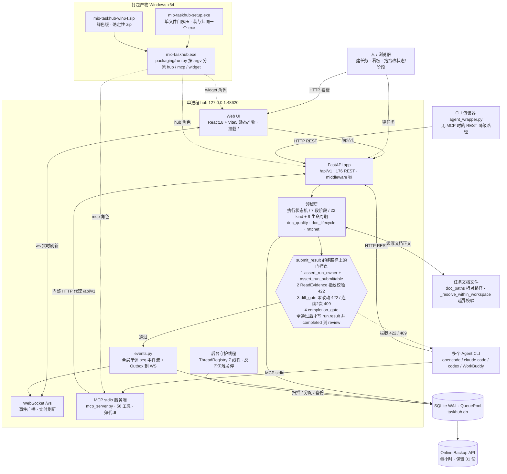
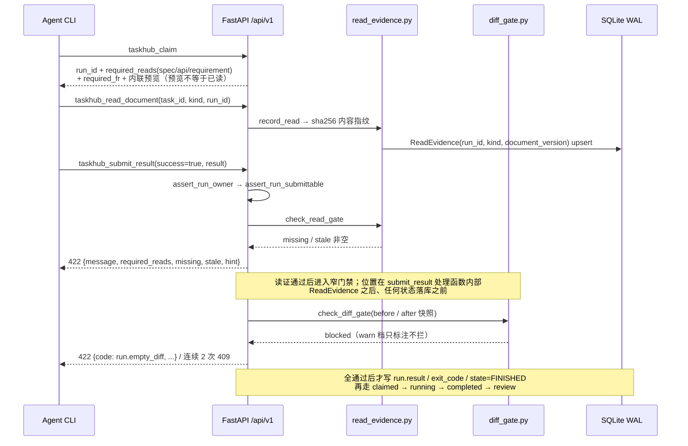

# 总体架构与技术选型（mio-taskhub v0.6.1）· Phase 1 / 任务 #2

> 编制：梁承宇（系统架构师）｜取证日 2026-11-06
> 口径说明：本节描述的对象是 `E:\work\code\agent-dev\mio-taskhub` 现有代码库（取证日 2026-11-06 事实包 + 本次源码复核），不是新建系统。数字以 `docs/taskhub/_delivery-fact-pack.md` 为准；源码复核发现的行数、错误体结构与事实包有差异的，逐一列在 §8【待确认】。本节不含排期与人周估算，该部分由需求拆解章节负责。描述文档门控只用「结构完整性校验」与「服务端强制」两个口径。

---

## 1. 架构总览

### 1.1 组件关系图

### 1.2 门控链路（必经路径）

文字说明：

- 系统形态是**模块化单体 + 进程内事件驱动组件**（`docs/architecture-audit-v3-2026-09-10.md` 定性结论，该报告为 v0.2.0 口径，数字不可引用）。人通过浏览器访问 hub 挂载的 React 静态产物；多个 Agent CLI 通过 MCP stdio 或 HTTP REST 接入，MCP 服务端本质是 `mcp_server.py` 里的 HTTP 转发薄代理。
- 默认监听 `127.0.0.1:48620`（`main.py:run()` 的 `--host` 默认值）。`main.py` 内 `net_guard.is_loopback_bind` 校验：非 loopback 且无 token 时直接 `SystemExit` 拒绝启动，除非显式置 `MIO_TASKHUB_ALLOW_INSECURE_NETWORK`。
- `main.py:lifespan` 负责装配：init_otel / instrument、启动 `background.start_background_jobs()`、git-sync / night-runner / cron-engine、SQLiteBackup、AlertManager、WS 指标推送、SLO 快照、dep 快照、insights / remediation 评估、update 服务；关停走 `_thread_registry.stop_all()` 反向顺序 + `engine.dispose()` + `shutdown_otel()`。
- 门控点位置（`mio_taskhub/api/runs.py:316-344` 源码复核）：`submit_result` 先 `assert_run_owner`（所有权）→ `assert_run_submittable`（状态），随后直接读 `success = body.get("success", True)`，**Agent 自报的 `success: bool` 被直接采信**；`success` 为真时依次执行 `check_read_gate`（不通过抛 422）、`_apply_diff_gate`（窄门禁）、`check_submit`（统一完成门禁，warn 只记录 / block 才拒绝）。四道校验全通过后才写 `run.result` / `exit_code` / `state=FINISHED` / `progress=100`，再由 `_handle_success` 推进任务状态。
- `diff_gate` 的准确位置不是「`submit_result` 之前的独立步骤」，而是**在 `submit_result` 处理函数内部、ReadEvidence 校验之后、任何状态落库之前**。`runs.py:335` 注释给出排序理由：读证门控纯查库、更便宜且更基础，先报读证问题。`git push --no-verify` 绕不过这条服务端路径。
- 门控的两个已知覆盖边界：ReadEvidence 指纹只覆盖被读文档，不覆盖代码（`read_evidence.py:file_fingerprint` 只对文档文件算 sha256）；窄门禁对采集失败、非 git 仓库、无 workspace、无前快照、并发 run 一律 fail-open 跳过（`diff_gate.py:check_diff_gate` 豁免优先级）。

---

## 2. 分层与模块划分

### 2.1 分层表（按真实目录）

| 层 | 模块 | 职责 | 关键文件 | 现状健康度 |
|---|---|---|---|---|
| 接入层 | 应用装配与中间件 | FastAPI app / lifespan / CLI / 路由挂载顺序 / 认证 / 静态产物 | `main.py`、`middleware.py` | 需关注：路由注册顺序有显式约束（`hall`、`inbox`、`blockers`、`readiness` 必须先于 `tasks.router`）；限流单桶，见 §5 |
| 接入层 | MCP stdio | 56 个 MCP 工具，把 REST 包装为 Agent 可调用工具 | `mcp_server.py` | 债务：God File，事实包记 ~643 行，当前工作树实测 905 行（见 §8） |
| 接入层 | WebSocket | 事件广播 / 实时刷新 / 指标快照推送 | `events.py::ws_manager`、`main.py:/ws`、`observability/ws_push.py` | 健康：客户端重连 + 高对比 / 连接横幅 |
| 应用层 | REST 路由 | 任务、阶段、文档、想法、评审、调度、观测等端点 | `api/`（当前工作树 44 个 `*.py`；事实包记 30+ 模块 / 176 端点） | 需关注：部分 router 挂载时未统一加 `/api/v1` 前缀，见 §8 |
| 领域层 | 执行状态机 | `queued→claimed→running→completed/retrying/failed/cancelled`，`can_transition` 单点校验 | `models.py::TaskState`、`workflow/` | 健康：单一权威枚举；`blocked_failed` 为不可达历史态，`ops/data_fixes.py` 批量迁回 |
| 领域层 | 7 段研发阶段 | `brainstorming→design→planning→ready→implementing→review→done`，产出物门控 | `api/task_stages.py::STAGE_ARTIFACT_REQUIREMENTS`、`LIFECYCLE_GATE` | 健康：`design` 另要求至少一条 discussion |
| 领域层 | 文档维度 | 22 类 kind / 7 件套主链 / 9 类生命周期 | `doc_paths.py`（`DOC_KINDS` 唯一事实源）、`doc_chain.py`、`doc_lifecycle.py` | 需关注：三处同步点缺一致性测试，见 §7 |
| 领域层 | 四层文档校验链路 | 写时 lint、状态门控、棘轮、读证/窄门禁 | `doc_quality.py`、`doc_lifecycle.py`、`ratchet.py`、`read_evidence.py`、`diff_gate.py`、`completion_gate.py` | 详见 §2.3；窄门禁是唯一保留投入项 |
| 领域层 | 编排与就绪 | 依赖满足、环检测、状态×阶段合成、拆解、下一步、统一完成门禁 | `dependency.py`、`composite.py`、`planner.py`、`hierarchy.py`、`decomposition.py`、`next_action.py`、`completion_gate.py` | 健康：`detect_cycle` 拒绝成环；依赖满足 = `state==completed` 或 `stage==done` |
| 领域层 | 安全 | SSRF、destructive 默认拒、workspace 越界、风险策略 | `net_guard.py`、`mcp_risk.py`、`policy_guard.py`、`_resolve_within_workspace()` | 需关注：`pre-push` 钩子 fail-open，见 §7 |
| 基础设施层 | 持久化 | engine / session / WAL / QueuePool / 轻量迁移；唯一权威模型与枚举 | `db.py`、`migrations.py`、`models.py`（实测 646 行） | 健康：单库单文件；依赖版本钉死，见 §3 |
| 基础设施层 | 事件与运维 | 单调 `seq` 事件流、在线备份、ADR 投影、数据修复 | `events.py`、`ops/backup.py`、`ops/git_sync.py`、`ops/data_fixes.py` | 健康：Outbox → WS 最终一致 |
| 基础设施层 | 可观测（冻结） | Prometheus 文本端点、告警、日志、SLO 快照、洞察 | `observability/`（metrics / alerts / dep_metrics / otel / logging_config / report / insights / remediation / slo_history / task_trace / ws_push） | 冻结：`MIO_OTEL` 相关 F8 记「otel 未生效」；SLO 目标域已冻结 |
| 后台调度层 | 守护线程 | 7 线程统一注册、反向优雅关停 | `background.py`（实测 717 行）、`ThreadRegistry` | 债务：God File；一进程崩溃则全部后台任务停止 |
| 后台调度层 | 调度与更新 | cron / 派单 / 空闲计划 / 容量 / 门禁 / 自动分诊 / 自更新 | `scheduling/`、`update/` | 需关注：F9 `night_runner` 拉起失败；`MioDigestJob`、`ContractJob` 默认仍开，不在冻结范围 |
| 冻结/移出主链路 | 想法、记忆网关、Mio 运行时 | 想法工作台、mio-intelligence MCP 代理、运行时观测 | `ideas/`、`memory_store.py`、`api/memory.py`、`mio_runtime.py` | 冻结：代码/接口/文档保留，停投入停调度；`MIO_OBSERVER_AUTOSTART`、`MIO_IDEA_REVIEW_ENABLED` 已改默认关 |
| 前端层 | React SPA | 10+ 视图、文档面板、评审面板、DAG / 甘特 CPM、WS 驱动 | `web/src/App.jsx`、`api.js`、`stageDocs.js`、`docLifecycle.js`、`cpm.js`、`components/DocPanel.jsx`（`KIND_META`） | 健康：49 文件 / 12,532 行；`KIND_META` 是三同步点之一 |
| 打包分发层 | 构建与安装 | 一键构建、三角色分派、确定性 zip、安装/卸载、布局契约 | `packaging/build.ps1`、`packaging/run.py`、`packaging/agent_wrapper.py`、`installer/`、`payload_layout.py`、`release_assets.py`、`scripts/make_zip.py` | 健康：Windows x64 优先；排除 torch/pandas/scipy |

### 2.2 三条正交维度及落点

| 维度 | 取值 | 落点 | 约束 |
|---|---|---|---|
| 执行状态机 | `queued / claimed / running / completed / retrying / failed / cancelled` | `models.py::TaskState.can_transition` | 非法转移拒绝；`blocked_failed` 历史遗留不可达 |
| 7 段研发阶段 | `brainstorming→design→planning→ready→implementing→review→done` | `api/task_stages.py::STAGE_ARTIFACT_REQUIREMENTS` | `advance` 只走相邻一段，`move` 可跳转但保留终态保护；`design` 要求 `requirement` approved + 至少一条 discussion |
| 22 类文档 kind + 9 类生命周期 | 8 类文档状态机 + Task 自身 | `doc_paths.py::DOC_KINDS` / `doc_lifecycle.py` | 严格向前、不许回退/跳级、终态不可改判；`api` 与 `spec` 同形（`draft→review→approved`），纳入生命周期使状态门控能作用于接口契约 |

三条维度正交挂在 `Task` 上，互不覆盖：执行状态由 `state` 列、阶段由 `stage` 列、文档由 JSON 列 `doc_paths` / `doc_statuses` 承载。

### 2.3 四层文档校验链路的落点

事实包称「四重质量闭环」，此处按实现拆为四层，落点如下：

| 层 | 落点文件 | 性质 | 服务端强制点 |
|---|---|---|---|
| 写时 lint（反馈不阻断） | `doc_quality.py::check_content` | `score = max(0, 100 - 20*errors - 5*warns)`；必备章节 / 表格行数 / 空壳占位 / 分点书写；`requirement` / `spec` / `api` 阈值 80 | `PUT /doc` 响应挂 `quality`，不阻断 |
| 状态门控（阻断） | `doc_lifecycle.py` + `api/task_documents.py` | 推进 `review`/`approved`/`done` 要求 `errors==0` 且分数达标 | `422 detail={message, quality}`；`force=true` 绕过但 emit `task_stage_gate_forced` 留痕 |
| 棘轮基线（阻断） | `ratchet.py` | 质量分 / 用例数只升不降 | `422 detail={message, ratchet, hint}`；`force=true` 绕过 |
| 读证 + 窄门禁（阻断/标注） | `read_evidence.py`、`diff_gate.py`、`api/runs.py` | `required_reads` 默认 `spec,api,requirement`；`document_version = "sha256:" + hexdigest` 绑定 `(run_id, kind)`；窄门禁 `off/warn/block` 默认 `warn`，`MAX_REJECTIONS=2`，`GIT_TIMEOUT_SEC=5` | `submit_result` 必经路径：读证 422 `{message, required_reads, missing, stale, hint}`；零改动 422 `{code: run.empty_diff, ...}`，连续 2 次 409 `{code: run.empty_diff_repeated, ...}` |

配套落点：`GET /api/v1/tasks/{id}/doc/{kind}/revision`（逐条问题 + 章节写作指引 + 模板片段）、`traceability()`（`FR-n` ↔ `TC-n`）、`GET /api/v1/tasks/{id}/ratchet`、`GET /api/v1/runs/{run_id}/diff-evidence`（只读自查，与提交同一套判据）、`GET /api/v1/board/diff-gate-stats`（纯统计，不参与流程判定）。

### 2.4 数据流转与存储概要

| 数据 | 存储 | 说明 |
|---|---|---|
| 权威状态（Task / Run / Agent / Event / Subtask / GitRef / HistoryEvent / TaskReview / Idea / Discussion / TaskTemplate / ScheduledJob / ReadEvidence / RatchetBaseline） | `SQLite(WAL) taskhub.db`，SQLModel 模型在 `models.py` 唯一定义 | 单库事务内写状态与事件；强一致 |
| `doc_paths` / `doc_statuses` | `Task` 上的 JSON 列 | 存相对路径，读写经 `_resolve_within_workspace()` 越界校验，逃逸 400 |
| 文档正文 | workspace 内文件系统，不入库 | `doc_paths.py` 的 `DOC_KINDS` 是 kind→路径唯一事实源 |
| 全局事件流 | `Event` 表单调 `seq`，增量订阅 | Outbox → WebSocket 最终一致；CAP 取 CP（v3 审计定性结论） |
| 变更证据 | `Run.diff_summary` 的 `before` / `after` 摘要 | `Snapshot.brief()` 只存 `head / porcelain / files / insertions / deletions / paths[:50]`，不存文件正文与 error 绝对路径 |
| 备份 | `~/.mio_taskhub/backups/` | SQLite Online Backup API 每小时，保留 31 份；恢复替换 `taskhub.db` |
| 冻结/旁路 | `MIO_HOME/memory.jsonl`（只读投影）、`docs/adr/ADR-xxx.md`（Outbox 投影）、MIO 运行时状态 | 零写入或默认关 |
| 用户数据 | `%USERPROFILE%\.mio_taskhub` | 卸载默认保留 |

详细实体建模不在本节范围。存储选型方向：维持单库单文件；迁移条件见 §5 可扩展性行与 §6.2。

---

## 3. 技术选型

| 领域 | 当前选择 | 版本 | 选择理由 | 被否决的备选 | 否决理由 | 重新评估触发条件 |
|---|---|---|---|---|---|---|
| Web 框架 | FastAPI + Starlette + uvicorn | `fastapi==0.141.1` / `starlette==1.6.0` / `uvicorn[standard]==0.52.4` | 原生 Pydantic 校验 + 自动 `/openapi.json`（MCP 自动生成的潜在事实源）+ sync endpoint 走 threadpool + 原生 WebSocket；176 端点已按 `api/` 分包 | Django（含自带 ORM / admin 全栈）；Flask | Django 会引入第二套 ORM 与 admin 运行时，与「本地单用户、零外部依赖、免安装单 EXE」冲突，且自动 OpenAPI 需额外 drf-spectacular；Flask 无原生 async、无 Pydantic 请求校验、无自动 OpenAPI，176 端点的 schema 需手写 | 出现多团队协作、需要 admin 后台或完整 RBAC 时；或 FastAPI 钉死版本出现必须升级的安全公告（需全量 `pytest -q` 0 红后逐项解钉） |
| ORM 与数据库 | SQLModel + SQLite(WAL, QueuePool) | `sqlmodel==0.0.42` / `SQLAlchemy==2.0.52` / `pydantic==2.13.5` | 单文件零安装；WAL 支持单机多 Agent 并发读；Online Backup API 给一致性快照；模型与 Pydantic schema 复用；依赖钉死因 CI 全新装到 0.0.48 / 2.1.4 后 32 个测试因 naive datetime 校验收紧挂掉 | PostgreSQL（独立服务）；纯 SQLAlchemy（不用 SQLModel）；文件/JSON 存储 | PostgreSQL 需要独立进程与运维，违背零云依赖与免安装 EXE，单人维护成本不可接受；纯 SQLAlchemy 需另写 Pydantic schema，与 FastAPI 校验重复；纯文件存储无事务、无 WAL 并发、无法支撑单调 `seq` 事件流的可靠增量订阅 | **并发 >1000 / 跨进程写 / 多租户**任一成立（`docs/roadmap/03` §6.1 N6 明确的重启条件）→ 迁 PostgreSQL；保留 SQLModel，改 engine 与连接串并复核 datetime 用例 |
| 前端 | React 18 + Vite 5，构建产物由 hub 挂载 `/` | React 18 / Vite 5 | 已有 49 文件 / 12,532 行、40+ 组件与 10+ 视图；生产产物嵌进 EXE，无需独立 Node 进程 | Vue 3；无构建原生 JS | Vue 3 需重写既有 40+ 组件（工作流泳道 / 拓扑 DAG / 甘特 CPM / 文档面板），切换无功能收益；无构建原生 JS 无法维护 10+ 视图的状态与组件复用、拖拽与 WS 实时刷新 | 需要 SSR / 多页面 SEO（本工具无此需求），或团队主力栈变更 |
| Agent 接入 | MCP stdio + REST 双通道，另有 CLI wrapper 降级 | `mcp==1.29.1` / `websockets>=12.0` | 56 MCP 工具覆盖 176 REST；opencode / claude code / codex / WorkBuddy 均原生支持 local stdio；REST 供人侧 UI、CLI 包装器、自更新与第三方集成 | 纯 REST；纯 MCP；长连接自定义协议 | 纯 REST 要 Agent 侧手写 curl 并自行维护配置；纯 MCP 覆盖不到 Web UI、CLI 包装器与无 stdio 能力的 HTTP 集成；自定义长连接协议需自建 SDK、版本协商与重连，而 MCP 已有事实标准与 `mcp==1.29.1` 钉死依赖 | MCP 生态出现统一网关规范、或需要跨机远程 Agent 接入、或 D2-b 门控协议化启动需统一接入面 |
| 状态与事件 | SQLite 内单调 `seq` 全局事件流 + WS 广播 | `events.py` / `TaskEvent` / `Event` / `HistoryEvent` | 状态与事件在同一库事务内写入；增量订阅只需 `seq > cursor`；Outbox → WS 最终一致 | 消息队列（RabbitMQ / Kafka）；Event Sourcing 框架 | 消息队列需独立 broker 进程与运维，违背零外部依赖单 EXE；Event Sourcing 需引入快照 / 重放 / 投影，与现有权威 ORM 表双写，而当前需求只是可追溯 + 增量推送 | 出现跨进程多写者、事件需独立保留与重放、或第二个事件消费方 |
| 打包分发 | PyInstaller 单 EXE + 单文件自解压安装包 + 确定性 zip | `packaging/build.ps1`、`packaging/run.py`、`scripts/make_zip.py` | 非技术用户双击即用、免 Python；装/卸同一个 exe；`run.py` 按 `argv[1]` 分派 hub/mcp/widget；`make_zip.py` 保证布局可复现（不用 `Compress-Archive`） | Docker only；Electron；Nuitka | Docker only 要求用户有 Docker 且无图形安装卸载，覆盖不到目标用户；Electron 需再引入 Node 运行时与 Chromium，构建链与体积翻倍，而 Web UI 已由 hub 挂载 `/`；Nuitka 编译时长与 Windows 工具链依赖更高，现有 PyInstaller 链路已验证可复现并产出 SHA256 | 需要 macOS / Linux 原生安装包（当前 Windows 优先），或需要代码级混淆 / 更小冷启动 |
| 可观测（此域已冻结） | 自建 `/metrics` Prometheus 文本端点 + `/healthz` `/readyz` `/dashboard` `/api/v1/alerts` `/api/v1/logs` | `observability/metrics.py` 等；`opentelemetry-*` ≥1.25 在依赖内但 F8 记 otel 未生效 | 零额外进程；文本端点可被 `packaging/prometheus.yml` 抓取；自包含监控看板无外部构建 | 全量 OTel Collector（独立进程 + 端口 + 配置 + 后端） | 单用户本地工具无人看指标；Collector 引入独立进程与配置，违背零云依赖与单人维护；2026-10-21 决策已把 Prometheus/SLO/tracing 列入 8 项冻结 | 出现第二个真实用户 → 重估 SLO / tracing（事实包 §1 复审条件④）；SLO 目标值是目标非实测且该域已冻结 |
| 后台调度 | `ThreadRegistry` 进程内守护线程（7 业务线程 + lifespan 内观测线程），反向优雅关停 | `background.py` / `scheduling/cron_engine.py` / `croniter==6.2.4`；`apscheduler==3.11.3` 亦在钉死依赖内（见 §8） | 单进程内启停、无 IPC、无第二份状态；`ThreadRegistry.stop_all()` 统一关停顺序 | Celery（broker + worker）；APScheduler 独立进程；第二进程托管 | Celery 需 broker 与 worker，违背单 EXE 零外部依赖；独立调度进程要跨进程共享 SQLite 并引入 IPC 与关停协调，单人维护下调试成本高 | 需要跨进程定时任务、任务需持久化队列、或后台任务需在 hub 崩溃后独立存活 |

口径：所有否决理由基于事实包的四条真实约束（本地单用户、零云依赖 / 零外部依赖、Windows 优先、单人维护），不引入未验证的性能或规模假设。

---

## 4. 接口契约要点

### 4.1 核心 API 清单（节选，同步/异步全部为同步 HTTP，另有 WS 广播）

| API | 方法 | 入参 | 出参 | 同步/异步 | 错误码 |
|---|---|---|---|---|---|
| `/api/v1/tasks/{id}/claim` 系列 | POST | `agent` 等 | `run_id` + `required_reads` + `required_fr` + `documents` 内联预览 + `read_evidence_required` + `readiness` | 同步 | 403 / 409（所有权、状态） |
| `/api/v1/runs/{run_id}/result` | POST | `success: bool`、`result`、`exit_code`、`agent` | `run` 终态 + 事件 | 同步 | 404 / 403 / 409 / **422 门控** |
| `/api/v1/runs/{run_id}/read-evidence` | GET | `run_id` | `required_reads` / `read_ok` / `missing` / `stale` / `enforced` / `passed` | 同步（只读） | 404 |
| `/api/v1/runs/{run_id}/diff-evidence` | GET | `run_id` | `mode` / `would_block` / `skipped` / `reason` / `before` / `after` | 同步（只读） | 404 |
| `/api/v1/tasks/{id}/doc` | GET / PUT | `kind` 或 `path`；PUT 带 `content` | 文档内容；PUT 响应含 `quality` 与 `status` | 同步 | 400（越界）/ 422（参数、二进制 append） |
| `/api/v1/tasks/{id}/doc/{kind}/status` | POST | `target`、`force` | `doc_statuses` 新态 | 同步 | **422 `{message, quality}`** / **422 `{message, ratchet, hint}`** / 422 非法转移 |
| `/api/v1/tasks/{id}/doc/{kind}/revision` | GET | `kind` | 逐条问题 + 章节写作指引 + 模板片段 + 追溯要求 | 同步 | 404 |
| `/api/v1/tasks/{id}/doc/quality` | GET | `kind` | 质量报告 + 追溯矩阵 | 同步 | 404 |
| `/api/v1/tasks/{id}/ratchet` | GET | — | 棘轮基线 | 同步 | 404 |
| `/api/v1/board/diff-gate-stats` | GET | — | 纯统计（不参与流程判定） | 同步 | — |
| `/ws` | WebSocket | `?token=` 或 Bearer 头 | `task_update` / `idea_update` / `metrics_snapshot` 等 | 异步广播 | close 4401（鉴权失败） |
| `/openapi.json`、`/docs`、`/redoc` | GET | — | OpenAPI schema / Swagger / ReDoc | 同步 | — |
| `/healthz`、`/readyz`、`/metrics`、`/dashboard` | GET | — | 存活 / 就绪（含备份份数）/ Prometheus 文本 / 看板 HTML | 同步 | `/readyz` 503 `{status:degraded, db:error}` |

### 4.2 契约要点

1. **前缀**：REST 统一挂 `/api/v1`（`main.py` 逐 router `prefix="/api/v1"`）；文档页无前缀，是 `/docs` 而非 `/api/v1/docs`；`/openapi.json`、`/landing`、`/dashboard`、`/healthz`、`/readyz`、`/metrics` 均在根路径。注意 `main.py` 中 `memory`、`mio_runtime`、`material_panel`、`value_discovery`、`scheduler_control`、`observability`、`insights` 等 router 挂载时未统一显式加 `prefix`，前缀分布见 §8【待确认】。
2. **认证范围**：`main.py:make_auth_middleware` 只对 `request.url.path.startswith("/api/")` 校验 `Authorization: Bearer <token>`（用 `secrets.compare_digest` 常量时间比较）；Web UI 与 `/docs` 免认证。未设 token 时中间件直接放行。`--auth` 时 token 优先取 `MIO_TASKHUB_TOKEN`，其次 `--token`，都没有则自动生成并打印。WebSocket 不走该 HTTP 中间件，在 `websocket_endpoint` 内单独校验 `?token=` 或 Bearer，失败 `close(code=4401)`。
3. **错误体**：实测并非全局单一 schema，按门控点各自结构化；共同点是 4xx 都带可执行的 `message` / `hint`：
   - 文档状态门控 422：`{message, quality}`（`api/task_documents.py:633`）。
   - 棘轮门控 422：`{message, ratchet, hint}`（`:653`）。
   - ReadEvidence 门控 422：`{message, required_reads, missing, stale, hint}`（`api/runs.py:257` 的 `_read_gate_detail`，注释说明「MCP 端截断 200 字符，尽量小」）。
   - 窄门禁 422：`{code: run.empty_diff, message, hint, files_changed, rejections, max_rejections}`；连续 2 次 409：`{code: run.empty_diff_repeated, ...}`（`api/runs.py:500/511`）。
   - 认证 401 `{detail: "unauthorized"}`；限流 429 `{error: "rate_limited", retry_after_seconds}`。
   是否收敛为单一统一错误体，见 §8【待确认】。
4. **`MIO_READ_GATE` / `MIO_DIFF_GATE` 开关**：`MIO_READ_GATE=0/off` 可整体关闭读证门控；`MIO_READ_GATE_KINDS` 可改必读项，默认 `spec,api,requirement`；`MIO_READ_GATE_MISSING` 默认 `block`；窄门禁三档 `off|warn|block` 默认 `warn`。`claim` 返回的内联预览明确标注「预览不等于已读」，必须调 `taskhub_read_document(task_id, kind, run_id)` 落 ReadEvidence。
5. **`/openapi.json` 作为 MCP 自动生成的潜在事实源**：FastAPI 自动生成的 schema 已含全部 operationId、请求/响应模型，可驱动 MCP 工具定义与 HTTP 转发的代码生成，把 `mcp_server.py` 的薄代理压到配置级。

### 4.3 God File 与「从 OpenAPI 自动生成 MCP 工具」

- 现状：`mcp_server.py` 是 God File。事实包记 ~643 行，本次源码复核当前工作树为 **905 行**；`background.py` 717 行、`models.py` 646 行（详见 §8）。`docs/architecture-audit-v3-2026-09-10.md` 已把「从 OpenAPI spec 自动生成 MCP 工具」列为最大单一代码质量问题，并估计可把转发层压到约 100 行配置（该估计为 v0.2.0 旧口径，不作为本方案成本承诺）。
- 理想方案：以 `/openapi.json` 为唯一事实源生成 56 个 MCP 工具定义与转发，消除每个工具约 20 行重复 HTTP 样板，同时消除新增 REST 端点与新增 MCP 工具之间的手工同步点。
- **为什么现在不做**：
  1. 2026-10-20/21 产品决策判定项目问题是「过度建设」，8 项冻结含「多入口合并（本轮不做）」；冻结定义是代码不删 / 接口不删 / 文档保留，但**停投入、停调度、停当价值宣称、移出主链路**。自动生成属新增工程投入，与停投入冲突。
  2. 唯一保留投入项是窄门禁 `diff_gate.py`，MCP 自动生成不在投入范围；`MioDigestJob`、`ContractJob` 默认仍开不等于放宽冻结范围。
  3. 176 个 REST 端点中大量是只读统计、冻结项与观测端点；无差别自动生成会把已冻结项一并暴露成 MCP 工具面，扩大需维护的接入面，方向与「停扩张」相反。
  4. 单人维护：生成层要处理 Pydantic → MCP JSON Schema 映射、错误体、分页、文件上传等特例，回归面覆盖 56 工具 + 1601 用例；收益是减少手写样板，风险是回归成本，当前不成立。
  5. 复审条件：MCP 工具数增长到维护成本可量化、出现第二个真实用户或第二个接入方、或 D2-b 门控协议化启动需要统一接入面。

---

## 5. 非功能性目标

「目标值」为设定目标，「实测值」为已有记录，两者不可混用。SLO 一行是目标值非实测，且该域已冻结。

| 维度 | 目标值 | 实测值 | 实现手段 | 验证方式 |
|---|---|---|---|---|
| 性能 | HTTP P50 < 100ms / P99 < 2000ms（SLO 目标，30 天窗口）；5xx < 0.1%（目标） | `claim` P50 30.5ms / P95 32.5ms；10×100 并发零重复 / 100% 成功率（主理人给定口径，原始报告路径与测量日期见 §8） | WAL + QueuePool；sync endpoint 走 threadpool；`board` 聚合查询与 `_task_detail` 的子查询在 v3 审计中被列为瓶颈，缓存为其建议项而非已实现项 | `pytest -q` 全量 0 红；`pytest -m e2e` 起真实 uvicorn 的并发压测；`GET /metrics` 读 `taskhub_dep_latency_*`、`taskhub_slo_*` |
| 可靠性 | 首启成功率 ≥90% 为 D1「成立」判据；HTTP 可用性 99.9% / 任务成功率 99.0% / MCP 99.5%（SLO 目标，已冻结） | 首启成功率 **81.9%**（n=234，2026-10-14 G2 回写，落在 70–90% 的「部分成立」档，未达 90%）；reaper n=444，三分根因 真死 27.7% / **链路断 70.9%** / 观测不足 1.4%；E4 相对原约 62% 基线有变化但未达 90% | SQLite Online Backup 每小时、保留 31 份；`reaper_decision` 埋点；窗口自适应 + 有界 requeue；requeue 自愈；Docker restart；WS 客户端重连 | `/healthz`（存活）/ `/readyz`（`SELECT 1`，异常 503 且带备份份数与最新时间）；`docs/taskhub/lifecycle-failure-audit-20261002.md` 与 G2 回写报告；v3 审计弹性检查记录「无熔断、无降级」 |
| 安全 | 默认仅 loopback；非 loopback 必须鉴权；`destructive` 默认拒；文档路径不越界 | `main.py:run()` 默认 `--host 127.0.0.1`，非 loopback + 无 token 直接 `SystemExit`；单 Bearer 仅作用于 `/api/*`，Web UI 与 `/docs` 免认证；WS 单独校验（4401）；`net_guard` SSRF；`mcp_risk` destructive 默认拒；DOMPurify；`_resolve_within_workspace()` 越界 400；SQLModel ORM 防注入、无 cookie 故无 CSRF | 认证中间件 + `secrets.compare_digest`；`net_guard.is_loopback_bind`；`MIO_TASKHUB_ALLOW_INSECURE_NETWORK` 显式放行；单 token 无过期/无轮换 | `pytest -q` 安全相关用例；`/api/*` 带/不带 token 的对照请求；非 loopback 启动拒绝检查 |
| 安全（已知缺陷） | 限流按调用方隔离 | `middleware.py:RateLimitMiddleware` 的 `key = f"{client_ip}"`，仅 client IP，默认 120 req/min 滑窗 60s；同机多 Agent 共用一个桶（F11 单桶缺陷）；`/healthz` `/readyz` `/metrics` 豁免 | 现状为全局单桶；`pre-push` 钩子 fail-open（F13）；单 token 无权限体系 | 见 §7 风险清单；`429 {error: rate_limited, retry_after_seconds}` |
| 可扩展性 | 维持单进程模块化单体；不新增功能面 | 当前 1–5 agents 规模（v3 审计定性）；SQLite WAL + QueuePool | 模块按 `api/` 分包，新增能力只需新建 `api/*.py` 模块并注册；状态机与枚举单一权威 | **具体触发条件：并发 >1000 / 跨进程写 / 多租户**任一成立 → 迁 PostgreSQL（`docs/roadmap/03` §6.1 N6）；多入口合并、云端多租户、团队权限为明确非目标 |
| 可维护性 | God File 收敛；文档 kind 三同步点有自动一致性测试 | 事实包记 `mcp_server.py` ~643 行 / `background.py` ~580 行；当前工作树实测 905 / 717 行（§8）；三同步点（`doc_paths.DOC_KINDS` / `api/task_documents.DOC_PATTERNS` / `web/src/components/DocPanel.jsx` 的 `KIND_META`）缺一致性测试；1601 用例 / 覆盖率 80.0%（G0 修复后口径）；v3 审计评分 80/100 为 v0.2.0 旧口径 | 文档专项用例 `test_doc_chain.py` / `test_doc_lifecycle.py` / `test_doc_quality.py` / `test_task_doc_paths.py`；`README` 统计拟由 `scripts/gen_readme_stats.py` 生成且 CI 校验（G3 判据）；理想方案见 §4.3 | `pytest -q --cov=mio_taskhub --cov-report=term-missing --cov-report=xml`（覆盖率不进 `addopts`）；新增 kind 时三处同步点人工核对 |
| 成本 | 零云依赖、单机、无外部服务计费 | 主链路不调用大模型做门控，判定由确定性状态机与 sha256 指纹完成，无按 token 计费；`memory gateway` 是 mio-intelligence 的 MCP 代理且已冻结默认关 | `MIO_MEMORY_COMMAND` / `MIO_MEMORY_ARGS` 子进程；若解冻，既有约定为 MCP 不可达 503 `memory_unavailable`、超时 504 `memory_timeout`、RPC 错误 502 `memory_rpc_error`、参数 422；子进程自动重启最多 `MIO_MEMORY_MAX_RESPAWN=3`（默认 3），端点限流 `MIO_MEMORY_RATE_LIMIT=60`/min | 冻结项按「停投入」执行，不新增成本；解冻前需单独给超时 / 重试 / 降级 / 成本控制方案 |
| 大模型调用（本系统） | 无 | 门控链路无 LLM 调用；`test` 只是一种文档 kind，不是运行器；系统不跑测试、不做代码静态分析 | 不适用 | 若未来引入 LLM 判定，需补超时、重试上限、降级到结构完整性校验、单次/单任务成本上限四项后才可进主链路 |

成本口径假设前提：单人全职 + Agent 辅助、熟悉本仓库、含设计/实现/测试/取证，不含外部评审等待、审批墙钟与分发运营。本节不给人周数字，排期见需求拆解章节。

---

## 6. 架构决策与权衡

| # | 决策 | 被否决方案 | 否决理由 | 复审条件 |
|---|---|---|---|---|
| 1 | **冻结 8 项，判定项目问题是「过度建设」**（2026-10-20/21 产品决策，现行最高约束）。冻结项：creativity 调度、observer 机会发现、Prometheus/SLO/tracing、memory gateway、ADR 投影、idea 子系统扩张、超出结构校验的文档质量阈值、多入口合并。冻结 = 代码不删 / 接口不删 / 文档保留，停投入 / 停调度 / 停当价值宣称 / 移出主链路；已改默认关 `MIO_OBSERVER_AUTOSTART`、`MIO_IDEA_REVIEW_ENABLED`；`MioDigestJob`、`ContractJob` 默认仍开，不擅自扩大冻结范围 | 继续扩功能面、继续投入 SLO / tracing、Evidence→Insight 自喂养、多入口合并 | 单用户本地工具无人看指标；想法 53 条仅 1 条采纳且无交付追踪；`Evidence→新 Insight` 为 0；项目已判定为过度建设，继续扩张与定位相反 | ① 窄门禁频繁误伤合法完成 → 回退为仅标注（**不加严**）；② 作者能演示某冻结项真的省了具体时间 → 解冻；③ 发现运行失败主因是口径失真 → 可靠性判断上修；④ 出现第二个真实用户 → 重估 SLO / tracing |
| 2 | **唯一保留投入项 = 窄门禁 `diff_gate.py`，档位 `off/warn/block`，默认 `warn`**。总原则：会在相当一部分合法完成上触发的检查只能警告 / 标注；只在明确的失败或撒谎上触发的检查才配拦截。实现上 fail-open 优先（采集失败 / 非 git / 无 workspace / 无前快照 / 并发 run 一律跳过），拒绝不消耗 attempt，`MAX_REJECTIONS=2` 才判失败。配套只读 `GET /api/v1/board/diff-gate-stats`（纯统计，不参与判定）。唯一成功判据是「能指着一例它拦下了一次本会放过的假完成」，观察记录 `docs/taskhub/diff-gate-grayscale-log.md`（M1~M5 + 回退条件 + 切 block 前置） | 默认 `block`；把「测试未跑」「diff 质量」纳入拦截；误伤后加严阈值 | 测试未跑与 diff 质量会在合法完成上大量触发；本系统不跑测试也不做静态分析，无判据；误伤后加严与总原则相反（回退方向固定为仅标注） | 灰度确认零误伤 + 作者能举出拦截实例 → 切 `block`；频繁误伤 → 回退为仅标注 |
| 3 | **G2 部分成立 → 暂缓 D2-b 协议化**。V1「门控 + ReadEvidence 改变 Agent 行为」证据不足（S2 单元 T 拦 422 / C 放 200 方向正确，但 n=1 ≪ 30，B 系列 defer，真实 agent 不可用）；V2 观测支持、非对照（`quality_strata.py` 真库 api Fisher p=0.037，观察性关联非 A/B 因果）；E3/E4 部分成立。按 G2 分支裁决：定位维持「个人/小团队效率工具」，G3 只做 D1 诊断可读化 + 开源前置，暂缓 D2-b，并禁止对文档门控作效应宣称（G4 口径冻结的四类表述不得出现） | 直接启动 D2-b 门控协议化；对外宣称门控效应 | 效应未过对照实验，样本自限（n16 教训），外部使用者 0；先宣称与 G4「结论出来前不得出现」的口径冻结冲突 | D2-a A/B 达 n≥30/组、p<0.05、一次通过率不下降、force/绕过率 ≤10%，且 ≥1 个非作者接入闭环 |
| 4 | **D1 根因 70.9% 落在项目外 → 收敛为「诊断可读化」而非「修复」**。首启 81.9%（70–90% 档，D1 部分成立）；reaper n=444 三分根因中链路断 70.9% 为主因（inv1 系列 agent 心跳问题，属 agent CLI / 环境）；定位维持效率工具，把根因以可读诊断形式交付用户（已有 `_diagnose_command` 先例），不升级为社区增长目标 | 继续在 hub 内修 reaper / timeout / 门控 / 事务；把可靠性定位上修 | 埋点设计边界已固化（不改 reaper / timeout / 门控 / 事务）；根因主要在项目外，hub 内改动无法根治，收益上限受限 | 根因回到项目内（发现运行失败主因是口径失真）→ 可靠性判断上修 |
| 5 | **门控位置放在服务端 `submit_result` 必经路径**（唯一候选差异，**推断档、未验证**）。对照：`github/spec-kit` 的 checklist gate 由 Agent 读勾选状态自执行；`marklynd/mcp-approvals` 自述「不在网络路径上、拦不住跳过」。本系统把 ReadEvidence 内容指纹与文档状态作为 submit 前置 422，`git push --no-verify` 绕不过 | 把门控放到 Agent 侧自觉执行、客户端钩子、或 pre-push 钩子 | Agent 侧与 pre-push 均可被跳过（`git push --no-verify`；项目内 pre-push 钩子 fail-open 且路径安装时固化），不能作为服务端强制点 | 核查口径：`docs/roadmap/03` §2.4 检索词与核查日 2026-10-10，「检索未发现 ≠ 不存在」；须待 D2-a A/B 通过 + ≥1 外部接入；当前不得写成已验证结论 |
| 6 | **维持模块化单体，不拆微服务 / 多进程** | 微服务化；按后台线程拆独立进程 | 当前 1–5 agents 规模单进程完全适用；拆分需引入 IPC、第二份状态、独立部署单元，与单人维护 / 单 EXE 零外部依赖冲突 | 并发 >1000 / 跨进程写 / 多租户任一成立（同 #3 存储迁移触发条件） |
| 7 | **依赖版本逐项钉死**（`fastapi==0.141.1` / `sqlmodel==0.0.42` / `SQLAlchemy==2.0.52` / `pydantic==2.13.5` / `mcp==1.29.1` 等） | 跟随 latest；宽松版本范围 `>=` | CI 全新装到 `sqlmodel 0.0.48` / `SQLAlchemy 2.1.4` 后 32 个测试因 naive datetime 校验收紧挂掉；无版本锁定会让本地与 CI 不一致 | 出现必须升级的安全公告时，逐项解钉：全量 `pytest -q` 0 红 + `pytest -m e2e` 并发回归通过后再提交 |
| 8 | **文档门控限定为结构完整性校验 + 服务端强制，不扩展到内容正确性判定** | 超出结构校验的文档质量阈值（冻结项之一）；用 LLM 判定内容是否正确；内建 pytest runner | `doc_quality.check_content` 是启发式结构校验（章节标题 / 表格行数 / 占位符），判断不了内容是否真的对；`test` 只是文档 kind；系统不跑测试不做静态分析，管的是研发过程约束 | 出现真实第二用户且能证明内容审查省了具体时间（同 #1 复审条件②） |

### 6.2 演进路径

成本估计一律给假设前提，不给确定数字。前提：单人全职 + Agent 辅助、熟悉本仓库、含设计/实现/测试/取证，不含外部评审等待与分发运营；下列工时均需按该前提重估，不引用 v3 审计的旧口径数字。

| 触发条件 | 演进动作 | 成本估计 |
|---|---|---|
| 并发 >1000 / 跨进程写 / 多租户任一成立 | SQLite → PostgreSQL；保留 SQLModel，改 engine 与连接串；复核 32 个 naive datetime 用例与 WAL 相关假设 | 需重估；前提同上，另含迁移脚本与回归，不含停机窗口 |
| 出现第二个真实用户 | 解冻 SLO / tracing，重估 OTel Collector 与告警处置流程 | 需重估；前提同上 |
| MCP 工具数持续增长、每新增工具仍需手写转发样板 | 从 `/openapi.json` 自动生成 MCP 工具，拆 `mcp_server.py`；同时冻结项端点需显式排除 | 需重估；前提同上，另含 56 工具 + 全量用例回归 |
| D2-a A/B 通过且 ≥1 非作者接入 | 启动 D2-b 门控协议化 | 条件性：前置结论未出不得进 `ready`，任务卡打 `labels += ["conditional"]` |
| 根因回到项目内（口径失真） | 可靠性判断上修，重估 D1 定位与 reaper 边界 | 需重估；前提同上 |
| 需要 macOS / Linux 原生安装包 | 在对应系统重打（当前 Windows 优先，Docker / 源码路径跨平台可用） | 需重估；前提同上，另含目标机构建链 |

---

## 7. 架构风险清单

| 风险 | 概率 | 影响 | 应对 |
|---|---|---|---|
| SQLite 并发上限（WAL + QueuePool 仅够单机多 Agent） | 中 | 高 | 维持现状；触发条件 并发 >1000 / 跨进程写 / 多租户 → 迁 PostgreSQL；备份用 Online Backup API 每小时 31 份 |
| 单 Bearer token，无多租户、无权限体系、无过期/轮换 | 高（现状确定） | 中 | 本地单用户定位，默认 loopback 缩小暴露面；非 loopback 强制鉴权；不引入权限体系（明确非目标） |
| God File：`mcp_server.py`（事实包 ~643 行 / 实测 905 行）、`background.py`（~580 / 717 行） | 高（现状确定） | 中 | 理想方案从 `/openapi.json` 自动生成；当前按冻结「停投入」不做，登记为技术债；新增工具继续走 `_tool` 装饰器工厂减少样板 |
| 文档质量 lint 是启发式结构校验，判断不了内容是否真的对 | 高（现状确定） | 中 | 限定为结构完整性校验 + 服务端强制；内容审查交人或 Agent 阅读；不扩阈值（冻结项） |
| 文档 kind 三同步点（`DOC_KINDS` / `DOC_PATTERNS` / `KIND_META`）缺一致性测试 | 中 | 中 | 新增 kind 时三处人工同步 + 文档专项用例；补一条一致性测试属工程修复，待排期 |
| `pre-push` 钩子 fail-open，且路径安装时固化 | 中 | 中 | 不作为服务端强制点；强制点固定在 `submit_result`；F13 登记延后 |
| Windows 优先：绿色版与 setup 脚本只覆盖 Windows | 高（现状确定） | 中 | Docker / 源码路径跨平台可用；macOS / Linux 原生安装包列演进项（§6.2），当前不投入 |
| F8 otel 未生效（依赖已装但埋点未生效） | 高（现状确定） | 低 | 可观测域已冻结，停投入；`/metrics` 文本端点为实际可用通道 |
| F9 `night_runner` 拉起失败（`spawn … 脚本不存在` 记录 50 次） | 高（现状确定） | 低 | 保持关闭、仅保留手动试跑（N5 不修复重启）；`MIO_OBSERVER_AUTOSTART` 默认关 |
| F10 告警无处置流程（有告警规则与 AlertManager，无闭环消费） | 中 | 低 | 可观测域已冻结；`insights` / `remediation` 评估线程已存在但属观测脚手架，不新增功能 |
| F11 限流单桶：`key` 仅 client IP，同机多 Agent 共用 120 req/min | 中 | 中 | 登记延后；短期靠 `MIO_TASKHUB_RATE_LIMIT` 调大与 `/healthz` `/readyz` `/metrics` 豁免；多 Agent 密集提交时可能互相挤占 |
| F12 异常吞（94 处） | 中 | 中 | 登记延后；`RequestIDMiddleware` 对 5xx 记 `logger.exception` 并带 `request_id`，`/api/v1/logs` 可按 level / logger 过滤排查 |
| F16 质量分不可全量回溯、F17 取消原因不落库 | 中 | 低 | 登记延后；引用历史结论时需注明口径与日期 |
| 主进程崩溃 → 全部后台线程停止（单点） | 低 | 高 | Docker restart；`ThreadRegistry.stop_all()` 只解决优雅关停不解决运行期隔离；跨进程托管为否决方案（§3） |
| ReadEvidence 指纹只覆盖被读文档、不覆盖代码；`success: bool` 直接采信 | 高（现状确定） | 中 | 窄门禁 `diff_gate.py` 补「声明成功但零改动」这一条，默认 `warn` 只标注；指纹不扩到代码（会改变门控范围，需另立结论） |
| 窄门禁 fail-open 覆盖面大（采集失败 / 非 git / 无 workspace / 无前快照 / 并发 run 全跳过） | 高（现状确定） | 中 | 刻意设计（判据采不到信息时视为有改动，绝不因采集问题拦人）；`GET /api/v1/runs/{run_id}/diff-evidence` 供提交前自查；`diff_gate_exempt` 可显式豁免 |
| 认证范围仅 `/api/*`；`/openapi.json` `/docs` `/dashboard` 免认证 | 中 | 低 | 默认 loopback 约束；对外暴露须 `--auth` + `--host` 显式；`net_guard` 拒绝非 loopback 无 token 启动 |
| 依赖钉死导致安全补丁滞后 | 中 | 中 | 逐项解钉流程（§6 #7）：全量 `pytest -q` 0 红 + e2e 回归后再升级 |
| 数字与口径漂移：事实包 / README 正文 / 当前工作树实测不一致 | 高（现状确定） | 中 | 见 §8；交付引用一律标注口径与日期，README 统计拟由脚本生成且 CI 校验（G3 判据） |

---

## 8. 【待确认】项

1. **数字口径三方不一致**：事实包（取证日 2026-11-06）记 `mcp_server.py` ~643 行、`background.py` ~580 行、`api/` 30+ 模块、176 REST / 56 MCP / 1601 用例；`README.md` 顶部表与事实包一致，但 §4.1 正文仍写「40 个 MCP 工具」、§11 目录结构写「26 个路由模块（119 个端点）」「1305 个用例」，属历史残留；本次源码复核当前工作树实测 `mcp_server.py` 905 行、`background.py` 717 行、`models.py` 646 行、`api/*.py` 44 个。交付以哪个快照为准需确认。
2. **`claim` P50 30.5ms / P95 32.5ms 与 10×100 并发零重复**的原始报告路径、测量日期、并发实验脚本位置未在事实包内逐条列出（主理人给定口径），引用前需核对 `docs/roadmap/02` 与并发实验报告。
3. **「统一错误体」是否要求收敛为单一 schema**：实测 4 类门控 422 detail 结构各不相同（`{message, quality}` / `{message, ratchet, hint}` / `{message, required_reads, missing, stale, hint}` / `{code, message, hint, files_changed, rejections, max_rejections}`），401 与 429 亦各异；当前文档未声明统一错误 schema。若交付方案需写「统一错误体」，应明确是「4xx 统一带 `message`/`hint`」还是「单一字段契约」。
4. **API 前缀与认证覆盖的对应关系**：`main.py` 中 `memory` / `mio_runtime` / `material_panel` / `value_discovery` / `scheduler_control` / `observability` / `insights` 等 router 挂载时未统一显式加 `prefix="/api/v1"`（`materials_router` 有，`memory.router` 等只给 tags）。需确认这些 router 是否在自身定义里带前缀，以及 176 端点是否全部落在「仅 `/api/*` 需认证」的范围内。
5. **`dashboard` fallback HTML 内嵌外部 CDN**：`main.py:_DASHBOARD_HTML` 引用 `cdn.jsdelivr.net/.../chart.umd.min.js`，与「零联网」主张存在张力；正式产物走 `web/dist/dashboard.html` 时是否也依赖外部 CDN 未核。
6. **`apscheduler==3.11.3`** 在钉死依赖内，但调度主链路源码为 `scheduling/cron_engine.py` + `croniter==6.2.4` 自管线程。需确认 apscheduler 是否为残留依赖、有无调用点。
7. **`docs/architecture-audit-v3-2026-09-10.md`** 为 v0.2.0 / 2026-09-10 口径（18 张表、506 用例、`mcp_server.py` 531 行、评分 80/100、各阶段工时估计）。本方案只引用其定性结论（模块化单体、CAP 取 CP、单点故障、无熔断无降级），不引用其数字与工时。
8. **`OutboxEvent` 自动清理状态**：v3 审计列为 P2 未修复，README §5.7 称「带自动清理」；`main.py:lifespan` 实测有 `DepMetricsPersist.cleanup()` 针对 dep 快照（非 OutboxEvent）。当前 OutboxEvent 是否有清理需核源码。
9. **`night_runner shell=True`**：v3 审计（2026-09-10）标记为中风险「Shell 注入 / 任意命令执行」；2026-11-06 取证当时仍在 `night_runner.py:152`。**2026-11-07 19:07 由 `2e42305` 消除**：改为 `split_command()` + `Popen(argv, shell=False)` + `MIO_NIGHTRUN_ALLOWED_CMDS` 白名单，全仓仅剩 2 处注释文字含 `shell=True`、无实际调用。主方案 §0.3 第 14 / 18 条、§7.1 #12 已收口；冻结 commit 上复验 AC-23 后关闭。本项不再是待确认。
10. **门控位置差异的唯一性**为「推断」档：`docs/roadmap/03` §2.4 检索词与核查日 2026-10-10，「检索未发现 ≠ 不存在」；V1 效应实验 n=1、B 系列 defer。交付方案不得将其写成已验证结论，不得使用 G4 口径冻结的四类表述。
11. **成本 / 工期交叉引用**：本节不给人周数字。若需与排期章节对齐，统一假设前提为「单人全职 + Agent 辅助、熟悉本仓库、含设计/实现/测试/取证；不含外部评审等待、审批墙钟、分发运营」。
12. **SLO 目标值**（HTTP 99.9% / 任务 99.0% / MCP 99.5% / P50<100ms / P99<2000ms / 5xx<0.1%）为目标非实测，且该域已冻结；`docs/SLO-SLI.md` 与 `packaging/alerts.yml` 的 24 条告警规则属冻结保留内容，不作为现行验收指标。
