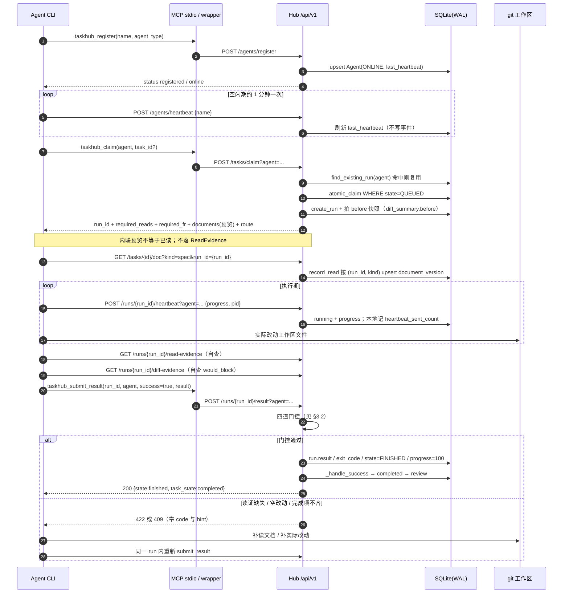
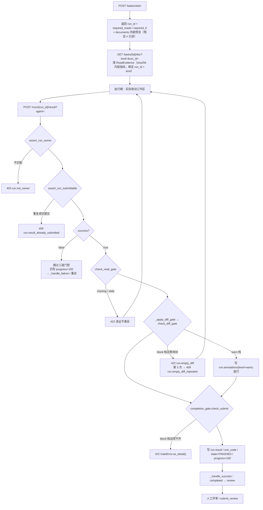

# Agent 接入协议与门控位置设计（Phase 2 / 任务 #3）

> 编制：安智体（智能体应用工程师）｜取证日：2026-11-06
> 对象：`E:\work\code\agent-dev\mio-taskhub` 现有 v0.6.1 代码库。本章属方案编制，不修改任何源码。
> 事实底稿：`docs/taskhub/_delivery-fact-pack.md`、`docs/taskhub/frozen-scope-20261021.md`、`docs/roadmap/01-positioning.md`、`docs/roadmap/05-execution-plan.md`、`delivery-plan/phase1-requirements.md`、`delivery-plan/phase1-architecture.md`、`delivery-plan/final-delivery-plan.md`（§0.2 六条裁决、§0.4 分册索引）。
> 源码复核：`mio_taskhub/api/runs.py`、`api/tasks.py`、`api/agents.py`、`api/claim.py`、`api/hall.py`、`api/reviews.py`、`mcp_server.py`、`mcp_risk.py`、`diff_gate.py`、`read_evidence.py`、`completion_gate.py`、`background.py`、`heartbeat.py`、`observability/lifecycle.py`、`packaging/agent_wrapper.py`、`main.py`、`models.py`。
> 口径声明：本章描述已落地项目的接入契约与门控落点，不是新建系统设计。系统不编排 LLM、不调用模型 API、不做 RAG。文档门控只用「结构完整性校验」与「服务端强制」两个口径。门控位置为**推断档、未验证**（检索日 2026-10-10，检索未发现 ≠ 不存在）。成本与工期只给假设前提，不给确定数字。不确定处标【待确认】。窄门禁状态一律写「代码已落地、灰度观察未成立」。

---

## 1. 本章定位与智能化边界

mio-taskhub 是服务多个编码 Agent 的本地协调中枢，但自身不编排 LLM。领取、超时、状态流转、门控全部是确定性逻辑。本章界定「多 Agent 如何接入、门控落在哪条必经路径、Agent 生命周期如何可判定」，不设计 Prompt 编排、不设计检索增强、不引入模型推理环节。

| 环节 | 用模型 / 用规则 | 理由 | 失败影响 |
|---|---|---|---|
| Agent 注册与在线判定 | 规则（`last_heartbeat` + 阈值比较） | 只需时间戳比较，`AGENT_TIMEOUT_SECONDS=180`（`background.py`） | 判死过早会把仍在执行者标记 OFFLINE；`heartbeat.py:25-29` 已因实测抖动把 run 超时由 120s 上调至 360s |
| 任务领取与抢占 | 规则（SQL 条件更新 `state=QUEUED`） | 需要可重复的原子结果，不允许概率性选单 | 抢占条件漏写会导致双发；现由 `atomic_claim` 的 `WHERE` 兜底 |
| 能力匹配与派单 | 规则（`build_relevance` 排序 + 类型匹配） | 匹配是排序问题，不是理解问题 | 排序不硬排斥，只会领到低相关任务，不产生错误状态 |
| 读证门控 | 规则（文件内容指纹比对） | 判据是 `sha256` 字符串相等 | 指纹口径偏了会误拦；见 §3.5 覆盖边界 |
| 空改动门禁 | 规则（git 快照 `before/after` 比对） | 判据是本次 run 期间工作区有无变更 | 采集失败按 fail-open 跳过，不拦人 |
| 完成门禁 | 规则（结构完整性校验，`CHECK_ORDER` 逐项） | 校验字段与产出物是否齐备 | `warn` 档只记录不拒绝 |
| 状态流转与交接 | 规则（`workflow.transitions` 状态机） | 状态必须由服务端单方裁定 | 若交给 Agent 自报直接采信，则「完成」只代表 Agent 自己说完成了 |
| 生命周期诊断（D1） | 规则（本地 jsonl 计数 + Hub 事件对账） | 判定「本地已发 ∧ Hub 未收」是计数问题 | 结论收敛为诊断可读化，不改动超时/门控/事务 |

结论：全链路零模型调用，Token 成本为 0。智能化投入集中在「确定性判据是否采得全、采得准」，不集中在模型能力。任何把状态判定或门控结论交给模型复述的方案都不在本章范围内。

---

## 2. Agent 接入协议（编排设计与工具定义）

### 2.1 三通道分工

| 通道 | 入口 | 传输 | 适用范围 | 边界 |
|---|---|---|---|---|
| MCP stdio | `python -m mio_taskhub.mcp_server` | FastMCP stdio → 进程内 HTTP 薄代理到 `/api/v1` | 主接入方式，56 工具（事实包 §2 口径） | `mcp_risk.check(method, path)` 在 `_request` 统一收口，`mcp_risk` 只在 MCP 通道生效；4xx 被压成 `{"error": "HTTP <code>: <text[:200]>"}`，拿不到完整结构化 detail |
| REST | FastAPI `/api/v1`，默认 `127.0.0.1:48620` | HTTP，单 Bearer token 仅作用于 `/api/*`（`MIO_TASKHUB_TOKEN`） | 被 MCP 代理调用，或直接调用 | 端点契约见 `phase2-backend.md`；`main.py:250-251` 挂载 `agents.router`、`runs.router` |
| wrapper 降级 | `packaging/agent_wrapper.py` | `urllib.request` 直连 REST，超时 10s | 无 MCP 能力的 Agent CLI | 只有 6 个 action：`register \| claim \| heartbeat \| result \| heartbeat-agent \| list`；**没有** `read_document`、`read_status`、`diff-evidence`，降级路径需自行补落 ReadEvidence 与提交前自查 |

三通道共用同一套服务端门控。走 wrapper 不会绕过 `submit_result` 上的校验，但会因缺少读证工具而在成功提交时命中 422，需在降级路径上补 `GET /tasks/{task_id}/doc?kind=...&run_id=...`。

### 2.2 接入全链路：端点与关键字段

| 步骤 | REST 路径 | MCP 工具 | 入参 / 关键字段 | 返回 / 错误 |
|---|---|---|---|---|
| 注册 | `POST /api/v1/agents/register` | `taskhub_register` | body：`name`（必填）、`agent_type`（可选；MCP 默认 `"cli"`，REST 未传为 `""`，`agents.py:27`） | 新注册 `{"name","status":"registered"}`；重复注册 `{"name","status":"online"}` 并刷新 ONLINE 与 `last_heartbeat`；缺 name → 400 `{"error":"name is required"}`；发 `agent_registered` 事件 |
| Agent 保活 | `POST /api/v1/agents/heartbeat` | `taskhub_agent_heartbeat` | body：`name` | `{"name","status":"online","last_heartbeat":ISO}`；未注册自动 upsert，`agent_type="cli"`；**不写事件**（防心跳事件风暴）；建议约 1 分钟一次 |
| 领取 | `POST /api/v1/tasks/claim` | `taskhub_claim` | query：`agent`（必填）、`agent_type`、`task_id`、`project`、`workspace`、`files`、`project_scope` | 返回 `id`（= run_id）、`task_id`、`state`、`agent_name`、`attempt`、`required_reads`、`required_fr`、`documents`（内联预览）、`lessons`、`route`；无任务 → 204；见 §2.5 幂等 |
| 执行期心跳 | `POST /api/v1/runs/{run_id}/heartbeat` | `taskhub_heartbeat` | query：`agent`（**必填**，所有权校验）；body：`progress`、`pid`、`checkpoint` | 更新 run 为 running、上报进度；`agent` 不匹配 → 403 `run.not_owner`；同时触发 `note_heartbeat_sent` 本地埋点（§7） |
| 落读证 | `GET /api/v1/tasks/{task_id}/doc?kind=&run_id=&agent=` | `taskhub_read_document` | `kind`、`run_id`（传则记 ReadEvidence）、`agent` | 不传 `run_id` 只返回正文，不产生 evidence |
| 读证自查 | `GET /api/v1/runs/{run_id}/read-evidence` | `taskhub_read_status` | `run_id` | `required_reads` / `read_ok` / `missing` / `missing_files` / `stale` / `enforced` / `passed` / `gate_kinds` |
| diff 自查 | `GET /api/v1/runs/{run_id}/diff-evidence` | 【待确认】是否已有对应 MCP 工具 | `run_id` | `mode` / `would_block` / `skipped` / `before` / `after`；只读，与 submit 同一套 `check_diff_gate`，不改 run、不落事件 |
| 提交 | `POST /api/v1/runs/{run_id}/result` | `taskhub_submit_result` | query：`agent`（必填）；body：`success`、`result`、`exit_code`、`evidence` | 成功 `{id,state,result,task_state}`；门控错误见 §4.3；失败且未超重试 → `task_state=retrying` + `retry_at` + `backoff_seconds` |
| 释放 / 拒单 | 源码未见专用端点 | 无 | — | `grab-mode/api.md` 是 draft contract，`/grab`、拒单、释放、`GrabAttempt`、`decline_limit`、`cooldown` 等均未落地；`grab-mode/requirement.md` 已列为非目标。当前释放由超时回收（`heartbeat.py` / `background.py`）与任务取消 `DELETE /api/v1/tasks/{id}` 覆盖。【待确认】是否另有未检索到的入口 |

`POST /tasks/claim` 带 `task_id` 且 `MIO_CLAIM_GATE=block` 时，先做就绪检查，不就绪返回 409 `gate.doc_missing`（`tasks.py:503-515`）。`claim_gate_mode()` 默认 `warn`（`completion_gate.py:60-64`），即默认不拦。

### 2.3 MCP 工具分组（按域）

工具数取事实包 / README 顶部表口径 56；README 正文仍有旧值「40 个 MCP 工具」，属历史残留【待确认】。下表为接入主链路相关工具，完整清单以 `mcp_server.py` 的 `@_tool(name=...)` 为准。

| 域 | 代表工具 | 对应 REST |
|---|---|---|
| 会话入口与决策 | `taskhub_get_me`、`taskhub_read_status`、`taskhub_read_plan`、`taskhub_poll_events`、`taskhub_add_decision`、`taskhub_resolve_decision` | `/status`、`/runs/{id}/read-evidence`、`/events` 等 |
| Agent 生命周期 | `taskhub_register`、`taskhub_agent_heartbeat`、`taskhub_claim`、`taskhub_heartbeat`、`taskhub_submit_result` | `/agents/*`、`/tasks/claim`、`/runs/{id}/*` |
| 任务 CRUD | `taskhub_list_tasks`、`taskhub_get_task`、`taskhub_update_task`、`taskhub_create_task`、`taskhub_cancel_task`、`taskhub_retry_task`、`taskhub_add_subtask`、`taskhub_delete_subtask` | `/tasks`、`/tasks/{id}`、`/tasks/{id}/retry` 等 |
| 文档链 | `taskhub_read_spec`、`taskhub_read_plan`、`taskhub_read_document`、`taskhub_write_document`、`taskhub_list_documents`、`taskhub_set_doc_status`、`taskhub_doc_quality`、`taskhub_doc_revision`、`taskhub_ratchet_status` | `/tasks/{id}/spec`、`/doc`、`/documents`、`/doc/{kind}/status`、`/doc/quality`、`/ratchet` |
| 门控自查 | `taskhub_read_status`、`taskhub_gate_status`、`taskhub_force_generate`、`taskhub_doc_quality` | `/runs/{id}/read-evidence`、`/tasks/{id}/doc/quality` |
| 阶段推进 | `taskhub_advance_stage`、`taskhub_move_to_stage` | `/tasks/{id}/stage`、`/stage/move` |
| 讨论 / 事件订阅 | `taskhub_add_discussion`、`taskhub_open_discussion`、`taskhub_reply_discussion`、`taskhub_poll_events` | `/tasks/{id}/discussions`、`/events` |
| 拆分 | `taskhub_decompose_preview`、`taskhub_decompose_apply` | `/tasks/{id}/decompose/*` |
| 偏离与高风险确认 | `taskhub_log_deviation`、`taskhub_resolve_deviation`、`taskhub_confirm_high_risk` | `/tasks/{id}/deviations/*`、`/tasks/{id}/confirm` |
| 想法评审（冻结域） | `taskhub_ideas`、`taskhub_review_idea`、`taskhub_triage_idea`、`taskhub_breakdown_idea` | `/ideas/*`；代码保留、停投入、不作价值宣称 |
| 记忆查询（冻结域） | `taskhub_memory_query`、`taskhub_memory_analyze` | memory gateway 路由仍挂载（`main.py:270`），不作接入主链路 |

### 2.4 接入时序

### 2.5 心跳时窗与所有权

| 时窗 | 常量 / 默认 | 作用 |
|---|---|---|
| Agent OFFLINE | `AGENT_TIMEOUT_SECONDS = 180`（`background.py`） | `_mark_stale_agents()` 把超时未心跳者标 OFFLINE |
| run 超时 | `MIO_TASKHUB_TIMEOUT_SECONDS = 360`（`heartbeat.py:29`，由 120s 上调） | 覆盖实测心跳间隔 67s~199s 与 D1 lag p50=302.7s |
| Agent OFFLINE 判死 | `MIO_TASKHUB_AGENT_OFFLINE_SECONDS = 120` | run 级存活辅助判据 |
| 宽限期 | `MIO_TASKHUB_GRACE_PERIOD_SECONDS = 60` | 超时前的缓冲 |
| MCP HTTP | `TIMEOUT = 15.0`（`mcp_server.py`） | 代理请求超时 |
| wrapper HTTP | `urlopen(timeout=10)` | 降级路径超时 |
| git 子进程 | `GIT_TIMEOUT_SEC = 5`（`diff_gate.py:29`） | 超时按 fail-open 跳过判定 |

`assert_run_owner(run, agent)` 的 `agent` 为**可选**参数（`runs.py:24-43`）：传了严格校验，不匹配 403 `run.not_owner`；不传则跳过校验以兼容存量调用方。源码注释明确「未传 agent 时仍可凭 run_id 越权，这是已知限制，不是修复完成态」。【待确认】收口排期见 §9。

### 2.6 `mcp_risk` destructive 默认拒

| 项 | 内容 |
|---|---|
| 收口点 | `mcp_server.py::_request`，所有工具调用统一过 `mcp_risk.check(method, path)` |
| denylist | 仅两条正则：`^DELETE\s+/tasks/[^/]+$`（cancel_task）、`^POST\s+/tasks/[^/]+/doc/[^/]+/status$`（set_doc_status） |
| 默认行为 | `destructive` 返回 `allowed=False`；`read` / `write` 放行 |
| 放行开关 | `MIO_MCP_ALLOW_DESTRUCTIVE` ∈ `1 / true / yes / on` |
| 生效范围 | 仅 MCP 通道；REST 直连不受此策略约束，只有 `/api/*` 的单 Bearer token |

差异：工具注解 `destructive=True` 与执行层 denylist 不一致。例如 `taskhub_delete_subtask` 注解 `destructive=True`，但其路径 `DELETE /tasks/{id}/subtasks/{subtask_id}` 不匹配 `^DELETE /tasks/[^/]+$`；`mcp_risk.py:11` docstring 提到的 `MIO_MCP_ALLOW_WRITE` 在 `check()` 中未被读取。【待确认】。

### 2.7 能力匹配、派单时序与抢单模式

`background.py::_scheduler_tick()` 顺序固定为 `_mark_stale_agents()` → `_requeue_retries()` → `_release_dependencies()` → `_assign_to_idle_agents()`（`background.py:515-519`）。第 ④ 步是 task-first 调度，与 Agent 主动 claim 是**两套独立入口**：

| 维度 | 后台派单 `_assign_to_idle_agents` | Agent 主动 `POST /tasks/claim` |
|---|---|---|
| 触发 | 后台 tick 周期性 | Agent CLI 主动发起 |
| 候选集 | `state=QUEUED` + `stage=READY` + `grab_mode == False` + `claimable_task_clause()`（`background.py:402-412`） | `claim_for` → `pick_candidate_task` → `build_relevance` 排序 |
| 排序 | `priority DESC, created_at ASC` | 类型匹配 > 无 target / fallback 到期 > 他人专属（只排序，不硬排斥） |
| 建 run | 直接调 `_claim_for(target.name, ...)`（`background.py:442`），**不经 claim 端点** | 经 `atomic_claim` 条件更新 |
| 上下文 | 不走 `build_claim_context`；`lessons` 挂在 `task_assigned` 事件载荷（`background.py:451-463`） | 走 `build_claim_context`，返回内联预览与 `route` |
| 事件 | `task_assigned`，`reason=idle_assign` | `task_claimed` |

确属事实的时序问题：后台派单与主动 claim 竞争同一批 `grab_mode=false` 的 queued 任务。后台 tick 若先于 Agent 的主动 claim 执行，`_claim_for` 已把任务置为 `CLAIMED` 并建了 run；此后 Agent 再 claim，要么命中 `find_existing_run` 复用自己已有的 run，要么因候选任务不再满足 `state=QUEUED` 而拿到 204。二者靠 `atomic_claim` 的 `WHERE state=QUEUED` 条件更新保证不会双发，但「谁先领到」取决于后台 tick 与 Agent 启动时机的相对关系。

对抢单模式的影响：当前 `grab_mode=true` 的任务已被 FR-4 派单让位排除出后台候选集（`background.py:397-407`），只由 Agent 经只读大厅 `GET /api/v1/tasks/hall` + 既有 `POST /tasks/claim` 领取。因此抢单模式下不会被后台先派；但 `grab_mode=false` 的存量任务上「派单先于 claim」的竞争仍然存在。事实包 §5 把该时序记为抢单「抢不到东西」的根因，FR-4 让位是后续落地的结果；本轮未实测 tick 周期对抢单成功率的影响【待确认】。`api/hall.py` 严格只读，不写库、不发事件、不加价；`requirement.md` 明确不实现悬赏、匹配评分、拒单、失约冷却与竞争人数统计。

### 2.8 人工介入点

| 介入点 | 触发条件 | 人工动作 | 系统约束 |
|---|---|---|---|
| 高风险任务确认 | `POST /tasks/{id}/confirm` | 确认人签字 | `taskhub_confirm_high_risk` 的 desc 要求确认人不能等于最近执行 agent；`reviewer` 仍是自由字符串（§8.2） |
| 文档状态推进 | `POST /tasks/{id}/doc/{kind}/status` | UI 操作或显式放行 | MCP 通道默认拒（`mcp_risk` denylist 第 2 条），需 `MIO_MCP_ALLOW_DESTRUCTIVE` |
| 任务取消 | `DELETE /tasks/{id}` | UI 操作 | MCP 通道默认拒（denylist 第 1 条） |
| 显式豁免空改动门禁 | 无代码产出任务 | `PATCH /tasks/{id}` 设 `diff_gate_exempt=true` | 422/409 的 `hint` 直接给出该路径（§4.3） |
| 门禁档位切换 | 灰度观察结论 | `MIO_DIFF_GATE=warn → block` | 当前 `diff-gate-grayscale-log.md` M1~M5 全「待观察」、切 block 勾选框全空，唯一成功判据 M2 未成立 |

---

## 3. 门控位置设计

### 3.1 为什么四道校验汇聚在 `submit_result`

`submit_result` 是唯一能把「Agent 的一次执行」转成「任务终态」的写入口。前置操作（注册、心跳、claim、read）都不改任务终态；`git push --no-verify` 之类本地绕过手段改变不了 Hub 侧数据库。把校验放在这一个点，理由是：

1. **单点收口**：MCP / REST / wrapper 三通道最终都落到同一个 `runs.py:submit_result`，不需要在三个通道各写一遍判据。
2. **状态裁定权在服务端**：Agent 自报 `success: bool` 只是入参，任务是否 completed 由服务端在通过校验后写。
3. **失败路径可区分**：`success=false` 跳过三道成功门控，但仍写 `progress=100`，走 `_handle_failure` 与重试判定。
4. **迟到结果必须可回写**：见 §5.2，门控不能简单用 `run.state=FINISHED` 一律拒绝。

门控位置为**推断档、未验证**：检索日 2026-10-10，检索范围内未发现同类系统把读证、空改动、完成项校验汇聚于单一提交端点的公开设计；「检索未发现」不等于「不存在」。此处只陈述本仓库源码的落点，不作外部对比结论。

### 3.2 源码顺序与每道校验拦截对象

`mio_taskhub/api/runs.py:316-392`，实测插入点 `runs.py:336-337`（`final-delivery-plan.md` §0.2 裁决 #5）。

| 序 | 代码 | 拦截对象 | 错误 | 仅 `success=true` |
|---|---|---|---|---|
| 0 | `run = db.get(Run, run_id)`；`task = db.get(Task, run.task_id)` | run 不存在 | 404 | — |
| 1 | `assert_run_owner(run, agent)` | 调用方不是 run 持有者（`runs.py:34-43`） | 403 `run.not_owner` | 否 |
| 2 | `assert_run_submittable(run, task)` | 「成功结果已交接」后的重复成功提交（`runs.py:46-75`） | 409 `run.result_already_submitted` | 否 |
| 3 | `success = body.get("success", True)` | 读取自报标志 | — | — |
| 4 | `check_read_gate(db, task, run_id)` → `_read_gate_detail(gate)` | 本次 run 未读必读文档 / 文档读后被改动 | 422，detail 含 `message`、`required_reads`、`missing`、`stale`、`hint` | 是 |
| 5 | `_apply_diff_gate(db, task, run, body)` → `check_diff_gate` | 声明成功但工作区零改动 | 422 `run.empty_diff` / 409 `run.empty_diff_repeated` | 是 |
| 6 | `completion_gate.check_submit(db, task, run, body)` | 完成项不齐（结构完整性校验） | `GateError` → `HTTPException(exc.status, exc.as_detail())`；默认 `warn` 只记录 `gate_issues` | 是 |
| 7 | 写 `run.result` / `exit_code` / `finished_at` / `state=FINISHED` / `progress=100` | — | — | 否（成功失败都写） |
| 8 | `_handle_success` 或 `_handle_failure` | 任务终态流转、失败重试 | — | — |

`completion_gate.CHECK_ORDER = ("result_not_empty", "deliverables_exist", "verification_passed", "no_unresolved_high_deviation", "not_zero_diff")`，`MIO_COMPLETION_GATE` 默认 `warn`，只有 `block` 档拒绝；`GateError.as_detail()` 返回 `{"code","message","detail"}`。`_apply_diff_gate` 抛 422/409 前必须 `db.commit()`（`runs.py:478`），否则 `get_session` 退出不 commit，拦截事件随会话丢弃。

### 3.3 门控链路

### 3.4 服务端强制与本地绕过

`git push --no-verify` 只影响客户端 git hook，不改变 Hub 进程内的数据库。Agent 无论用哪个通道、是否执行本地 hook，`submit_result` 都会重新走 §3.2 的 1~6 步：读证查 `ReadEvidence` 表，空改动查工作区快照与 `diff_summary.before`，完成项查任务字段与产出物。文档门控口径为「结构完整性校验」与「服务端强制」。

边界：`assert_run_owner` 的 `agent` 可选且不传即跳过（§2.5），这是当前唯一已知的、可凭 `run_id` 绕过所有权校验的缺口；它不是门控设计意图，是兼容存量调用方的遗留限制【待确认】。

### 3.5 ReadEvidence 边界

| 项 | 实现 |
|---|---|
| 指纹 | `file_fingerprint(path)` 返回 `"sha256:" + h.hexdigest()`（`read_evidence.py:80`）；文件不存在 / 不可读返回 `""` |
| 存储键 | `record_read` 按 `(run_id, document_kind)` upsert（`read_evidence.py:140-169`），`latest_evidence` 用 `WHERE run_id AND document_kind` 取最新一条 |
| 字段 | `document_version=fp`、`requirement_ids=frs`、`read_at`、`agent_name` |
| 门控判据 | `check_read_gate` 对 `required` 逐项比 `fp`：`ev is None` → `missing`；`(ev.document_version or "") != fp` → `stale`；相等 → `read_ok`；`passed = not missing and not stale`（`read_evidence.py:173-209`） |
| 必读种类 | `DEFAULT_READ_KINDS = ("spec", "api", "requirement")`；受 `MIO_READ_GATE`、`MIO_READ_GATE_KINDS`、`MIO_READ_GATE_MISSING`（默认 `block`）控制 |
| 内联预览 | `claim` 返回的 `documents` 与 `build_claim_context` **不产生 evidence**（`read_evidence.py:275`）；必须 `taskhub_read_document(..., run_id=<本 run>)` |

**关键边界**：`document_version` 只覆盖被读文档，不覆盖代码。因此读证通过只说明「必读文档读过且版本一致」，不说明「代码按文档实现」；「完成」在窄门禁之前只代表 Agent 自报 `success: bool` 被直接采信。窄门禁补的是「声明成功但工作区零改动」这一项，不补代码与规格的一致性判定。

---

## 4. 窄门禁的 Agent 侧契约

状态口径：**代码已落地、灰度观察未成立**。`diff_gate.py`、`api/runs.py`、`web/src/App.jsx`、`web/src/components/TaskDetail.jsx` 三链路均已实现，`GET /api/v1/board/diff-gate-stats` 为纯统计、不参与流程判定的必要配套。排期不含从零开发；`diff-gate-grayscale-log.md` 起止仍为 `____-__-__`、M1~M5 全「待观察」，切 block 的三个勾选框全空。

### 4.1 开关、常量与 fail-open

| 项 | 值 / 行为 |
|---|---|
| `MIO_DIFF_GATE` | `off \| warn \| block`，`DEFAULT_GATE_MODE = "warn"`；`off` → 200 且**不留任何标注**（`runs.py:435-436`） |
| `MAX_REJECTIONS` | `2`（`diff_gate.py:33`） |
| `MAX_PATHS` / `GIT_TIMEOUT_SEC` | `50` / `5`（变更路径截断、git 超时按 fail-open 跳过） |
| `EXEMPT_TASK_KINDS` | `("idea_review", "change_tracking")`，本就不一定改代码 |
| `ACTIVE_RUN_STATES` | `("claimed", "running")`，用于并发判定 |

`check_diff_gate` 的跳过优先级（`diff_gate.py:292-318`）：`gate_off` > `no_task` > `no_workspace` > `task_exempt` > `task_kind_exempt` > `concurrent_run` > `collect_failed` > `no_before_snapshot`。以上一律 `skipped=True` 并写 `reason`；判据采不到信息时一律视为「有改动」。`warn` 档零改动只写 `reason=empty_diff_warn` 标注、不拦；只有 `block` 档零改动才 `blocked=True`。设计原则是只在「明确的假完成」上拦截，测试未跑、diff 质量等一律降级为标注。

### 4.2 工具 / 端点定义表

| 工具 | 用途 | 入参 Schema（关键字段） | 幂等 | 副作用 | 超时 | 权限 |
|---|---|---|---|---|---|---|
| `taskhub_register` | 注册 / 刷新在线 | `{name*, agent_type?}` | 是（重复注册刷新） | 写 Agent、发事件 | MCP 15s | `MIO_TASKHUB_TOKEN`（`/api/*`） |
| `taskhub_agent_heartbeat` | Agent 保活 | `{name*}` | 是（upsert） | 写 `last_heartbeat`，不发事件 | MCP 15s | 同上 |
| `taskhub_claim` | 领取 / 幂等复用 | `{agent*, agent_type?, task_id?, project?, workspace?, files?}` | 是（`find_existing_run` 复用） | 写 Task/Run、拍 before 快照、发 `task_claimed` | MCP 15s | 同上 |
| `taskhub_read_document` | 读文档 / 落读证 | `{task_id*, kind*, run_id?, agent?}` | 是（按 `(run_id, kind)` upsert） | 写 ReadEvidence | MCP 15s | 同上；`mcp_risk` 判 read |
| `taskhub_read_status` | 读证自查 | `{run_id*}` | 是 | 无 | MCP 15s | 同上 |
| `GET /runs/{id}/diff-evidence` | 提交前空改动自查 | path `run_id` | 是（只读） | 无，不改 run、不落事件 | MCP 15s | 同上 |
| `taskhub_submit_result` | 提交终态 | `{run_id*, agent*, success, result, exit_code?, evidence?}` | 否（受 `assert_run_submittable` 约束） | 写 run 终态、任务流转、事件、outbox | MCP 15s | 同上；`agent` 必填 |
| `taskhub_cancel_task` | 取消任务 | `{task_id*, reason?}` | 否 | 标记 cancelled | MCP 15s | `mcp_risk` **默认拒** |
| `taskhub_set_doc_status` | 文档状态推进 | `{task_id*, kind*, status, force?}` | 否 | 可绕过质量门 / 棘轮 | MCP 15s | `mcp_risk` **默认拒** |
| `PATCH /tasks/{id}` | 设 `diff_gate_exempt` | body 局部字段 | 是 | 写 Task | — | 同上；MCP 注解 `destructive=False` |

### 4.3 错误响应字段

| 状态 | `code` | detail 字段 |
|---|---|---|
| 422 | `run.empty_diff` | `code`、`message`、`hint`（「先在工作区实际完成改动…再 submit_result；若本任务确无代码产出，用 PATCH /tasks/{id} 设置 diff_gate_exempt=true」）、`files_changed: 0`、`rejections`、`max_rejections`（`runs.py:511-519`） |
| 409 | `run.empty_diff_repeated` | 同上 6 字段，`message` 带连续次数（「连续 N 次声明 success 但工作区零改动，本次执行判定失败」），`hint` 提示重新领取或设豁免（`runs.py:500-509`） |
| 422 | 读证不满足 | `message`、`required_reads`、`missing`、`stale`、`hint`（提示补读 missing、重读 stale）（`runs.py:257-266`） |
| 403 | `run.not_owner` | `code`、`message`、`owner` |
| 409 | `run.result_already_submitted` | `code`、`message`、`state` |

409 分支内部已写 `run.exit_code=1`、`run.state=FINISHED`、`run.finished_at`、`run.result=verdict.message`，并调 `_handle_failure` 交既有重试机制。拦截同时发 `run.result_rejected` 事件（`entity="task"`，否则前端不弹 toast）并写 `HistoryEvent(type="rejected")`。

### 4.4 `MAX_REJECTIONS` 语义与源码差异

`runs.py:480` 判据为 `if run.rejections > MAX_REJECTIONS`（`MAX_REJECTIONS=2`），即**第 3 次**才 409 `run.empty_diff_repeated`；前 2 次是 422「请改完重试」。需求 `phase1-requirements.md` FR-B06 写「≥2 → exit_code=1」，属文档差异，以源码为准（`final-delivery-plan.md` §0.2 裁决 #2，文档修订列 W-3）。

拒绝不消耗 `attempt`：同一 run 内改完即可重试，连续拒绝达上限才判本次执行失败、交既有重试机制。因此 422 阶段 Agent 不需要重新 claim，也不能重新 claim（会命中 `find_existing_run` 复用）。

### 4.5 被拦后的操作序列

1. 保持同一 `run_id`，不改状态机、不重新 `claim`。
2. 按 422 `hint` 在工作区实际完成改动（提交或保留改动均可）；若命中读证 422，先 `taskhub_read_document(task_id, kind, run_id=<本 run>)` 补齐 `missing`、重读 `stale`。
3. `GET /api/v1/runs/{run_id}/diff-evidence` 自查 `would_block=false`。
4. 再次 `POST /api/v1/runs/{run_id}/result?agent=...`，`success=true`。
5. 若本任务确无代码产出，用 `PATCH /api/v1/tasks/{id}` 设 `diff_gate_exempt=true`，或确认 `task_kind` 属于 `EXEMPT_TASK_KINDS`。
6. 连续被拒到第 3 次会收到 409，此时 run 已置失败并进入重试判定，需重新领取。

### 4.6 提交前自查与呈现差异

`GET /api/v1/runs/{run_id}/diff-evidence` 与 `submit_result` 使用同一套 `diff_gate.check_diff_gate`，返回 `mode`、`would_block`、`skipped`、`before`、`after`；只读、不改 run、不落事件（`runs.py:284-307`）。【待确认】MCP 通道是否已有对应工具，若无则降级路径需直连 REST。

`run.annotations` 按 `level` 呈现：

| level | 写入条件 | 前端呈现 |
|---|---|---|
| `warn` | `warn` 档零改动、`skipped` 各 reason | `TaskDetail.jsx` 渲染「提示」，不打断 |
| `block` | `block` 档零改动，`code=run.empty_diff` | 渲染「已被拦截」；`App.jsx` 对 `run.result_rejected` 事件弹打断式红色 toast |
| 无标注 | `off` 档 | 业务数据里不留任何痕迹 |

### 4.7 Agent 侧最小改动清单（不改状态机）

1. `register` / `agent_heartbeat` 用同一个 `name`，保活间隔小于 180s。
2. `claim` 时若要点名任务必须传 `task_id`；不传按相关度挑选，可能领到其他任务。
3. 对 `required_reads` 逐项调 `read_document(..., run_id=<本 run>)`；内联预览不算已读。
4. 所有写操作带 `agent` 参数（`heartbeat` / `submit_result`），避免 403 与所有权缺口。
5. 执行期按小于 360s 间隔发 run 心跳并上报 `progress`。
6. 提交前自查 `read_status` 与 `diff-evidence`，按 `would_block` / `passed` 决定是否补改动。
7. 收到 422 按 §4.5 在同 run 内补做后重试；不要把 422 当 `success=false` 处理。
8. 失败提交照常走 `success=false`；不接受「用 `diff_gate_exempt` 掩盖零改动」作为常规路径。

---

## 5. 多 Agent 并发与幂等

### 5.1 `find_existing_run` 只按 `agent_name` 过滤

`runs.py:80-84` 与 `tasks.py:516-518` 的查询均为 `WHERE Run.agent_name == agent AND Run.state IN (CLAIMED, RUNNING)`，**不按 task 过滤**。后果：

- 同一 Agent 重复 `claim`（即使带不同 `task_id`）会复用已有 run，`task_id` 被忽略，不会新领任务。
- 一个 Agent 同时只能有一个活跃 run，「单 Agent 并发领多任务」在当前实现下不成立。
- 后台派单的并发保护同样依赖这个查询：`_assign_to_idle_agents` 在 `_claim_for` 返回后检查 `run.task_id != t.id` 就 `rollback` 跳过（`background.py:446-449`）。
- 抢占本身靠 `atomic_claim` 的 `sa_update(Task).where(Task.id==..., Task.state==QUEUED, claimable_task_clause()).values(state=CLAIMED)` 条件更新，`rowcount != 1` 即回滚，保证不会双发。

【待确认】「不按 task 过滤」是有意的单活跃 run 约束，还是需要收敛的缺陷；两种解释对接入契约影响不同。

### 5.2 `late_result_recovery` 必须保留

`assert_run_submittable`（`runs.py:46-75`）**只拦**「成功结果已交接后的重复成功提交」，判据是 `run.state=FINISHED` 且 `run.exit_code==0` 且 `task.state==COMPLETED`；不拦迟到结果。原因：reaper 判超时把 run 置 finished 后，Agent 迟到的成功提交仍需返回 200，由 `_handle_success` 在 `task.state==FAILED` 且 `_is_system_timeout_failure(db, task)` 为真时改判回 COMPLETED（`runs.py:522-540`），否则库里会留下 `task=FAILED` + `run=成功/exit0` 的矛盾态。`tests/test_timeout_misjudge.py` 是该链路的护栏。

判据**不能**用 `progress == 100`：`submit_result` 对成功与失败**都**把 `progress` 置 100（`runs.py:349`），用它做判据会把「失败后迟到的成功」误判成重复提交。

### 5.3 失败路径与终态写入

`success=false` 时 §3.2 的第 4~6 步全部跳过（`if success and task is not None`），但第 7 步照常写 `state=FINISHED`、`progress=100`，随后 `_handle_failure` 按 `max_retries` 决定 `retrying` 或 `failed`。提交成功后还有 `enqueue_outcome` 异步写回 runtime，放在 `db.commit()` 之后，写回失败不回滚已完成任务、不改变响应结构（`runs.py:370-387`）。

---

## 6. 上下文治理与知识边界

本章不设计 Prompt、不设计 RAG、不设计上下文窗口预算，原因是系统不调用模型。为免把「接入上下文」误写成 LLM 上下文，列出实际存在的上下文分区：

| 区块 | 载体 | 预算 / 上限 | 压缩策略 |
|---|---|---|---|
| 任务必读文档 | `claim` 返回 `documents` 内联预览 | `INLINE_CAP = 8000`（`read_evidence.py`） | 超限截断为预览，正文靠 `read_document(kind)` 单独取 |
| 必读清单 | `required_reads` / `required_fr` | 由 `DEFAULT_READ_KINDS` 与 `MIO_READ_GATE_KINDS` 决定 | 只下发清单，不下发正文 |
| 读证 | `ReadEvidence.document_version` | 每 `(run_id, kind)` 一条 | 按 `(run_id, kind)` upsert，不累积历史 |
| 同项目参考 | `lessons`（主动 claim）/ `task_assigned` 事件载荷（后台派单） | — | 取不到置空，不影响领取 |
| 改动证据 | `Run.diff_summary` | `before` 6 字段，`after` 仅 `{files, insertions, deletions}`；路径列表 `MAX_PATHS=50` | 超 50 条截断，不影响判定 |
| 路由决策 | `claim` 返回 `route` | 单条 | 异常降级为 `null`，不参与排序 |

`build_claim_context` 的内联预览是**任务上下文**，不是模型上下文；`required_reads` 是**必读约束**，不是检索召回。memory gateway 路由仍挂载（`main.py:270`）但已冻结，不作接入主链路，也不作为门控判据来源。

---

## 7. Agent 生命周期可判定性（D1）

### 7.1 两级证据与真相源

| 事件类型 | 含义 | 采集位置 |
|---|---|---|
| `agent_lifecycle.agent_ready` | Agent 进程就绪 | `observability/lifecycle.py` |
| `agent_lifecycle.process_alive` | 进程存活探测 | 同上，`probe_process_alive(run_id, pid)` |
| `agent_lifecycle.heartbeat_sent_count` | 本地已发心跳计数（含 `delivered` 标志） | `mcp_server.py::taskhub_heartbeat` 调 `note_heartbeat_sent(run_id, delivered)`；`delivered = not ("error" in resp)` |

真相源为本地文件 `$MIO_HOME/lifecycle/<writer_pid>/<run_id>.jsonl`，不经 Hub 事件表。`scripts/ingest_lifecycle.py` 是唯一回填通道，非实时、幂等键 `(type, run_id, ts)`。埋点走 `Queue(1000)` + daemon worker，`put_nowait` 全吞，写盘 / 探测失败不影响业务返回；T0.7 边界明确不改 reaper、timeout、门控、事务。

### 7.2 判定条件与三分根因

C3 判定：`本地已发 sent>0 ∧ Hub 未收`。单机 C 类故障与网络分区在该判据下**不可分**——本地计数只能证明「发出过」，不能证明「链路哪一段断」。按此把首启失败分三类：真死、链路断、观测不足。

G2 实测值：`01-positioning.md`，首启 n=234，成功率 81.9%；reaper n=444；根因分布 真死 27.7% / 链路断 70.9% / 观测不足 1.4%。`heartbeat.py:25-29` 记录 D1 实测 lag p50=302.7s 对原 timeout 300s（margin +8.1s），据此把 run 超时上调至 360s。

T2.4 三态判据（≥90% 成立 / 70–90% 部分成立 / <70% 不成立）下 D1 为**部分成立**。结论收敛为「诊断可读化」：埋点让「链路断」可被区分出来，但不修复它。70.9% 的根因在项目外（Agent CLI / 运行环境），项目内可做的是把判据采全、把矛盾态回写正确（§5.2），不是新增编排或自治恢复。

---

## 8. 评测、自报治理与兜底

### 8.1 评测指标与三态结论

| 指标 | 定义 | 目标 | 测量方式 |
|---|---|---|---|
| V1 门控效应 | 开关窄门禁前后任务完成质量差异 | n≥30/组，4 周封顶 | 真实 Agent A/B（`04-experiment-design.md`）；当前 n=1，B 系列 defer，结论**证据不足** |
| V2 质量分层 | `quality_strata.py` 分层差异 | Fisher 精确检验 | 观察性数据，p=0.037，非对照，不能替代 V1 |
| D1 判定率 | C3 判据可判定样本占比 | ≥90% 成立 | 本地 jsonl + Hub 事件对账，实测部分成立 |
| 灰度零误伤 | 切 `block` 前 M2 判据 | M1~M5 全观察完成 | `diff-gate-grayscale-log.md`，当前 M1~M5 全「待观察」，M2 未成立 |
| 迟到结果纠正率 | `late_result_recovery` 命中后任务状态一致 | 无 `FAILED + exit0` 矛盾态 | `tests/test_timeout_misjudge.py` |

M / B / P 三层证据（M 机制层，脚本 / TestClient；B 行为层，真实 Agent A/B；P 质量层，观察性 Fisher）不得互相替代；结论只允许三态：支持 / 不支持 / 证据不足；多重比较用 Holm 校正。n16 教训（`experiment-cohort-n16-20261002.md`）：n=16、25 run、1.56 run/task、9 次重试、10 次生命周期失败、16/16 最终 completed 且带 ReadEvidence，但样本自然停在 16，属样本自限，不得据此宣称门控效应。

### 8.2 自报 `success` 的治理

Agent 自报 `success: bool` 被直接采信，是窄门禁之前的基线。窄门禁只补「声明成功但工作区零改动」一项，不补代码与规格一致性（§3.5）、不补测试是否执行、不补 diff 质量。`completion_gate` 默认 `warn` 只记录 `gate_issues`。

`submit_review` 自审 409 缓解（`api/reviews.py`）：`MIN_APPROVE_SUMMARY = 8`；若 `reviewer` 等于该任务最近一次 run 的 `agent_name` 且未显式 `self_review=true`，返回 409 `review.self_approval`。剩余身份隔离缺口：`reviewer` 仍是自由字符串，`self_review=true` 可显式放行，系统没有 run 级凭证或身份体系（`runs.py:31-32` 亦把该缺口列为已知限制）。

### 8.3 降级路径

本系统无模型，因此「多模型兜底 / 模型降级」不适用。实际存在的降级：

| 场景 | 降级动作 |
|---|---|
| MCP 不可用 | 切 `packaging/agent_wrapper.py` 直连 REST；需自行补落 ReadEvidence 与 diff 自查 |
| 门控采集失败 | fail-open 跳过并写 `reason`，不拦人（§4.1） |
| `block` 档误伤 | 回退 `MIO_DIFF_GATE=warn`；当前默认即 `warn` |
| 完成项不齐 | `MIO_COMPLETION_GATE=warn` 只记录，切 `block` 才拒绝 |
| run 判死后迟到成功结果 | `late_result_recovery` 回写 COMPLETED（§5.2） |
| 连续 3 次零改动 | 409 判本次执行失败，交既有重试机制，不无限重试 |
| 空改动豁免 | `diff_gate_exempt=true` / `EXEMPT_TASK_KINDS`，留痕在 `reason=task_exempt` |

### 8.4 成本（假设前提，不给确定数字）

系统零模型调用，Token 成本为 0；接入侧成本集中在本地 git 子进程（`GIT_TIMEOUT_SEC=5` 上限）、SQLite 写入与事件广播，随 run 数线性增长。若需折算金额，须先给定三项假设：日活 run 数、平均改动文件数（`MAX_PATHS=50` 截断）、单机硬件与并发 Agent 数。工期同理：仅在假设「单人全职 + Agent 辅助、已熟悉本仓库、含设计 / 实现 / 测试 / 取证，不含外部评审等待、审批墙钟、分发运营」下讨论；灰度观察（M1~M5）是唯一无法用开发工时压缩的关键路径。

### 8.5 对外表达纪律

- 禁用「提升质量」「形成闭环」「生产级可靠」「首创 / 突破」。
- 文档门控只写「结构完整性校验」与「服务端强制」。
- 门控位置写推断档、未验证，检索日 2026-10-10，「检索未发现」不等于「不存在」。
- **Star / Trending / fork / 转发数不得作为任何 Gate 判据**（`05-execution-plan.md`）。
- 窄门禁状态写「代码已落地、灰度观察未成立」，不写待开发。
- 评测结论只用三态，p 值与观察性数据不得写成因果结论。

---

## 9. 明确边界、冻结清单与【待确认】

### 9.1 不做什么（逐条依据）

| 不做 | 依据 |
|---|---|
| 不编排 LLM、不引入模型推理环节 | 系统定位为确定性协调中枢；状态机 / 门控全部规则化 |
| 不用 LLM 替代确定性状态机 / 门控 | `workflow.transitions` 与 `submit_result` 已落地；模型复述会引入不确定性 |
| 不做 RAG / 知识库 | memory gateway 已冻结；读证是文件指纹比对，不是检索召回 |
| 不重启 creativity 调度与 idea 自动评审 | 冻结清单第 1、6 项；`MIO_OBSERVER_AUTOSTART` 默认 off |
| 不做 D2-b 协议化 | V1 门控效应证据不足（`01-positioning.md`） |
| 不做 D3 完成回执 | 无消费方（`03-technical-gap.md`） |
| 不新增抢单经济模型 / 拒单额度 / 失约冷却 | `grab-mode/requirement.md` 非目标清单；`api/hall.py` 严格只读 |
| 不新增虚构功能或端点 | 交付方案只描述已落地代码；draft contract 不写成事实 |

### 9.2 冻结清单 8 项（不解冻）

creativity 调度、observer 机会发现、Prometheus / SLO / tracing、memory gateway、ADR 投影、idea 子系统扩张、超出结构校验的文档质量阈值、多入口合并。

冻结定义：代码不删、接口不删、文档保留；停投入、停调度、停当价值宣称、移出主链路。`MIO_DIFF_GATE` 不是冻结项，是**唯一投入项**的灰度开关，默认 `warn`；`MioDigestJob`、`ContractJob` 未纳入冻结，默认仍开。

### 9.3 【待确认】项

| # | 事项 | 现状 / 需确认内容 |
|---|---|---|
| 1 | 门控位置 | 推断档、未验证；检索日 2026-10-10，检索未发现 ≠ 不存在 |
| 2 | 释放 / 拒单端点 | 源码未见专用端点；`grab-mode/api.md` 为 draft contract，`requirement.md` 列为非目标。是否另有未检索到的入口 |
| 3 | 派单 / claim 时序 | 「派单先于 claim」在 `grab_mode=false` 任务上确属事实，FR-4 让位只覆盖 `grab_mode=true`；tick 周期对抢单成功率的影响未实测 |
| 4 | `mcp_risk` 注解一致性 | 注解 `destructive=True` 与两条 denylist 正则不一致；`MIO_MCP_ALLOW_WRITE` docstring 提及但 `check()` 未读取 |
| 5 | diff-evidence 的 MCP 工具 | REST 端点已存在，是否有对应 MCP 工具未确认；降级路径需直连 REST |
| 6 | 所有权校验缺口 | `assert_run_owner` 的 `agent` 可选、不传即跳过（`runs.py:24-32` 标为已知限制）；收口排期 |
| 7 | `find_existing_run` 不按 task 过滤 | 是有意的单活跃 run 约束，还是待收敛缺陷 |
| 8 | 工具数口径 | 事实包 / README 顶部表 56，README 正文旧值 40；另有 docstring「47 处调用」 |
| 9 | 档位切换判据 | `MIO_COMPLETION_GATE` / `MIO_CLAIM_GATE` 默认 `warn`，切 `block` 的灰度判据未取证 |
| 10 | MCP 4xx 压缩 | 4xx 被压成 `{"error": "HTTP <code>: <text[:200]>"}`，422 的 `required_reads` / `missing` / `stale` 在 MCP 通道会丢，Agent 自纠错需改走 REST 或 `read_status` |
| 11 | 文档差异 | FR-B06「≥2」vs 源码 `> MAX_REJECTIONS`（第 3 次）；已以源码为准，文档修订列 W-3 |
| 12 | 成本 / 工期 | 只给假设前提（§8.4），未给定日活 run 数与硬件前不出金额与日历 |
