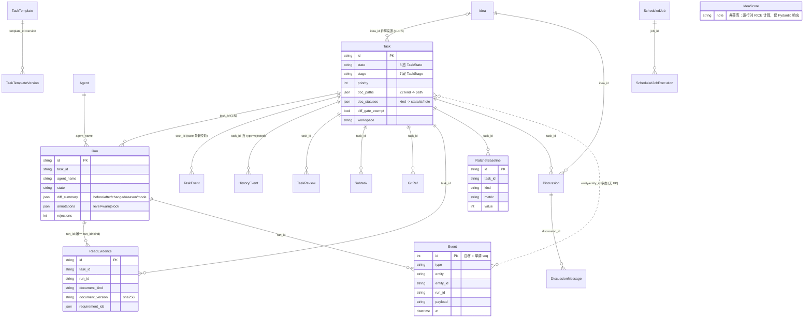

# 数据模型、窄门禁数据与迁移治理策略（Phase 2 / 任务 #4）

> 编制：储海量（数据建模工程师）｜取证日 2026-11-06
> 主理人归档说明：保留全部结论、码位、表格与待确认项；示例 JSON 与冗长推导从略，完整原文由主理人留存。
> 事实底稿：`docs/taskhub/_delivery-fact-pack.md`；已完整读完 `phase1-requirements.md`、`phase1-architecture.md`。
> 源码复核：`models.py`（646 行）、`db.py`、`migrations.py`、`diff_gate.py`、`read_evidence.py`、`ratchet.py`、`events.py`、`api/events.py`、`api/claim.py`、`api/runs.py`、`api/board.py`、`api/task_documents.py`、`api/task_stages.py`、`api/idea_scoring.py`、`doc_paths.py`、`doc_lifecycle.py`、`ops/data_fixes.py`、`ops/backup.py`、`utils.py`、`pyproject.toml`；补充 `docs/roadmap/02-current-state-audit.md`（取证日 **2026-10-10**）、`docs/taskhub/event-consistency-model.md`、`docs/roadmap/05-execution-plan.md`、`tests/test_cancel_reason.py`。
> 数字口径：v0.6.1 / 176 REST / 56 MCP / 1601 用例 / 22 kind 取事实包 §2（2026-11-06）。**生产库行数（383 task / 284 run / 2988 event / readevidence 96 / ratchetbaseline 48 / outboxevent 0 / CANCELLED 186 / task_cancelled 145 / task_doc_status 103 / 26 次无 quality_score）均为 2026-10-10 历史快照，非当前值**；`pyproject.toml` 注释的「1113 passed」为 T0.1 当时基线。引用一律注口径与取证日。

---

## 1. 概念模型 / ER 图

单库单文件 `SQLite(WAL) taskhub.db`，SQLModel 模型在 `models.py` 唯一定义，本次复核共 **26 个 `table=True` 类**。

| 实体 | 说明 | 关键属性 |
|---|---|---|
| Task | 任务主体，三条正交维度汇聚点 | `id`(PK) / `state` / `stage` / `priority` / `doc_paths`(JSON) / `doc_statuses`(JSON) / `diff_gate_exempt` / `workspace` |
| Run | 一次执行（claim 到 submit） | `id`(PK) / `task_id` / `agent_name` / `state` / `diff_summary`(JSON) / `annotations`(JSON) / `rejections` |
| Agent | 注册的 Agent，主键是 name | `name`(PK) / `status` / `last_heartbeat` / `agent_type` |
| TaskEvent | 任务生命周期事件日志（M1），不可变只追加 | `id`(PK,自增) / `task_id` / `event_type` / `from_state` / `to_state` / `from_stage` / `to_stage` |
| Event | 全局事件流，自增 `id` 即单调 `seq` | `id`(PK,自增 seq) / `type` / `entity` / `entity_id` / `run_id` / `payload` / `at` |
| HistoryEvent | 任务动态 tab 的执行历史 | `id`(PK) / `task_id` / `type` / `payload` / `at` |
| Subtask / GitRef / TaskReview | 任务子项 / git 引用 / 审阅记录 | 均按 `task_id`；TaskReview 不可变 |
| ReadEvidence | 本次 run 读过规定版本文档的证据 | `id`(PK) / `task_id` / `run_id` / `document_kind` / `document_version` / `requirement_ids`(JSON) |
| RatchetBaseline | 某任务某 kind 某指标的历史最好值 | `id`(PK) / `task_id` / `kind` / `metric` / `value` |
| Idea / Discussion / DiscussionMessage | 想法 / ADR、讨论、消息 | `Idea` 含 `novelty/feasibility/impact` 三评分列 |
| **IdeaScore** | **非落库实体**：`api/idea_scoring.py::_calculate_idea_score()` 运行时算 RICE，返回 `IdeaScoreResponse`（Pydantic），无 ORM 表、无 `db.add` | 全部派生 |
| TaskTemplate / TaskTemplateVersion | 模板与版本快照 | `(template_id, version)` |
| ScheduledJob / ScheduledJobExecution | cron 定时任务与执行日志 | `enabled` / `job_id` |
| OutboxEvent | 事务性发件箱（ADR→Git 投影） | `id`(PK) / `aggregate_id` / `payload`(JSON) / `status` |

另有 `IdeaChange` / `IdeaHistory` / `IdeaUserPref` / `IdeaAssumptionLink` / `RolePrompt` / `AppConfig` / `RouteDecision` / `MioOutbox` / `Decision` 等表，以及 `materials/models.py` 独立素材表，不在 ER 主链内。

### 关系（**全库无 FOREIGN KEY 约束**，关联靠应用层字符串列与查询维持，本期不改）

| 关系 | 基数 | 说明 |
|---|---|---|
| Task → Run / TaskEvent / HistoryEvent / TaskReview / Subtask / GitRef / ReadEvidence / RatchetBaseline / Discussion | 1 : N | 均按 `task_id`；**任务当前 state 是 TaskEvent 最新行的投影**（`models.py:207-211` 注释）；窄门禁拦截走 `HistoryEvent(type=rejected)` |
| Idea → Task | 0..1 : N | `Task.idea_id`（拆解来源） |
| Idea → Discussion → DiscussionMessage | 1 : N → 1 : N | `idea_id` / `discussion_id` |
| Run → ReadEvidence | 1 : N | 唯一键 `(run_id, document_kind)`，重读原地 upsert |
| Run → Event | 1 : N | `Event.run_id`（兼容旧字段）；拦截事件 `entity=task` |
| Agent → Run | 1 : N | `Run.agent_name`；无外键约束 |
| TaskTemplate → TaskTemplateVersion / ScheduledJob → ScheduledJobExecution | 1 : N | `template_id+version` / `job_id` |
| Event（全局流） | 独立 | `entity`/`entity_id` 多态指向 task/idea/discussion/memory，非单一外键；`id` 单调全局 |

### ER 图（Mermaid）



---

## 2. 三条正交维度的建模方式

字段定义见 `models.py:12-58`（枚举）、`doc_paths.py:DOC_KINDS`、`doc_lifecycle.py:DOC_LIFECYCLE`。

| 维度 | 取值 | 承载列 / 落点 | 校验单点 | 约束 |
|---|---|---|---|---|
| ① 执行状态机 | 8 态：`queued / claimed / running / retrying / completed / failed / cancelled / blocked_failed` | `Task.state` | `TaskState.can_transition(src,dst)`（`models.py:22-33` 的 `valid` 字典） | `COMPLETED`/`CANCELLED` 为终态；`BLOCKED_FAILED` 不在 `valid` 任何键中，历史不可达态，由 `ops/data_fixes.py` 规则 8 批量迁回 `queued` |
| ② 7 段研发阶段 | `brainstorming→design→planning→ready→implementing→review→done`（另有持久化专用 `CANCELLED`，共 8 枚举值） | `Task.stage` | `TaskStage.can_advance`（`models.py:46-58`）+ `api/task_stages.py::STAGE_ARTIFACT_REQUIREMENTS` / `LIFECYCLE_GATE` | `advance` 只走相邻一段；`move` 可跳转但保终态；`design` 要求 `requirement` approved + ≥1 Discussion |
| ③ 22 kind + 9 类生命周期 | 22 kind；9 类生命周期口径 = 8 个文档状态机（`DOC_LIFECYCLE` 实测 8 kind：requirement/spec/api/decision/plan/test/milestone/incident）+ Task 自身状态机占位 | `Task.doc_paths`（`kind -> path`）、`Task.doc_statuses`（`kind -> {state,at,note}`） | `doc_lifecycle.validate_transition` / `api/task_documents.py::set_doc_status` | 严格向前、不许回退/跳级、终态不可改判；路径读写经 `_resolve_within_workspace()` 越界校验（逃逸 400） |

**为什么不合成一列**：

1. 状态空间不同且乘积爆炸（8 态 × 7 段 × 22 kind 不是同一量纲）：`state` 描述「这次执行到哪一步」，`stage` 描述「研发流程推进到哪一段」，`doc_statuses[kind]` 描述「某一份文档走到哪一档」。
2. 校验点与时机不同：`state` 由 `can_transition` 单点拒绝非法转移；`stage` 由 `STAGE_ARTIFACT_REQUIREMENTS` 门控（还要查 Discussion 数量）；`doc_statuses` 由 `validate_transition` + 写时 lint + 状态门控 + 棘轮四层校验。合成一列会让三类错误共用一个入口，无法分别给可执行的 `message`/`hint`（架构 §4.2 实测四类门控 422 detail 结构各不相同）。
3. 变更频率与查询模式不同：`claim.pick_candidate_task`（`api/claim.py:81-91`）只按 `state=QUEUED AND stage=READY` 过滤、按 `priority`/`created_at` 排序，完全不碰文档维度；合成一列会让这条高频查询必须解析 JSON 才能过滤。
4. 依赖判定语义：`dependency.py` 的「依赖满足 = `state==completed` 或 `stage==done`」需要两列独立比较。

口径差异：事实包记「9 类生命周期状态机」，`doc_lifecycle.py` 表头 9 行（含 `Task` 行，注释明确「即任务本身 state 机，非文档」），`DOC_LIFECYCLE` 字典只有 8 kind。本文按「8 文档状态机 + Task 状态机占位 = 9 行角色表」记录，列 §9【待确认】。

---

## 3. 物理模型与索引

SQLModel 类型到 SQLite 物理类型：`str→VARCHAR`、`int→INTEGER`、`bool→BOOLEAN`、`datetime→DATETIME`（naive 存储）、`dict/list→JSON`、`Text→TEXT`。枚举列由 SQLAlchemy Enum 默认按**枚举 name（大写）**存字符串，读路径多处 `.lower()` 兼容；`migrations.py:146-155` 有把历史小写 stage 规范为大写的 UPDATE。

### 3.1 核心表字段（节选，含窄门禁列）

**Task**（`models.py:127-203`）

| 字段 | 类型 | 约束 | 默认 | 说明 |
|---|---|---|---|---|
| `id` | VARCHAR | PK | `_uuid()`（uuid4[:8]） | 主键 |
| `title` | VARCHAR | NOT NULL | — | 标题 |
| `state` | VARCHAR(Enum) | NOT NULL | `TaskState.QUEUED` | 执行状态机 8 态 |
| `stage` | VARCHAR(Enum) | NOT NULL | `TaskStage.READY` | 7 段阶段 |
| `priority` | INTEGER | NOT NULL | 0 | claim 排序键 |
| `task_kind` | VARCHAR(Enum) | NOT NULL | `NORMAL` | `normal` / `change_tracking` / `idea_review`；后两者是窄门禁豁免 kind |
| `workspace` | VARCHAR | NOT NULL | `""` | 工作区绝对路径；空 = 窄门禁跳过 |
| `depends_on` / `labels` / `files` / `deliverables` / `deviations` | JSON | NOT NULL | `[]` | 列表列 |
| `doc_paths` | JSON | 可空（迁移回填 `{}`） | `{}` | 22 kind → 相对路径；与旧列 `spec_path`/`plan_path` 保持同步 |
| `doc_statuses` | JSON | 可空（迁移回填 `{}`） | `{}` | kind → `{state,at,note}`；RMW 并发缺陷见 §4 |
| `doc_gate_exempt` | BOOLEAN | NOT NULL | 0 | 文档链门控豁免；迁移把存量全置 1 |
| `diff_gate_exempt` | BOOLEAN | NOT NULL | 0 | 窄门禁豁免；迁移把存量全置 1 |
| `gate_tier` / `gate_tier_reason` | VARCHAR | NOT NULL | `"light"` / `""` | Phase 1 完成门禁档位 |
| `parent_id` / `idea_id` | VARCHAR | 可空, index | NULL / `""` | 层级（只允许一层）/ 拆解来源 |
| `grab_mode` | BOOLEAN | NOT NULL | 0 | 抢单模式；迁移明确「不加索引，布尔列收益极低」 |
| `retry_at` / `last_transition_at` | DATETIME | 可空, index | NULL | 重试时刻 / 最近状态转移时刻 |
| `created_at` / `updated_at` | DATETIME | NOT NULL | `_now()` | 时间戳 |
| `attempt` / `retry_count` / `bounce_count` | INTEGER | NOT NULL | 0 | 计数器 |

**Run**（`models.py:286-307`）

| 字段 | 类型 | 约束 | 默认 | 说明 |
|---|---|---|---|---|
| `id` | VARCHAR | PK | uuid4[:8]（`create_run` 显式赋值） | 主键，`claim` 返回给 Agent |
| `task_id` | VARCHAR | NOT NULL, index | — | 关联 Task |
| `agent_name` | VARCHAR | NOT NULL | — | 关联 Agent.name |
| `state` | VARCHAR(Enum) | NOT NULL | `CLAIMED` | `claimed/running/retrying/finished` |
| `attempt` / `progress` | INTEGER | NOT NULL | 1 / 0 | 尝试序号 / 进度 |
| `diff_summary` | JSON | 可空 | None | **窄门禁核心**；未采集=None（不是 `{}`） |
| `annotations` | JSON | 可空（迁移回填 `[]`） | `[]` | `[{code, level, message, at}]`，`level ∈ {warn, block}` |
| `rejections` | INTEGER | NOT NULL | 0 | 本 run 累计被拒次数 |
| `evidence` / `checkpoint` | JSON / VARCHAR | 可空 | None | Phase 1 证据 / 断点 |
| `result` / `exit_code` | VARCHAR / INTEGER | 可空 | None | 提交结果 / 退出码 |
| `started_at` / `last_heartbeat` / `finished_at` | DATETIME | 可空 | `_now()` / None / None | 时间戳；**无 created_at/updated_at 列** |

**Agent**（`models.py:278-284`）：`name`(PK) / `agent_type`(NOT NULL, `""`) / `status`(Enum, `OFFLINE`) / `last_heartbeat` / `capabilities` / `registered_at`；**无 updated_at 列**。

**Event**（`models.py:373-380`）：`id`(INTEGER PK 自增 = 单调 `seq`) / `type` / `entity`(index) / `entity_id`(index) / `run_id`(index) / `payload`(Text, `json.dumps(ensure_ascii=False)`) / `at`；**无 created_at/updated_at 列**。

**ReadEvidence**（`models.py:239-256`）：`id`(PK) / `task_id` / `run_id` / `document_kind`（三者单列 index）/ `document_version`（`"sha256:" + hexdigest`，文件缺失为空）/ `agent_name` / `requirement_ids`(JSON) / `read_at`；**UNIQUE `(run_id, document_kind)`**（`migrations.py:85-94` 的 `uq_read_evidence_run_kind`）。

**RatchetBaseline**（`models.py:259-275`）：`id`(PK) / `task_id` / `kind`（单列 index）/ `metric`（`score`/`test_cases`）/`value`(INTEGER，只升不降) / `at` / `note`；**UNIQUE `(task_id, kind, metric)`**（`migrations.py:73-82` 的 `uq_ratchet_task_kind_metric`）。

**规范差距如实说明**：岗位输出规范要求「每张表必须有 created_at、updated_at；涉及删除优先软删除」。现有模型不满足：`Run`/`Agent`/`Event`/`ReadEvidence`/`RatchetBaseline`/`TaskEvent`/`HistoryEvent` 只有单一时间戳，没有 `updated_at`；删除走硬删除或状态标记（`state=cancelled`）而非软删除列。这是现状，本期按「冻结 8 项 + 唯一投入项 = 窄门禁」不重设计、不补列，登记为已知口径。

### 3.2 索引方案（已有 / 建议新增）

**已有索引**

| 表 | 已有索引 | 来源 | 服务查询 |
|---|---|---|---|
| Task | `retry_at` / `idea_id` / `parent_id` / `last_transition_at`（单列）；`ix_task_parent_id`；`uq_task_active_change_tracking`（部分唯一：`idea_id WHERE task_kind='CHANGE_TRACKING' AND state NOT IN ('COMPLETED','CANCELLED')`） | `models.py` / `migrations.py:157-162,245-246` | 重试扫描 / 拆解反查 / 层级查询 / 活跃变更跟踪去重 |
| Run | `task_id`（单列） | `models.py:288` | 按任务查 run |
| Event | `id`(PK 自增)；`entity` / `entity_id` / `run_id`（单列） | `models.py:376-378` | 增量订阅 / 按实体查事件 |
| TaskEvent / HistoryEvent / TaskReview | `task_id`（+`event_type` / `decision`） | `models.py:213-214,325,229-230` | 时间线 / 动态 tab / 审阅 |
| ReadEvidence | `task_id`/`run_id`/`document_kind` 单列 + UNIQUE `(run_id,document_kind)` | `models.py:250-253` / `migrations.py:85-94` | `latest_evidence` / `check_read_gate` |
| RatchetBaseline | `task_id`/`kind` 单列 + UNIQUE `(task_id,kind,metric)` | `models.py:270-271` / `migrations.py:73-82` | `_baseline_row` / `list_baselines` |
| Subtask / GitRef / Discussion / DiscussionMessage | `task_id` / `task_id` / `task_id`+`idea_id` / `discussion_id` | `models.py` | 按父实体查 |
| Idea / TaskTemplate / TaskTemplateVersion / ScheduledJob | `last_reviewed_at`/`adr_number`/`adr_status`/`superseded_by`/`novelty`/`feasibility`/`impact`；`title`；`template_id`+`version`；`name`+`next_run_at` | `models.py` | 想法闸门 / 模板 / 调度扫描 |
| observability 表 | `idx_insight_ts` / `idx_insight_kind` / `idx_slosnapshot_ts` / `idx_alertaudit_*` / `idx_depmetricssnapshot_ts` | `migrations.py:500-598` | 冻结域观测 |

**明确「无需新增」**：`events.py` 增量订阅 `WHERE Event.id > after_seq ORDER BY Event.id LIMIT`（PK 天然有序，游标分页而非 OFFSET，`api/events.py:19-31`）；`ReadEvidence(run_id,kind)` upsert（唯一约束覆盖）；`RatchetBaseline._baseline_row`（三列唯一索引完全覆盖）；`diff-gate-stats` 的 `select(Run).all()` + Python 聚合（纯只读统计、低频，加索引无收益）。

**建议新增（本期不实施）**

| 优先级 | 建议索引 | 字段 | 服务查询 | 理由 |
|---|---|---|---|---|
| 高 | `ix_task_claim_queue` | `task(state, stage, priority, created_at)`，或 `... WHERE state='QUEUED'` 部分索引 | `claim.pick_candidate_task`（`api/claim.py:81-91`）：`WHERE state='QUEUED' AND stage='READY'` + `ORDER BY relevance, priority DESC, created_at ASC`；`background.scheduler` 每 30s 扫描 | 全库最高频写前扫描，四列目前**全无索引**。`relevance` 是 `case()` + `func.strftime("%s","now")` 表达式排序，索引只帮过滤段；落索引前须用 `EXPLAIN QUERY PLAN` 实测再定列序 |
| 中 | `ix_task_workspace` | `task(workspace)` | `diff_gate._has_concurrent_run`（`diff_gate.py:231-236`） | 当前全表扫描 Task；`warn`/`block` 档每次 submit 都跑 |
| 中 | `ix_event_type_entity` | `event(type, entity)` | AC-03 查库 `SELECT * FROM event WHERE type='run.result_rejected' AND entity='task'` | `type` 目前无索引；灰度观测低频 |
| 低 | `ix_run_task_state` | `run(task_id, state)` | `_has_concurrent_run` 的 `WHERE task_id=? AND state IN ('claimed','running')` | 已有 `task_id` 单列能过滤，收益有限 |

**分区 / 分表**：当前不需要。单库单文件、1–5 agents 规模，`event` 表历史快照 2988 行量级，`run` 284 行。若 `Event` 持续增长，冷数据归档（`seq < 某水位` 转储后 DELETE）是演进项，前提是「增量订阅方已消费到该水位」且 WS 广播为尽力推送不依赖历史重放 —— 本期不做，不编造容量阈值。

### 3.3 高频查询与优化

| 查询场景 | SQL 要点 | 使用索引 | 优化建议 |
|---|---|---|---|
| 事件增量订阅 | `WHERE id > :after_seq ORDER BY id ASC LIMIT :limit` | `Event.id` PK（已有） | 已用游标分页，勿改 OFFSET；`next_seq = events[-1].seq` |
| claim 候选扫描 | `state=QUEUED AND stage=READY` + `case()` 关联度 + `priority DESC` + `created_at ASC` | 现无（建议 `ix_task_claim_queue`） | 落索引前 EXPLAIN 实测；`first_ready_row` 在 Python 侧再过 `run_at`/readiness |
| ReadEvidence 门控 | `WHERE run_id=? AND document_kind=?` | 唯一索引（已有） | 已覆盖；每个 required kind 各查一次（默认 3 个），批量化收益小 |
| 并发 run 判定 | Task 按 workspace 找兄弟 → 逐兄弟查 Run 活跃行 | 现无（建议 `ix_task_workspace`/`ix_run_task_state`） | N+1 查询；可改单次 join，属代码改造非本期 |
| RatchetBaseline 校验 | `WHERE task_id=? AND kind=? AND metric=?` | 唯一索引（已有） | `check_ratchet` 也是 RMW，与 §4 同类竞争 |
| 拦截事件查库（AC-03） | `WHERE type='run.result_rejected' AND entity='task'` | 现无（建议 `ix_event_type_entity`） | 低优先，灰度期手工查库即可 |
| diff-gate-stats | `select(Run).all()` + Python 分组 | 无 | 纯统计不加索引；`blocked_runs[:50]` 已在响应层截断 |
| `_delivery_quality` / `board` 聚合 | 多表聚合 + 子查询 | 混合 | 架构 §5 记 v3 审计把 `board` 聚合与 `_task_detail` 子查询列为瓶颈；缓存是建议项非已实现，本域冻结不投 |

---

## 4. JSON 列的取舍与并发缺陷

### 4.1 为什么用 JSON 列

`Task.doc_paths` / `Task.doc_statuses` 是 `kind -> ...` 的稀疏映射：22 kind 中单个任务通常只登记几份文档，有生命周期的只有 8 kind。用 JSON 列：

- 避免稀疏宽表（不需要 22 个可空 `*_path` 列 + 8×3 个 `*_state/at/note` 列）。
- 新增 kind 零 DDL：加一个 kind 只需改 `doc_paths.DOC_KINDS`（以及 `DOC_PATTERNS`、`KIND_META` 两处同步点），不用 `ALTER TABLE`。
- 读路径整体取值：`claim` 的 `build_claim_context`、`read_evidence.doc_status`、`task_stages` 的 `LIFECYCLE_GATE`、`completion_gate` 都一次性取整个 dict 在内存判断，无需 22 路 join。
- 迁移成本低：`migrations.py:108-130,188-191` 加列时 JSON 回填 `'{}'`，并把旧列 `spec_path`/`plan_path` 用 Python 组装 JSON 迁入（避免路径含引号/反斜杠拼出非法 JSON）。

`Run.diff_summary` / `annotations` 同理：结构随窄门禁策略演进，一次写入整体替换，不做字段级查询。

### 4.2 读-改-写并发丢更新（已知缺陷）

`set_doc_status`（`api/task_documents.py:571-671`）：

```
588: statuses = dict(getattr(t, 'doc_statuses', None) or {})   # 读：整份 JSON 复制到内存
593: err = validate_transition(kind, cur, state)                # 校验
651: db.commit()                                               # 棘轮基线处先 commit 一次（放大窗口）
660: statuses[kind] = {'state':..., 'at':..., 'note':...}        # 改：只动一个 kind
662: t.doc_statuses = statuses                                   # 写：整份 JSON 覆盖回列
663: db.add(t); 669: db.commit()
```

两个并发请求各自 `db.get(Task, task_id)` 加载到各自 Session 的对象，各自读到同一份旧 `doc_statuses`，各自推进**不同 kind** 的状态，后提交的整列覆盖前一个的修改 → 前一个 kind 的推进丢失。全程没有版本字段、没有行锁（SQLite 无 `SELECT ... FOR UPDATE`，代码里也没有 `with_for_update`）、没有条件 UPDATE、没有乐观锁检查。两个请求都走到 `return {...}` → **接口均返回 200 假成功**。中间 `651` 行的棘轮 `db.commit()` 进一步拉长读与写之间的窗口。

同一模式也出现在：`_apply_diff_gate`（`api/runs.py:421-430`，但同 run 通常单 Agent 顺序 submit，并发面小）、`record_read`（`read_evidence.py:153-166`，有唯一索引兜底，单次只动一行）、`check_ratchet`（`ratchet.py:83-97`，同一 `(task_id,kind,metric)` 并发推进可能丢抬高）。

### 4.3 不改存储前提下的缓解方案与代价

假设前提：单进程模块化单体 hub、SQLite WAL + QueuePool、`busy_timeout=5000`。

| 方案 | 做法 | 跨进程有效 | 代价 |
|---|---|---|---|
| A. 串行化（进程内锁） | 在 `set_doc_status` / `_apply_diff_gate` / `check_ratchet` 外按 `task_id`（或 `run_id`）加分段 `threading.Lock`，把「读-校验-写-commit」包进临界区 | 否 | 只解决单进程内并发，与当前形态一致；需管理锁粒度与生命周期；`get_session` 每请求一个 Session，锁必须跨 Session 边界，改动集中在路由层 |
| B. 单写者 | 把 doc_status / diff_summary 变更收敛到单一串行队列 / 单线程 actor | 部分 | 引入队列与结果回传，改动面最大；与「停投入」冲突，本期不成立 |
| C. 版本字段（乐观锁） | `Task` 加 `doc_version INTEGER`，写入改条件 UPDATE `UPDATE task SET doc_statuses=:v, doc_version=doc_version+1 WHERE id=:id AND doc_version=:expected`，`rowcount=0` 则重读重试或返回 409 | 是 | 加一列 + 改所有写路径 + 重试逻辑；要动 `migrations.py` 加列迁移与 1601 用例中相关写路径回归 |
| D. 条件 UPDATE / `BEGIN IMMEDIATE` | 用 `BEGIN IMMEDIATE` 把 RMW 包进写事务，或 `UPDATE ... WHERE json_extract(doc_statuses, ...)=:expected` | 是 | SQLModel Session 事务语义需调整；`json_extract` 是 SQLite 函数，迁 PG 时要重写（§7） |

**推荐（若将来修）**：C 为主、A 为辅。C 给跨进程正确性，A 给单进程内低冲突重试；两者都不拆表。

### 4.4 为什么不拆成独立表

把 `doc_statuses` 拆成 `doc_status(task_id, kind, state, at, note)` 子表、按 `(task_id, kind)` 主键做行级 UPSERT，确实能从根上消除整列覆盖。但：

1. **改动面**：`task_documents.set_doc_status` / `_auto_init_doc_status` / `list_doc_statuses`、`task_stages` 的 `LIFECYCLE_GATE`、`read_evidence.doc_status` 与 `build_claim_context`、`completion_gate.build_readiness`、`doc_chain.update_info_section`、MCP 工具、前端 `DocPanel`/`stageDocs`、以及所有按 `Task.doc_statuses` 整体取值的读路径都要改。
2. **回归面**：文档链门控、7 段阶段门控、写时 lint、状态门控、棘轮、ReadEvidence 六层链路全依赖这两个 JSON 列；1601 用例 / 覆盖率 80.0%（G0 后口径），新增 kind 三同步点还缺一致性测试。
3. **数据回填**：22 kind × 每任务若干条的 JSON → 行迁移，还要处理「从未设状态的旧任务」（`doc_gate_exempt` 迁移就是为这个隐式语义加的显式列）。
4. **决策约束**：2026-10-20/21 产品决策判定项目问题是「过度建设」，8 项冻结、唯一保留投入项是窄门禁 `diff_gate.py`。拆表属新增结构性工程投入，与「停投入」直接冲突。
5. **风险量级**：现状单用户单进程、历史 103 次文档状态流转（2026-10-10 快照），并发写 `doc_statuses` 是低频路径，丢更新以理论风险为主。

结论：本期按「不拆表 + 登记 + 改状态必须串行」处理；若出现真实并发写者（跨进程、第二个用户），再按 §4.3 的 C/A 方案处理，不触发 §7 的换行级迁移。

---

## 5. 窄门禁所需数据与迁移策略

### 5.1 数据项清单（全部落在既有表，**无新表**）

| 数据项 | 载体 | 结构 / 值域 | 写入点 | 用途 |
|---|---|---|---|---|
| `Run.diff_summary` | JSON 可空 | 顶层 `{before, after, changed, reason, mode}`；`before` = `Snapshot.brief()` = `{head, porcelain, files, insertions, deletions, paths[:50]}`；`after` 实测为 `{files, insertions, deletions}`；`reason` 见 `check_diff_gate` 全集：`gate_off / no_task / no_workspace / task_exempt / task_kind_exempt / concurrent_run / collect_failed / no_before_snapshot / has_changes / empty_diff_warn / empty_diff` | `create_run`（`api/runs.py:99-111`）拍 before；`_apply_diff_gate`（`:421-430`）写 after/changed/reason/mode | 判定「本次 run 期间工作区有没有改动」；M5 按 `reason` 分组 |
| 不存什么 | — | **不存文件正文**；**不存 `error` 绝对路径**。`Snapshot.brief()` 不含 `error`；失败时只给分类文案（`非 git 仓库` / `git 调用超时` / `git 不可用` / `workspace 不存在或为空` / `git 调用失败: <异常类名>`，`diff_gate.py:154-188`），`create_run` 失败分支落 `{"before": null, "collect_error": snap.error}`；`porcelain` 是状态行，`paths` 只留前 50 条（`MAX_PATHS=50`） | `diff_gate.py:63-72,147-188` | 脱敏与体积控制 |
| `Run.rejections` | INTEGER NOT NULL DEFAULT 0 | 本 run 累计被拒次数 | `_apply_diff_gate`（`:455`） | `MAX_REJECTIONS=2`；M1 = `rejections>0` 的 run 数 |
| `Run.annotations` | JSON list | `[{code, level, message, at}]`，`level ∈ {warn, block}`；`merge_annotations` 按 `code` 去重只留最新一条 | `_apply_diff_gate`（`:441-446` warn / `:456-461` block） | `warn` 只常驻提示行不弹 toast；`block` 完成报告红框卡 |
| `Task.diff_gate_exempt` | BOOLEAN NOT NULL DEFAULT 0 | 用户显式豁免；迁移把存量全置 1 | `migrations.py::_migrate_task_diff_gate` | 文档/评审/决策类无代码产出任务不误拦 |
| `Event` | `type="run.result_rejected"`, `entity="task"` | `payload={code, message, rejections, max_rejections}` | `_apply_diff_gate`（`:465-469`），抛 422/409 前 `db.commit()` | WS 红色 toast（AC-03 查库确认） |
| `HistoryEvent` | `type="rejected"` | `payload={message, rejections, code}` | `_apply_diff_gate`（`:471-477`） | 动态 tab 红行；**不用 TaskEvent**（`TaskDetail.jsx` 对 TaskEvent 走 `compositeLabel(null,null)` 会渲染 `null·null`） |

**口径差异（如实标注）**：需求 §4.2 / 事实包把 `before`/`after` 都描述成 `Snapshot.brief()` 的 6 字段结构。源码实测：`before` 确实是完整 6 字段（`api/runs.py:107`），但 `after` 在 `_apply_diff_gate` 里只有 3 个数值字段 `{files, insertions, deletions}`（`:422-426`），`changed`/`reason`/`mode` 平铺顶层，`head` 比较在 `differs()` 里用现场 `snapshot()` 完成但不落库。即 **after 与 before 不同构**。此外 `summary["changed"] = (verdict.reason == "has_changes")`：跳过判定与拦截时 `changed` 都是 False，语义是「本次判定结论为无改动/未判定」，不等于「工作区真的没动」；M5 统计应看 `reason` 而非 `changed`。详见 §9【待确认】。

**另一处阈值差**：`diff_gate.py:33` `MAX_REJECTIONS=2`，`api/runs.py:480` 判失败条件是 `if run.rejections > MAX_REJECTIONS`（源码注释「连续被拒**超过**上限，默认 2 即第 3 次」「前 2 次是 422，第 3 次才是本次执行失败」）。而 `phase1-requirements.md` FR-B06 写「`≥2` → `exit_code=1`、state=FINISHED」。本文以源码为准（第 3 次失败），需求措辞差异列 §9【待确认】。

### 5.2 判定与豁免口径（`diff_gate.py`）

- 三档开关 `MIO_DIFF_GATE=off|warn|block`，默认 `warn`（`GATE_MODES`/`DEFAULT_GATE_MODE`，`:36-38`）；`gate_mode()` 对非法值按 `warn` 处理。
- 唯一拦截判据：`check_diff_gate` 命中 `blocked=True` 仅发生在 `mode=block` 且 `changed==False`（`:337-340`）；`warn` 档 `empty_diff_warn` 只写标注放行。
- 豁免优先级（任一命中即跳过并写 `reason`，`:286-320`）：`gate_off > no_task > no_workspace > task_exempt > task_kind_exempt > concurrent_run > collect_failed > no_before_snapshot`。`EXEMPT_TASK_KINDS=("idea_review","change_tracking")`（`:41`）。
- `differs()`（`:193-205`）：before/after 任一 `!ok` → True；`head` 变 → True；`porcelain` 变 → True；否则 `(after.insertions+after.deletions)>0`。采不到信息一律返回 True（fail-open）。`GIT_TIMEOUT_SEC=5`。
- 只读自查端点 `GET /api/v1/runs/{run_id}/diff-evidence`（`api/runs.py:288-312`）与提交同一套 `check_diff_gate` 判据。

### 5.3 `GET /api/v1/board/diff-gate-stats` 聚合口径（`api/board.py:317-386`）

纯只读统计，不参与任何流程判定。全表 `select(Run).all()` 后 Python 聚合：

| 返回字段 | 计算口径 |
|---|---|
| `mode` | `gate_mode()` 当前档位 |
| `scanned_runs` / `judged_runs` / `unjudged_runs` | `len(runs)` / 有 `diff_summary` 的行数 / `diff_summary` 为空的行数 |
| `by_reason` | 按 `diff_summary.get("reason") or "unknown"` 分组计数（对应 M5） |
| `blocked_run_count` / `blocked_runs` | `rejections>0` 的 run 数（M1）/ 明细 `[:50]`，每条含 `run_id/task_id/agent_name/rejections/state/exit_code/finished_at` + 首个 `level=block` 的 annotation |
| `warned_run_count` | `reason=="empty_diff_warn"` 计数 |
| `skipped_run_count` | `reason` 前缀命中 `gate_off/no_/task_/collect_/concurrent_` 计数 |
| `suspected_false_positive_count` / `suspected_false_positive` | `rejections>0` 且 `exit_code==0`（被拒后又成功完成）作为 M3 疑似误拒信号，明细 `[:50]` |
| `note` | 固定说明：M2/M3 需人工回看；`mode=warn` 时 `blocked_run_count=0` 属正常 |

需求 §4.2.3 给的 SQL 示例 `json_extract(diff_summary,'$.reason') ... GROUP BY 1` 是 **SQLite 函数**，与端点内 Python 聚合口径等价但实现不同；迁 PG 时要改 `diff_summary->>'reason'`（见 §7）。需求 §8.2 待确认 3 的「确切返回字段 schema」本文已按源码复核给出。

### 5.4 迁移策略

`migrations.py::run_migrations` 在每次启动经 `db.init_db() → _migrate_stage_column()` 调用，`inspect(conn).get_columns()` 判列存在性 + `CREATE INDEX IF NOT EXISTS`，**幂等、向前兼容、只加列不删列不重建表**。

| 迁移函数 | 变更内容 | 兼容性 | 回滚方案 |
|---|---|---|---|
| `_migrate_task_diff_gate`（`:212-227`） | `ALTER TABLE task ADD COLUMN diff_gate_exempt BOOLEAN NOT NULL DEFAULT 0`；随即 `UPDATE task SET diff_gate_exempt=1 WHERE diff_gate_exempt=0` | 列带默认值，旧代码读不到该列时不影响；**存量任务自动置 1 保历史行为**，之后新建任务默认 0 受门禁 | 无需回滚：改 `MIO_DIFF_GATE=off` 即完全关闭门禁（`off` 档连标注都不留，`api/runs.py:434-435`），列留在库里不影响 |
| `_migrate_run_diff_gate`（`:297-314`） | `run` 加 `diff_summary JSON` / `annotations JSON`（回填 `'[]'`）/ `rejections INTEGER NOT NULL DEFAULT 0` | 存量 run 一律 `None`/`[]`/`0`，「没采到」与「采到空」区分 | 同上，不需回滚迁移 |
| `_migrate_task` 的 `doc_gate_exempt`（`:199-209`） | 同套路的先例：加列默认 0 + 存量全置 1 | 同上 | 同上 |
| `_migrate_read_evidence` / `_migrate_ratchet_baseline`（`:73-94`） | 两个 UNIQUE 索引（upsert 幂等兜底） | `IF NOT EXISTS`；历史重复行异常不阻塞启动 | 索引可 DROP，写入端按 upsert 仍成立 |
| `_migrate_run_evidence` / `_migrate_task_hierarchy` / `_migrate_task_decomposition` / `_migrate_task_completion_gate`（`:249-294`） | 各 Phase 1 / P2 追加列 | 全部按列存在性判断 | 只加列，无破坏性变更 |
| `_migrate_event`（`:469-478`） | `entity`/`entity_id` 加列 + 把 `entity=''` 且 `run_id` 非空的行回填 `entity='run'` | 回填是唯一一处数据改写，幂等（条件 `entity=''`） | 不回滚 |
| `_drop_orphan_tables`（`:62-70`） | `DROP TABLE IF EXISTS plan`（零引用孤儿表） | 唯一一处删表，`IF EXISTS` 幂等 | 不可回滚，但被删表经全库引用扫描确认零引用 |

**数据回填策略**：所有 `JSON` 列加列后回填 `'{}'`/`'[]'` 避免 SQLAlchemy 读出 NULL（`:110-111,190-191,276,310`）；`diff_gate_exempt` / `doc_gate_exempt` 的「存量置 1」UPDATE **只在首次加列时执行一次**（列已存在则整段跳过），之后新建任务不再被置 1。这是保历史行为的关键，不是普通默认值能替代的。

**回滚总原则**：窄门禁的回退维度是环境变量而不是迁移。`MIO_DIFF_GATE=off`（或 `warn`）后判据生效但只标注/不拦，不需要回滚任何 `ALTER TABLE`，也不需要改代码（事实包 §1、需求 FR-B03、AC-16）。

---

## 6. 迁移与版本化

### 6.1 现有迁移机制

- **轻量迁移**：`migrations.py` 无版本号、无迁移历史表，靠 `inspect` 列存在性 + `IF NOT EXISTS` 索引 + 一次性 UPDATE 实现幂等。`run_migrations` 每次启动全量跑一遍（约 15 个 `_migrate_*` 分支），`conn.commit()` 收尾。`db.py:39-47` 的 `init_db()` 顺序是 `create_all(engine)` → `run_migrations` → 种子模板插入；**必须先 `import mio_taskhub.materials.models` 再 `create_all`**，否则新表不注册。
- **一次性脏数据修复**：`ops/data_fixes.py`（`python -m mio_taskhub.ops.data_fixes [--dry-run]`）。与本次交付相关的两条：规则 8 `state=blocked_failed → state=queued + block_reason='依赖未满足'`；规则 9 `stage=CANCELLED → state=cancelled, stage=BRAINSTORMING`。`state` 写入小写、`stage` 写入大写（`data_fixes.py:19` 注释）；`--dry-run` 只统计不写；`needs_review` 导出 CSV。**不是启动自动执行**，是人工 CLI 一次性修复。
- **依赖钉死**：`pyproject.toml:11-31` 全部 `==` 精确版本，含 `sqlmodel==0.0.42` / `SQLAlchemy==2.0.52` / `pydantic==2.13.5` / `fastapi==0.141.1` / `starlette==1.6.0` / `mcp==1.29.1` / `croniter==6.2.4` / `apscheduler==3.11.3`；`websockets>=12.0` / `python-multipart>=0.0.9` / `opentelemetry-*>=` 为下限。钉死原因（`:12-14` 注释）：CI 全新装到 `sqlmodel 0.0.48` / `SQLAlchemy 2.1.4` 后 **32 个测试因 naive datetime 校验收紧挂掉**；钉死组合是本地全量 1113 passed 验证过的组合（T0.1/9784640a，与事实包 1601 用例为不同日期不同基线）。
- **naive datetime 根源**（源码复核）：`utils.py::_now()` 返回 `datetime.now(timezone.utc)`（aware），但 SQLite `DATETIME` 列不保存时区，读回是 naive。代码里到处手动补时区：`utils.py:21` / `api/events.py:45-48` / `api/board.py:22-27` / `api/claim.py:133-135` 都是 `if dt.tzinfo is None: dt.replace(tzinfo=timezone.utc)`。新旧 SQLAlchemy/Pydantic 对 aware/naive 混用与比较的校验强度不同，这正是 32 个测试挂掉的方向。
- **解钉流程**（架构 §6 #7）：出现必须升级的安全公告时逐项解钉 → 全量 `pytest -q` 0 红 + `pytest -m e2e` 并发回归通过后再提交；不批量解钉、不跟随 latest。

### 6.2 `db.py` 配置

| 配置 | 值（`db.py:12-37`） | 说明 |
|---|---|---|
| 连接串 | `sqlite:///{DB_PATH}`，`DB_PATH = $MIO_TASKHUB_DB` 或 `~/.mio_taskhub/taskhub.db` | 单库单文件；`%USERPROFILE%\.mio_taskhub` |
| 连接池 | `QueuePool, pool_size=5, max_overflow=10` | 单进程内多线程共享 |
| 连接参数 | `check_same_thread=False` | SQLite 专属 |
| PRAGMA | `journal_mode=WAL` / `busy_timeout=5000` / `synchronous=NORMAL` | `@event.listens_for(engine,"connect")` 每条连接设置 |
| 埋点 | `before/after_cursor_execute` → `DepMetrics.record("sqlite", op, elapsed_ms)` | 每条语句计时 |
| 广播钩子 | `install_broadcast_hooks(engine)`（`events.py:138-142`） | `after_flush` 收集 Event / `after_commit` 广播 |
| 探活 | `check_connection()` → `SELECT 1` | `/readyz` |

### 6.3 备份与恢复

`ops/backup.py::SQLiteBackup`：守护线程，启动后延迟 60s，`DEFAULT_INTERVAL=3600`（每小时）用 **SQLite Online Backup API**（`src_conn.backup(dst_conn)`）做一致性快照，写到 `~/.mio_taskhub/backups/taskhub_YYYYMMDD_HHMMSS.db`，`_prune()` 保留 `keep_hourly=24 + keep_daily=7 = 31` 份（`max_keep=31`，按文件名倒序保留最近 N 个），`get_backup_status()` 给 `/readyz` 返回 `{backup_dir, count, latest, total_bytes}`。

**恢复流程（源码未实现，如实标注）**：`backup.py` 只有备份 + 清理 + 状态查询，没有 restore 命令。人工恢复步骤应为：停 hub（让 `ThreadRegistry.stop_all()` 与 `engine.dispose()` 完成）→ 选一份备份 → 处理 WAL 伴生文件（`-wal` / `-shm`，先 checkpoint 或在关闭连接后整体替换，否则备份里的 DB 与残留 WAL 不一致）→ 用备份文件替换 `taskhub.db` → 重启 hub → 用 `SELECT ... FROM event ORDER BY id` 校验水位。**这一步目前无脚本、无验收命令**，属运维手册待补项，列 §9【待确认】。

---

## 7. SQLite → PostgreSQL 迁移（演进项，非本期工作）

### 7.1 触发条件

`并发 >1000 / 跨进程写 / 多租户` 任一成立即触发（`docs/roadmap/03` §6.1 N6，架构 §5 可扩展性行、§6.2 演进路径）。当前 1–5 agents 单进程，不成立。

### 7.2 需要改的点

| 面 | 现状（SQLite） | 迁 PG 要改 |
|---|---|---|
| engine / 连接串 | `sqlite:///...` + `check_same_thread=False` + `pool_size=5/max_overflow=10` | 改 `postgresql+psycopg://...`；去掉 `check_same_thread`；QueuePool 参数保留但语义变（真网络连接、需 `pool_pre_ping`） |
| WAL 假设 | `PRAGMA journal_mode=WAL / busy_timeout=5000 / synchronous=NORMAL`（`db.py:31-37`）；单写者、5s 等锁 | 全部 PRAGMA 删除，PG 用 MVCC；`busy_timeout` 的「等锁 5s」假设、`claim.atomic_claim` 的条件 UPDATE 抢占（`api/claim.py:143-157`，依赖 SQLite 无 FOR UPDATE）要按 PG 隔离级别复核 |
| JSON 列类型 | `Column(JSON)`，SQLite 存 TEXT | 改 `JSONB`；需求 §4.2.3 的统计 SQL `json_extract(diff_summary,'$.reason')` 要改 `diff_summary->>'reason'`；`diff-gate-stats` 端点是 Python 侧 `.get()`，不受影响 |
| naive datetime | SQLite `DATETIME` 不存时区，读回 naive，代码手动 `replace(tzinfo=utc)` | PG 用 `TIMESTAMP WITH TIME ZONE`；与 `_now()`（aware）写入、各处兼容分支的 32 个测试全量复核 |
| 单调 seq | `Event.id INTEGER PRIMARY KEY AUTOINCREMENT`，提交序≈分配序 | 改 `BIGSERIAL` / `IDENTITY`；**事务隔离下分配序 ≠ 提交序，`WHERE id > after_seq` 增量订阅可能漏事件**，这是本迁移最大的一致性风险点，需要额外设计（如 `AFTER COMMIT` 水位或独立 sequence + 可见性判定），不能只换类型 |
| 迁移脚本 | `migrations.py` 全篇 `sqlite_master` / `PRAGMA table_info` / `PRAGMA index_list` / `ALTER TABLE ... ADD COLUMN` | 整份重写为 PG 方言（或引入 Alembic）；部分唯一索引 PG 也支持，语法需核 |
| SQLite 函数 | `func.strftime("%s","now")`（`api/claim.py:102-106`）、`json_extract`（统计 SQL） | 改 `EXTRACT(EPOCH FROM now())` / `->>` 等 PG 等价 |
| 备份方式 | `sqlite3.Connection.backup()` Online Backup API，每小时 31 份 | 换 `pg_dump` / WAL 归档 / PITR；`ops/backup.py` 整条链路 + `get_backup_status()` 重写；§6.3 恢复流程缺口一并补 |
| 打包形态 | 单文件 `taskhub.db` 嵌进单 EXE，零安装 | PG 需独立服务进程，与「零云依赖 / 免 Python 单 EXE / 本地单用户」定位直接冲突 |

### 7.3 为什么现在不做

1. 触发条件（并发 >1000 / 跨进程写 / 多租户）当前均不成立，`WAL + QueuePool` 在 1–5 agents 单进程规模够用。
2. 2026-10-20/21 产品决策判定项目问题是「过度建设」，8 项冻结、停投入；唯一保留投入项是窄门禁 `diff_gate.py`。PG 迁移属基础设施重构，不在投入范围。
3. 引入独立进程后运维/安全成本上升，违背零云依赖与免安装 EXE；多租户/团队权限本身是明确非目标。
4. 成本口径：架构 §6.2 只给「需重估；前提为单人全职 + Agent 辅助、熟悉本仓库、含迁移脚本与回归，不含停机窗口」，不给确定人周。

**明确：这是演进项，不是本期工作。**

---

## 8. 数据治理与已知口径问题

取证日均为 2026-10-10 的 `docs/roadmap/02-current-state-audit.md` 生产库只读快照，非当前值。

| # | 问题 | 现状 | 影响 | 处置 |
|---|---|---|---|---|
| 1 | **F17 取消原因不落库** | 历史：`event.task_cancelled` 145 条，抽查 3 条 `payload` 全 `null`（`02` §6.1/附录 A.12、§9 F17）。**但当前源码已修写入路径**：`api/task_stages.py:412-447` 定义 `CANCEL_REASONS=("manual","duplicate","obsolete","superseded","policy","other")`，`cancel_task` 的 `emit_event(... payload={"reason": reason, ...})`；`tests/test_cancel_reason.py`（T0.6/F17）验证 payload 非 null、含 reason、非法 reason 400 | 历史 145 条仍不可归因；新取消可归因 | **登记延后**（历史数据不回填、差额口径说明不做）；新写入路径已修属事实，两者不矛盾但口径需写清，列 §9【待确认】 |
| 2 | **186 cancelled 任务 vs 145 事件差 41** | `task` 表 `CANCELLED 186`（383 任务中 48.6%）、`event.task_cancelled 145`，差 41 | 取消型失败无法完整归因；口径说明未完成 | **登记延后**：不回填历史；引用历史结论注口径与日期 |
| 3 | **quality_score 103 次流转中 26 次无分（F16）** | 26 次缺 `quality_score`（早期版本未记分）；另有 2 次 45 分越界（边界日 2026-09-23，`02` §8.4/附录 A.11） | 质量分不可全量回溯；V2 结论强度受限 | **登记延后**：不补录历史分数；对外只称「结构完整性校验」 |
| 4 | **cancelled/failed 混用** | `CANCELLED 186 / FAILED 5`；`data_fixes.py` 规则 9 把遗留 `stage=CANCELLED` 归一为 `state=cancelled`；事实包 §8.1 把 P1-1 列为前置止血 | 成功率口径失真；D1 三分根因（真死 27.7% / 链路断 70.9% / 观测不足 1.4%，G2 回写 2026-10-14）依赖此分类 | **登记延后**：P1-1 完成度【待确认】；窄门禁拦截明确不混进「任务失败」口径（FR-B06，`api/runs.py:480-509` 独立 `run.empty_diff_repeated`） |
| 5 | **outboxevent 0 行** | `02` §6.1 记 0 行；`event-consistency-model.md`（任务 c32a2145）已纠正「不是死表」：`OutboxEvent` 是 ADR→Git 投影的事务性发件箱（`adr.py` 写 + `git_sync.py` 投递 worker + `cleanup_old_outbox_events` 清理 30 天前 SYNCED/FAILED），0 行 = 未触发/已清理，两者静态数据不可区分 | 曾被误判为「事件一致性无保障」；结论已纠正 | **登记（已核）**：两机制模型成立，0 行不构成一致性问题；架构 §8 待确认 8 提到「是否有清理需核源码」，本方案按 `event-consistency-model.md:46` 记清理函数存在，仍列 §9【待确认】 |
| 6 | **`Event.seq` 单调与 Outbox→WS 最终一致** | `Event.id` 自增主键 = 单调 seq；`events.py` 的 `after_flush` 收集 + `after_commit` 广播；机制 A（任务事件）= 事务内持久化强一致 + 提交后尽力推送（至多一次），失败注入四场景已验证；机制 B（ADR→Git）= 事务性 outbox 最终一致 | WS 推送时延/可达性不保证，但事件日志是可重放事实源；不存在「事件会丢」 | **现状健康，无需改**；`_broadcast_after_commit` 已逐事件 try/except（`:117-135`），广播异常不反向影响已提交事务 |
| 7 | **备份保留与用户数据目录** | `ops/backup.py` 每小时 31 份（24 hourly + 7 daily），`~/.mio_taskhub/backups/`；`db.py:18-20` 用户数据 `~/.mio_taskhub`（Windows `%USERPROFILE%\.mio_taskhub`），卸载默认保留 | 恢复流程源码未实现（§6.3） | **登记延后**：备份机制保留；恢复脚本/验收命令属运维手册待补 |
| 8 | **敏感字段与脱敏** | `Run.diff_summary` 不存文件正文与 error 绝对路径；`doc_paths` 存相对路径，读写经 `_resolve_within_workspace()` 越界校验；单 Bearer token 仅 `/api/*`，默认 loopback | 无 PII 专项字段；文档正文在 workspace 文件系统不入库 | **现状**：本期无新增敏感字段；窄门禁的 `porcelain`/`paths[:50]` 已做最小化采集 |
| 9 | **审计字段与软删除** | 多表缺 `updated_at`，删除走硬删除或状态标记（§3.1 规范差距） | 无法区分「创建后未改」与「改过但没记时间」 | **登记延后**：本期不补列，不重设计 |
| 10 | **枚举存储大小写混用** | SQLAlchemy Enum 默认存 name（大写）；`migrations.py:146-155` 有把历史小写 stage 规范为大写的 UPDATE；`data_fixes.py:19` 注释却写「state 写入用小写（DB 原生）」；`02` §6.1 显示 `CANCELLED 186`（大写） | 读路径靠 `.lower()` 兼容；`uq_task_active_change_tracking` 的 `state NOT IN ('COMPLETED','CANCELLED')` 按大写写 | **登记**：属历史迁移遗留，读路径已兼容，本期不改 |

**安全与合规小结**：敏感数据最小化已由 `Snapshot.brief()` 与 `_resolve_within_workspace()` 落实；权限最小化靠单 Bearer token + 默认 loopback（无多租户/权限体系，明确非目标）；审计靠 `Event`/`TaskEvent`/`HistoryEvent` 三套只追加日志；备份靠 Online Backup API 31 份；数据保留 = 卸载默认保留用户目录，无自动删除策略；`diff_summary` 的 `paths` 属工作区文件路径元数据，不含正文。

---

## 9. 【待确认】

1. **`Run.diff_summary` 的 `after` 结构**：需求 §4.2 / 事实包描述 before/after 同为 6 字段；源码实测 `after` 只有 `{files, insertions, deletions}`。取证：`api/runs.py:421-430` 与 `diff_gate.py:63-72`。若需画「before/after 对称快照图」，须先与后端服务工程师确认以哪份为准。
2. **`MAX_REJECTIONS` 阈值语义**：源码 `run.rejections > MAX_REJECTIONS`（第 3 次判失败，`api/runs.py:480`），需求 FR-B06 写「`≥2` 判失败」。建议以源码为准并在需求侧更正。
3. **「9 类生命周期状态机」口径**：事实包记 9 类；`doc_lifecycle.py` 表头 9 行含 `Task` 行（非文档），`DOC_LIFECYCLE` 字典实测 8 kind。本文按「8 文档状态机 + Task 状态机占位」记录。取证：`doc_lifecycle.py:4-23,27-60`。
4. **`IdeaScore` 是否为实体**：事实包 §3 列为「主要实体」，源码复核 `api/idea_scoring.py` 只有 `IdeaScoreResponse`（Pydantic）与运行时 RICE 计算，`models.py` 无 `IdeaScore` 表；`Idea` 表自身有 `novelty/feasibility/impact` 三评分列。ER 图已按「非落库派生」处理，请主理人确认事实包用词是否需订正。
5. **F17 口径**：事实包 §2 把「取消原因不落库」列入 P2/P3 登记延后；当前源码 `api/task_stages.py:441-443` 已让新取消事件 payload 带 `reason` + 可选 `detail`，并有 `tests/test_cancel_reason.py`（T0.6）。二者差异是「历史遗留登记延后」与「新写入路径已修」并存。取证：跑 `SELECT payload FROM event WHERE type='task_cancelled' ORDER BY id DESC LIMIT 5`；以及 `git log` 确认 T0.6 是否已在 v0.6.1。
6. **`OutboxEvent` 清理是否真实生效**：`event-consistency-model.md:46` 记 `cleanup_old_outbox_events` 清理 30 天前 SYNCED/FAILED；架构 §8 待确认 8 记「`main.py:lifespan` 实测只有 `DepMetricsPersist.cleanup()`」。取证：`ops/git_sync.py` 与 `main.py:lifespan` 是否有调用点。
7. **`diff-gate-stats` 返回 schema**：需求 §8.2 待确认 3 说字段【待确认】。本文已按 `api/board.py:317-386` 给出完整字段表；请主理人确认是否以源码复核口径收口该待确认项。
8. **P1-1（区分 cancelled/failed）/ P1-2（禁空 reviewer / 删 self_review）当前完成度**：需求 §8.2 待确认 4 标未知。取证：决策 §4 验收项 + `api/reviews.py` / `submit_review` 端点语义。
9. **恢复流程**：`ops/backup.py` 无 restore 实现，WAL 伴生文件处理方式、恢复后 `Event.seq` 水位校验命令均未定义。本方案给的是建议步骤，非已验证流程。
10. **索引建议的收益量化**：§3.2 的 4 条建议索引未跑 `EXPLAIN QUERY PLAN`，尤其 `ix_task_claim_queue` 的复合列序受 `build_relevance` 的 `case()`+`strftime` 表达式排序影响。取证：在 383 task / 284 run 量级测试库实测；不编造性能数字。
11. **生产库行数均为历史快照**：383 task / 284 run / 2988 event / 96 readevidence / 48 ratchetbaseline / 0 outboxevent / 186 CANCELLED / 145 task_cancelled / 103 task_doc_status / 26 无分，全部取 `02-current-state-audit.md` §6.1/§8.4，**取证日 2026-10-10**；`pyproject.toml` 的「1113 passed」为 T0.1 基线，与 1601 用例（2026-11-06 口径）不同日期不同基线。当前工作树实际行数未重新取证。
12. **成本 / 工期**：本方案不含人周数字。统一假设前提为事实包 §4「单人全职 + Agent 辅助、熟悉本仓库、含设计/实现/测试/取证；不含外部评审等待、审批墙钟、分发运营」。
13. **AI 场景存储不适用**：`models.py` 无向量表、无 embedding 列/版本管理、无 LLM 会话/消息表（`Discussion`/`DiscussionMessage` 是讨论记录，不是模型会话）；`memory gateway` / ADR 投影为冻结项。本岗位输出规范 §6「AI 场景存储」在本项目无对应实体，不做设计，不编造。

---

（本段交付完毕。对象为现有数据模型梳理 + 窄门禁所需数据 + 迁移治理策略，未重新设计库、未新增表、未改任何源码；所有数字标注取证日与口径；索引建议与缓解方案均为建议项，本期不实施；SQLite→PostgreSQL 明确为演进项非本期工作。）
